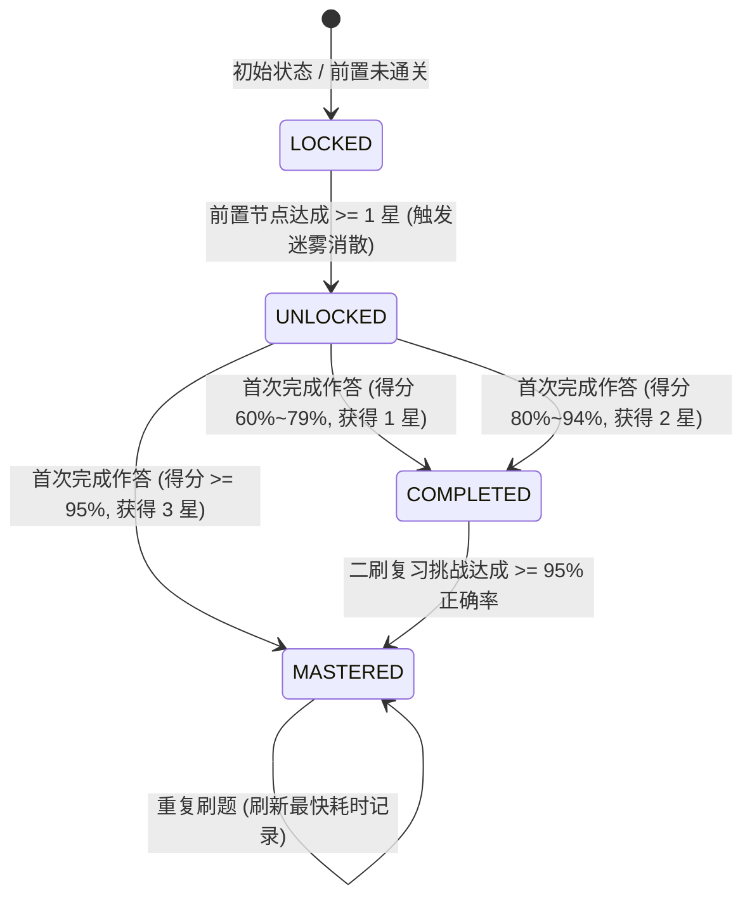
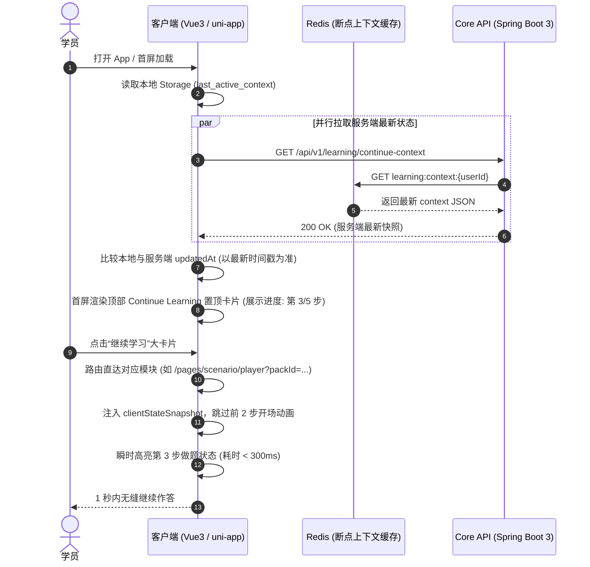
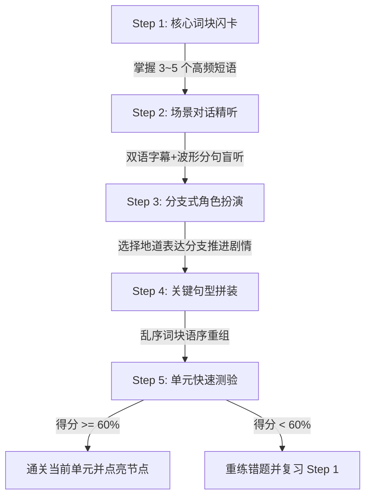
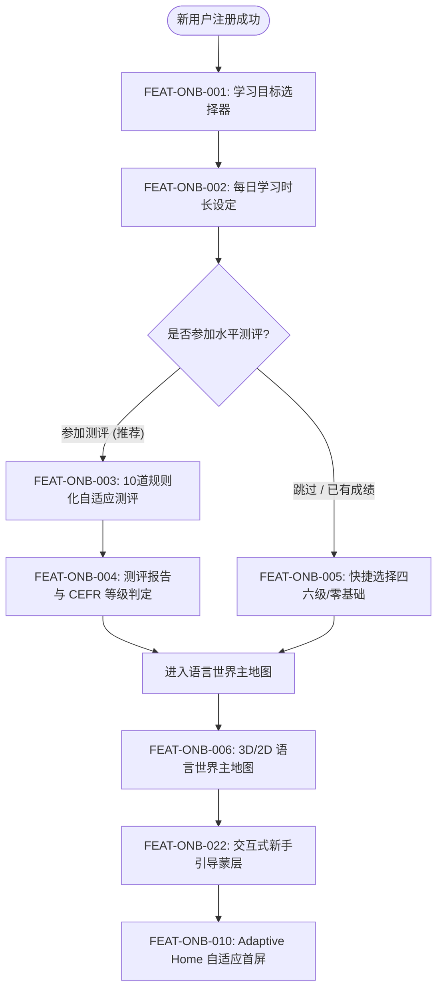

# 01｜Onboarding 与自适应首屏详细设计 (Onboarding & Adaptive Home)

> **文档版本**：v1.0  
> **基线 PRD**：`requirements/product-requirements.md` (PRD v3.3) §3.1 ~ §3.4、§13.7、§18.3、§18.18  
> **功能范围**：`requirements/feature-matrix.md` ONB 域全量 22 项功能 (FEAT-ONB-001 ~ FEAT-ONB-022)  
> **所属业务模块**：`com.englishflow.modules.onboarding` & `com.englishflow.modules.home` & `com.englishflow.modules.world`  
> **服务承载**：`services/core-api` (Java 17 / Spring Boot 3) + `apps/mobile` / `apps/learner-web` (Vue 3 + TypeScript + uni-app)

---

## 1. 模块业务目标与边界 (Business Goals & Scope Boundaries)

### 1.1 业务目标与价值定位
Onboarding（新手引导与定级）与 Adaptive Home（自适应首屏）是语学星 (EnglishFlow) 链接用户“从注册到进入沉浸式学习状态”的第一道核心转化通道。其根本业务目标为：
1. **秒级建立学习锚点**：在 60 秒内通过零门槛的目标与强度选择，精准捕获 18 岁以上成人用户的学习动机。
2. **5 分钟科学定级与建立信任**：摒弃传统耗时且冗长的分级考试，通过 10 道规则化题目的快速自适应推断，在 3~5 分钟内测出学员基线（CEFR 等级与词汇量预估），建立专业教学信任。
3. **沉浸式语言世界探索**：打破传统背单词/刷题软件枯燥的列表排版，通过星系/岛屿形态的“语言世界 (Language World)”拓扑大地图，为学员提供具备游戏化驱动力与清晰掌握感的学习路线。
4. **千人千面的首屏自适应重排 (Adaptive Home)**：基于成人目标画像与学习进展，动态组装最高效的首屏组件流，让备考四六级/考研的学员直接面对真题与模考，让零基础学员聚焦音标与核心词，让职场学员快速切入场景会话。
5. **极速无缝的断点续学 (Continue Learning)**：实现跨端（Mobile/iPad/Web）毫秒级上下文存储与 1 秒无感恢复，极大降低学员重新开始的学习摩擦成本。

### 1.2 阶段边界与演进设计 (Phase Scopes)
严格遵守项目核心架构与合规准则：
- **Phase 1 (当前交付范围 - P0/P1)**：
  - **用户群边界**：严格仅面向 **18 周岁及以上**的成人、大学生与职场人士。
  - **算法边界**：**完全基于规则引擎与确定性数学统计模型**实现题目自适应推荐、CEFR 等级判定与首屏重排；**严禁在 Phase 1 引入任何生成式 AI (LLM)**。
  - **场景课程边界**：所有场景课程（机场、餐厅、酒店、商务）均由教研团队手工录入合法授权的标准语料与分支对话脚本，不使用 AI 动态生成。
  - **多端渲染边界**：语言世界地图支持 3D WebGL (Three.js) 渲染，并内置四级画质降级引擎（自适应降级为 2.5D SVG / 2D Canvas 静态瓦片），确保中低端手机与小程序流畅运行。
- **Phase 2 (架构预留)**：
  - 引入 AI 智能编排中心 (`services/ai-orchestrator`)，在定级后提供 AI 伴学导师语音答疑与发音微调建议。
  - 开放 AI 动态自适应场景实战（基于 LangGraph 状态机的开放式自由对话分支）。
- **Phase 3 (架构预留)**：
  - 在完成未成年人资质与国家合规认证后，开放 K12 学员专属引导与家长监护中心模式。

---

## 2. 完整功能树与 22 项子功能逐条深度剖析

### 2.1 ONB 域完整功能拓扑树
```
Onboarding 与自适应首屏 (ONB 域)
├── 1. 新手引导与目标设定 (Onboarding)
│   ├── FEAT-ONB-001: 学习目标选择器 (Goal Selector)
│   ├── FEAT-ONB-002: 每日学习时长设定 (Daily Goal Setting)
│   └── FEAT-ONB-022: 交互式新手教程蒙层 (Interactive Spotlight Tutorial)
├── 2. 规则化自适应水平测评 (Assessment Engine)
│   ├── FEAT-ONB-003: 非 AI 规则化自适应定级 (Deterministic Adaptive Placement)
│   ├── FEAT-ONB-004: 测评报告与 CEFR 等级判定 (Assessment Report & Radar)
│   └── FEAT-ONB-005: 免测跳过与快速定级 (Placement Skip & Fast-Track)
├── 3. 沉浸式语言世界主地图 (Language World Map)
│   ├── FEAT-ONB-006: 沉浸主地图拓扑渲染 (World Map Topology Rendering)
│   ├── FEAT-ONB-007: 关卡迷雾与解锁机制 (Fog of War & Node Unlock)
│   ├── FEAT-ONB-008: 节点星级评价体系 (3-Star Node Rating System)
│   ├── FEAT-ONB-009: 关卡节点类型差异化 (Polymorphic Node Types)
│   └── FEAT-ONB-021: 地图缩放与全景漫游 (Map Zoom & Pan Controller)
├── 4. 自适应首屏与学习看板 (Adaptive Home)
│   ├── FEAT-ONB-010: Adaptive Home 千人千面 (Profile-Driven Reordering)
│   ├── FEAT-ONB-011: Continue Learning 断点续学 (1-Second Context Resume)
│   ├── FEAT-ONB-012: 今日任务看板 (Daily Stream & Task Board)
│   ├── FEAT-ONB-013: 顶部能量与连续打卡状态栏 (XP/Coins/Streak Bar)
│   ├── FEAT-ONB-019: 快捷全局搜索入口 (Global Omni-Search)
│   └── FEAT-ONB-020: 快捷通知与红点提示 (Notification Bell & Badging)
└── 5. 场景课程包与实战流转 (Scenario Packs)
    ├── FEAT-ONB-014: 课程包货架与分类筛选 (Scenario Catalog & Filter)
    ├── FEAT-ONB-015: 机场英语首发场景实战包 (Airport English Pack)
    ├── FEAT-ONB-016: 餐厅就餐与酒店住宿场景包 (Dining & Hotel Pack)
    ├── FEAT-ONB-017: 场景课词块与对话穿插练习 (Interleaved Practice Flow)
    └── FEAT-ONB-018: 场景通关测试与结业证书 (Scenario Exam & Certificate)
```

---

### 2.2 22 项子功能逐条深度剖析 (FEAT-ONB-001 ~ FEAT-ONB-022)

#### 【FEAT-ONB-001】学习目标选择器 (Goal Selector)
- **功能目的**：在注册后第一时间获取用户核心学习动机，建立初始学员画像基线。
- **业务规则**：
  1. 提供 4 大主选维度（单选）：`ZERO_BASIS` (成人零基础入门)、`CET_4_6` (大学四六级备考)、`POSTGRADUATE` (考研英语冲刺)、`WORKPLACE_DAILY` (职场商务与日常交流)。
  2. 支持次级细分标签多选（最多选 3 个）：如“发音矫正”、“外企邮件”、“旅游出行”、“学术论文阅读”。
  3. 用户提交后，即时在 `usr_learning_profile` 固化目标代码，并在本地持久化目标上下文。
  4. 目标随时可在“个人中心 -> 学习设置”中重新切换，切换后首屏布局实时热重排。
- **前置条件**：用户已通过手机号/微信完成身份认证注册。
- **后置条件**：流转至 FEAT-ONB-002（每日时长设定）。

#### 【FEAT-ONB-002】每日学习时长设定 (Daily Goal Setting)
- **功能目的**：帮助学员建立微习惯，量化每日学习履约标准与预期达标周期。
- **业务规则**：
  1. 提供 4 档固定强度选择：5 分钟（轻松摸鱼 - 10 XP/天）、15 分钟（标准稳步 - 30 XP/天）、30 分钟（进阶突破 - 60 XP/天）、45 分钟（硬核突击 - 100 XP/天）。
  2. **动态倒推计算引擎**：根据所选目标与当前时长档位，前端实时联动计算并展示“预计掌握 1000 核心词所需天数”与“预计通关关卡数”（例如：选 15 分钟 + 零基础，显示“预计 45 天掌握 1000 基础词，通关第一大陆”）。
  3. 每日完成度计算：以当天学习时长累计秒数及答题经验值是否达到配额为准，达成后触发当日打卡 Streak +1。
- **前置条件**：已完成 FEAT-ONB-001 目标选择。
- **后置条件**：弹出水平测试邀请，流转至 FEAT-ONB-003 或 FEAT-ONB-005。

#### 【FEAT-ONB-003】非 AI 规则化自适应定级 (Deterministic Adaptive Placement)
- **功能目的**：在 3~5 分钟内通过 10 道题目精准测出用户的真实英文能力，杜绝大模型随机波动与幻觉。
- **业务规则**：
  1. 题库配比：词汇识别题 4 道 + 基础语法题 3 道 + 听力理解题 3 道，共 10 题。
  2. 初始题难度设定为 A2 (CET-4 基础水平)。
  3. **实时难度升降阶梯**：
     - 若当前题目作答正确且耗时在标准时长内 $\rightarrow$ 下一题难度上升 1 阶 ($L_{i+1} = L_i + 1$)；
     - 若当前题目作答错误或超时 $\rightarrow$ 下一题难度下降 1 阶 ($L_{i+1} = \max(1, L_i - 1)$)；
     - 连续 2 题作答正确，下一题触发跳阶上升 ($L_{i+1} = L_i + 2$)；
     - 难度梯度定义：1(A1) -> 2(A2) -> 3(B1) -> 4(B2) -> 5(C1) -> 6(C2)。
  4. 支持倒计时机制：每题限定 25 秒，超时自动判错并提交。
- **前置条件**：用户选择进入“5分钟水平测评”。
- **后置条件**：完成 10 题后触发结算引擎，流转至 FEAT-ONB-004。

#### 【FEAT-ONB-004】测评报告与 CEFR 等级判定 (Assessment Report & Radar)
- **功能目的**：向学员输出权威、可信、可视化且解释性极强的测评成绩单。
- **业务规则**：
  1. **能力等级映射**：输出初始参考等级（语学星 L1~L6，对应 CEFR A1~C2），并在界面明确注明“根据答题正确率与用时综合推算，非官方 CEFR 考试认证”。
  2. **词汇量预估算式**：结合最终难度收敛值与词汇题得分，计算预估词汇量 $V = \text{BaseVocabulary}(L_{\text{final}}) + \Delta V$（例如 L2 对应 1500~2500 词）。
  3. **五维能力雷达图**：展示“词汇广度”、“语法准确度”、“听力敏感度”、“答题反应速度”、“场景理解度”五维得分 (0~100 分)。
  4. **首周定制学习建议**：根据薄弱项自动输出确定性规则建议卡（如：“听力敏感度较低，已为你将首周学习流中的‘慢速精听’比重上调 30%”）。
- **前置条件**：FEAT-ONB-003 作答数据上报完成。
- **后置条件**：用户点击“进入语言世界”，数据入库并跳转至语言世界主地图。

#### 【FEAT-ONB-005】免测跳过与快速定级 (Placement Skip & Fast-Track)
- **功能目的**：针对已有明确考试成绩或急于体验的用户，提供 0 门槛快速准入通道。
- **业务规则**：
  1. 在测评引导页提供“已有英语成绩，直接定级”与“零基础，直接从头学”两个快捷入口。
  2. 选项映射规则：
     - “已过英语四级 (CET-4 425+)” $\rightarrow$ 直接赋予 CEFR B1 (语学星 L3) 初始档案；
     - “已过英语六级 (CET-6 425+)” $\rightarrow$ 直接赋予 CEFR B2 (语学星 L4) 初始档案；
     - “考研英语 60+ / 雅思 6.0+” $\rightarrow$ 直接赋予 CEFR B2+ (语学星 L4.5) 初始档案；
     - “从零学起 / 没底子” $\rightarrow$ 直接赋予 CEFR A1 (语学星 L1) 初始档案。
  3. 选择后直接解锁对应等级之前的所有主地图关卡，前置关卡标记为“免测通关（默认 2 星）”。
- **前置条件**：用户在测评邀请弹窗中点击“跳过测评/选择已有成绩”。
- **后置条件**：生成用户能力档案并直达语言世界主地图。

#### 【FEAT-ONB-006】沉浸主地图拓扑渲染 (World Map Topology Rendering)
- **功能目的**：以星球、星系、大陆与探索路径为视觉核心，提供清晰、具象的掌握进阶感知。
- **业务规则**：
  1. 主地图由多大主题星区（大陆）组成：如“起点站”、“词汇森林”、“语法工坊”、“听力港口”、“口语街区”、“挑战塔”等。
  2. 每个星区内包含 15~30 个有序拓扑节点（关卡），节点之间由发光能量路径连接。
  3. 渲染管线采用 `Three.js` (WebGL) 构建 3D 悬浮岛屿与星云粒子背景，并根据设备算力自适应降级为 2D 矢量 SVG 拓扑图。
  4. 当前活跃关卡展示呼吸光晕与小星人 (Avatar) 驻留动画。
- **前置条件**：用户完成定级或免测进入主页。
- **后置条件**：支持点击可用节点开启学习。

#### 【FEAT-ONB-007】关卡迷雾与解锁机制 (Fog of War & Node Unlock)
- **功能目的**：通过渐进式探索感增强长期留存，防止学员认知过载。
- **业务规则**：
  1. 节点 4 态：`LOCKED` (未解锁/迷雾锁闭)、`UNLOCKED` (已解锁未通关/可挑战)、`COMPLETED` (已通关已评星)、`MASTERED` (满星精通/闪耀金态)。
  2. **迷雾遮罩算法**：未解锁的星区和后续关卡覆盖动态迷雾材质（Alpha 0.75 + 噪点着色器），关卡图标置灰并显示锁形图标。
  3. **解锁条件**：必须通关前置节点（得分 $\ge 60$ 分或至少获得 1 星），通关瞬时触发“迷雾消散粒子特效”与路径点亮动画，激活下一节点。
- **前置条件**：地图数据加载完成。
- **后置条件**：节点状态变更即时同步后端 `usr_map_progress`。

#### 【FEAT-ONB-008】节点星级评价体系 (3-Star Node Rating System)
- **功能目的**：量化单关掌握质量，驱动学员主动二刷复习、追求极致掌握。
- **业务规则**：
  1. **1 星基线（及格通关）**：综合正确率 $\ge 60\%$ 且完成所有必答题；
  2. **2 星进阶（熟练掌握）**：综合正确率 $\ge 80\%$ 且答题中途求助/提示次数 $\le 1$ 次；
  3. **3 星完美（精通掌控）**：综合正确率 $\ge 95\%$（或 100%），平均单题耗时 $\le 15$ 秒，零提示；
  4. **星级宝箱**：星区累计达到 10 星、20 星、满星时，可开启“星区宝箱”，掉落免费星币、经验加成卡及专属装扮。
- **前置条件**：完成某一关卡的全部交互习题。
- **后置条件**：关卡结算页展示星级动画，更新累计星数。

#### 【FEAT-ONB-009】关卡节点类型差异化 (Polymorphic Node Types)
- **功能目的**：通过多样化的关卡形式穿插打破单调背题，覆盖输入、内化与输出全环节。
- **业务规则**：
  1. **普通关卡 (NORMAL)**：5~8 道综合题（词汇选择+听音选图+填空），耗时约 3 分钟。
  2. **复习关卡 (REVIEW)**：基于艾宾浩斯遗忘曲线抓取最近 7 天的高频易错词与遗忘点，集中强化。
  3. **Boss 挑战关 (BOSS)**：限时挑战（60 秒极速对决），生命值机制（初始 3 颗心，错一题扣 1 颗心），通关奖励海量 XP。
  4. **阶段 Checkpoint 模考关 (CHECKPOINT)**：星区终极里程碑，标准 15 题综合大考，通关后点亮星区勋章并解锁下一大陆。
- **前置条件**：节点处于 `UNLOCKED` 状态。
- **后置条件**：根据节点类型拉取对应题型的执行引擎。

#### 【FEAT-ONB-010】Adaptive Home 千人千面 (Profile-Driven Reordering)
- **功能目的**：根据成人目标画像动态重排首屏组件优先级，打造最高效的信息流体验。
- **业务规则**：
  1. **成人零基础画像**：首屏置顶“3D 发音口型工坊” > “高频核心词卡” > “探索大地图” > “场景英语”。
  2. **四六级 / 考研画像**：首屏置顶“真题倒计时看板” > “今日考研/CET 必背核心词” > “长难句 X 光机” > “历年真题模拟题”。
  3. **职场 / 日常交流画像**：首屏置顶“断点场景对话（如机场/商务谈判）” > “高频语块跟读” > “职场邮件表达”。
  4. **用户绝对控制权**：设置页提供“恢复默认布局”、“手动拖拽组件排序”、“锁定当前首屏”选项，严禁强制捆绑。
- **前置条件**：用户已建立画像或存在历史学习轨迹。
- **后置条件**：首屏布局引擎计算出组件排序 JSON 并在端侧渲染。

#### 【FEAT-ONB-011】Continue Learning 断点续学 (1-Second Context Resume)
- **功能目的**：在用户打开 App/Web 的 1 秒内，精准恢复上次中断的学习上下文，消除跳出阻力。
- **业务规则**：
  1. 首屏顶部固定保留“断点续学大卡片”。
  2. **毫秒级快照存储**：学员在做题、背词、场景课中途退出或切后台时，端侧与服务端原子记录：`moduleId`、`lessonId`、`stepIndex`、`uncommittedAnswers`、`elapsedTimeMs`。
  3. **一键直达**：点击卡片 1 秒内打开对应交互界面并高亮定位至中断题号，已答题目保留作答状态，直接继续作答。
- **前置条件**：存在未完成的做题或背词会话（有效期 7 天）。
- **后置条件**：成功进入上次中断的交互步骤。

#### 【FEAT-ONB-012】今日任务看板 (Daily Stream & Task Board)
- **功能目的**：为学员清晰量化今日学习任务进度，提供“目标明确、反馈即时”的日常牵引。
- **业务规则**：
  1. **三维核心指标展示**：今日待学新知数（词汇/句型）、到期待复习数（基于遗忘算法）、待攻坚错题数。
  2. **环形动态进度条**：根据用户选定的每日时长配额（如 15 分钟），动态计算今日学习耗时百分比（0%~100%）。
  3. 一键“开始今日学习流”按钮：自动将“新学 + 复习 + 错题消灭”智能打包为线性任务流，学员无需纠结选什么。
- **前置条件**：获取当天学员的学习与复习队列。
- **后置条件**：任务流完成时弹出当日全勤成就。

#### 【FEAT-ONB-013】顶部能量与连续打卡状态栏 (XP/Coins/Streak Bar)
- **功能目的**：实时反映学员资产与连续坚持成就，激发积极向上的学习动力。
- **业务规则**：
  1. **连续打卡天数 (Streak)**：显示燃烧火苗图标与连续天数；支持展示“本周打卡点阵图 (Mon-Sun)”；若有一天断签，提示使用“补签卡 (Streak Freeze)”。
  2. **星币余额 (Star Coins)**：展示当前代币数，支持点击跳转至兑换商城换取免费主题皮肤或补签道具。
  3. **等级与经验值 (XP / Level)**：展示当前等级徽章（如 Lv.5 探索先锋）与升至下一级所需经验值进度条。
- **前置条件**：用户登录且状态栏组件挂载。
- **后置条件**：任意做题经验变动时触发数字平滑滚动特效与粒子爆裂。

#### 【FEAT-ONB-014】课程包货架与分类筛选 (Scenario Catalog & Filter)
- **功能目的**：将碎片化知识聚合为系统化、有明确交付结果的“场景课程包”，方便学员按需选用。
- **业务规则**：
  1. 分类维度包含：`TRAVEL` (出国旅行)、`WORKPLACE` (外企职场)、`BUSINESS` (商务贸易)、`CAMPUS` (大学备考与学术)。
  2. 货架卡片呈现：课程包名称、封面插画、总关卡数、核心词汇量、预计学习耗时、当前学习进度（%）。
  3. 支持“免费体验首单元”与“加入我的主修课”操作。
- **前置条件**：进入“场景课程”一级/二级货架。
- **后置条件**：点击进入特定场景课程包详情。

#### 【FEAT-ONB-015】机场英语首发场景实战包 (Airport English Pack)
- **功能目的**：覆盖出国出境及国际航班全流程高频语言实战。
- **业务规则**：
  1. 包含 10 个标准教学单元：
     - Unit 1: 航站楼值机与选座 (Check-in & Seat Selection)
     - Unit 2: 行李托运与超重处理 (Baggage Drop & Overweight)
     - Unit 3: 安检问询与随身物品 (Security Screening)
     - Unit 4: 海关申报与入境卡填写 (Customs & Immigration)
     - Unit 5: 免税店购物与退税 (Duty-Free Shopping & Tax Refund)
     - Unit 6: 登机口变更与延误广播 (Gate Changes & Delays)
     - Unit 7: 机舱服务与餐食选择 (In-Flight Services & Meals)
     - Unit 8: 转机与过境签办理 (Flight Transfers & Transit)
     - Unit 9: 行李丢失与行李转盘申报 (Lost Baggage Claim)
     - Unit 10: 机场接驳与打车换乘 (Ground Transportation)
  2. 每个单元严格遵循标准闭环教学流。
- **前置条件**：学员选择开启该课程包。
- **后置条件**：数据记录入 `usr_scenario_enrollment`。

#### 【FEAT-ONB-016】餐厅就餐与酒店住宿场景包 (Dining & Hotel Pack)
- **功能目的**：解决海外旅行与商务差旅中最高频的衣食住行痛点。
- **业务规则**：
  1. **餐厅模块 (Dining)**：电话预约订位、点餐常用表达、过敏与忌口说明 (Dietary Requirements)、牛排熟度与酒水搭配、催菜与账单核对、分账 AA 结账。
  2. **酒店模块 (Hotel)**：前台入住办理 (Check-in)、房型升级与押金、客房服务呼叫 (Room Service)、设施报修 (空调/热水/WIFI)、延迟退房与行李寄存。
  3. 强调地道短语搭配（如 *“Could we have the check, please?”*, *“On the side”*）。
- **前置条件**：学员进入场景课选择餐厅/住宿主题。
- **后置条件**：按单元序逐步解锁。

#### 【FEAT-ONB-017】场景课词块与对话穿插练习 (Interleaved Practice Flow)
- **功能目的**：杜绝“先背 100 个词再去读课文”的割裂模式，采用交错式沉浸学习流。
- **业务规则**：
  1. 单元标准 5 步流转结构：
     - Step 1 **核心词块闪卡 (Chunk Flashcards)**：3~5 个关键短语句块（带发音、例句、慢速跟读）；
     - Step 2 **场景对话精听 (Dialogue Listening)**：真人录制标准对话，支持双语音频与分句波形高亮；
     - Step 3 **分支式预编角色扮演 (Branching Role-play)**：学员扮演旅客，根据对方提问从 2~3 个合法表达中选择或拼装正确回应；
     - Step 4 **关键句型仿写与盲打 (Sentence Assembly)**：乱序词块点击重排成正确语序；
     - Step 5 **单元快测 (Quick Quiz)**：3 题极速检验掌握度。
- **前置条件**：进入某场景单元。
- **后置条件**：完成 5 步后记录该单元通关，计入总进度。

#### 【FEAT-ONB-018】场景通关测试与结业证书 (Scenario Exam & Certificate)
- **功能目的**：提供阶段性学习成果认证与社交分享成就感。
- **业务规则**：
  1. **通关大考触发**：当场景包内所有单元全部达到 2 星以上时，解锁“终极实战模拟考”。
  2. **考核标准**：包含 15 道综合场景题（听力选择 + 句子拼装 + 场景应对选择），满分 100 分。
  3. **认证下发**：得分 $\ge 80$ 分即为通关，服务端生成具有唯一防伪编号的“场景实战结业证书”（可导出高清图片分享至朋友圈/社交媒体），并点亮专属场景勋章。
- **前置条件**：完成场景包所有前置单元。
- **后置条件**：颁发电子证书并记录至 `usr_certificates`。

#### 【FEAT-ONB-019】快捷全局搜索入口 (Global Omni-Search)
- **功能目的**：让学员在首屏随时能够秒级检索单词、语法点、文章、场景和个人错题。
- **业务规则**：
  1. 顶部常驻搜索栏，点击展开全局搜索蒙层。
  2. **聚合检索结果分 Tab**：
     - 单词/短语 (Words & Chunks)：点击可直接查看释义、加入生词本、听真人发音；
     - 语法卡片 (Grammar Points)：查看长难句剖析与规则解释；
     - 场景课程 (Scenarios)：直接定位至对应单元；
     - 我的错题 (Mistakes)：直接筛选用户历史错题。
  3. 支持搜索历史本地持久化与热门搜索推荐词。
- **前置条件**：首屏处于就绪状态。
- **后置条件**：点击搜索结果直接跳转至对应详情页。

#### 【FEAT-ONB-020】快捷通知与红点提示 (Notification Bell & Badging)
- **功能目的**：建立系统公告、复习召回与学习成就的统一触达中心。
- **业务规则**：
  1. 右上角常驻铃铛图标，未读消息展示红色气泡角标（上限显示 99+）。
  2. **消息分类聚合**：
     - 【学习提醒】：艾宾浩斯复习到期提醒、连续打卡中断预警；
     - 【成就与奖励】：星级宝箱开启提醒、结业证书下发通知、排行榜名次变动；
     - 【系统公告】：版本更新、教研新课上架、维护通知。
  3. 支持“一键已读”与静音免打扰时段设置。
- **前置条件**：用户已登录，长轮询或 WebSocket/推送服务就绪。
- **后置条件**：点击对应消息跳转至关联业务页。

#### 【FEAT-ONB-021】地图缩放与全景漫游 (Map Zoom & Pan Controller)
- **功能目的**：让学员自由查看整个学习宇宙的全貌与长远目标，提升大局掌控感。
- **业务规则**：
  1. **多端平滑手势**：
     - 移动端/iPad：支持双指捏合无级缩放 (Pinch to Zoom，缩放区间 0.5x ~ 2.0x)、单指拖拽漫游 (Pan)；
     - Web/桌面端：支持鼠标滚轮平滑缩放、鼠标按住拖拽漫游，并提供界面右下角浮动 `[+]` `[-]` `[全景]` 缩放按钮。
  2. **快速定位锚点**：提供“回到当前进度”快捷悬浮球，点击后镜头平滑插值过渡（Easing 插值）聚焦至当前活跃关卡。
  3. **LOD (层次细节) 渲染优化**：在缩小至全景态 (0.5x) 时自动隐藏次要粒子和微小文字，只保留大陆板块与里程碑关卡，保证 60 FPS 满帧运行。
- **前置条件**：主地图组件处于挂载渲染状态。
- **后置条件**：视口坐标更新。

#### 【FEAT-ONB-022】交互式新手教程蒙层 (Interactive Spotlight Tutorial)
- **功能目的**：对初次进入核心复杂页面的学员进行无侵入、高聚焦的步骤引导，降低使用门槛。
- **业务规则**：
  1. **聚光灯高亮模式 (Spotlight Overlay)**：采用黑色半透明蒙层镂空高亮目标 DOM 元素，配合跳动引导箭头与对话气泡。
  2. **引导场景覆盖**：
     - 首次进入主地图：引导如何点击节点与查看星级；
     - 首次进入背词卡：引导“点击翻面看释义”、“滑动标记掌握/不认识”；
     - 首次进入场景课：引导“分支对话选择”与“波形跟读”。
  3. **防疲劳机制**：每类引导在用户生命周期内仅展示 1 次（服务端记录 `tutorial_viewed_flags`），并随时提供右上角“跳过引导”按钮。
- **前置条件**：检测到用户首次进入对应功能页面。
- **后置条件**：完成或跳过引导后，置位已读标记，不再重复弹出。

---

## 3. 5 分钟非 AI 自适应测评算法数学模型与规则设计

### 3.1 核心算法设计思想
Phase 1 严格遵循**确定性数学统计与规则自适应模型**，坚决不使用大语言模型进行主观打分。测评引擎在用户答题过程中，基于**项目反应理论 (Item Response Theory, IRT) 的简化状态机**结合**动态阶梯算法 (Staircase Method)**，实时根据题目的难易度、学员作答正误与作答耗时，在 10 道题内快速收敛学员的能力值 $\theta$。

### 3.2 难度阶梯定义与题库配比
难度等级划分为 6 阶，对应国际 CEFR 标准与国内备考标准：
- **Level 1 ($L_1$)**：CEFR A1 (入门级，词汇量 $\le 1000$，基础字母与简单高频词)
- **Level 2 ($L_2$)**：CEFR A2 (初级，词汇量 $1000\sim 2200$，日常简单句与初级听力)
- **Level 3 ($L_3$)**：CEFR B1 (中级 / CET-4 基线，词汇量 $2200\sim 4500$，四级核心词与复合句)
- **Level 4 ($L_4$)**：CEFR B2 (中高级 / CET-6 基线，词汇量 $4500\sim 6500$，六级词汇与长难句)
- **Level 5 ($L_5$)**：CEFR C1 (高级 / 考研英语与雅思 7.0+，词汇量 $6500\sim 9000$)
- **Level 6 ($L_6$)**：CEFR C2 (精通级，词汇量 $9000+$，专业学术与高级修辞)

**10 道自适应测评题题型结构配比**：
| 题号 | 考查维度 | 题型类型 | 初始/动态难度范围 | 答题时限 |
|---|---|---|---|---|
| Q1 | 词汇识别 (Vocabulary) | 核心词义 4 选 1 | 固定 $L_2$ (A2) 初始锚点题 | 20s |
| Q2 | 词汇辨析 (Vocabulary) | 语境填空 4 选 1 | 动态 $L_1 \sim L_3$ | 20s |
| Q3 | 基础语法 (Grammar) | 时态与语态单选 | 动态 $L_1 \sim L_4$ | 25s |
| Q4 | 听力理解 (Listening) | 短句听音辨义 4 选 1 | 动态 $L_1 \sim L_4$ | 25s |
| Q5 | 词汇搭配 (Vocabulary) | 介词/动词短语搭配 | 动态 $L_2 \sim L_5$ | 20s |
| Q6 | 句法结构 (Grammar) | 定语/状语从句连接词 | 动态 $L_2 \sim L_5$ | 25s |
| Q7 | 听力反应 (Listening) | 场景对话问答单选 | 动态 $L_2 \sim L_6$ | 25s |
| Q8 | 复杂词汇 (Vocabulary) | 考研/六级高频词义 | 动态 $L_3 \sim L_6$ | 20s |
| Q9 | 长难句理解 (Grammar) | 倒装/虚拟语气/主干识别 | 动态 $L_3 \sim L_6$ | 30s |
| Q10 | 综合听力 (Listening) | 语篇细节推断选择 | 动态 $L_3 \sim L_6$ 终极收敛题 | 30s |

---

### 3.3 动态难度升降算法状态机与公式
令 $i \in [1, 10]$ 为当前题号，$L_i \in [1, 6]$ 为第 $i$ 题的难度等级。学员第 $i$ 题的作答结果为 $R_i \in \{0, 1\}$（0 表示错误或超时，1 表示正确），作答耗时为 $t_i$（秒），该题标准期望耗时为 $T_{\text{std}}(i)$。

#### 1. 速度惩罚与加权系数 $W(R_i, t_i)$
为防止盲猜或极速碰运气，定义时间加权系数：
$$
W(R_i, t_i) = \begin{cases}
1.2, & \text{若 } R_i = 1 \text{ 且 } t_i \le 0.5 \times T_{\text{std}} \text{ (极速且正确)} \\
1.0, & \text{若 } R_i = 1 \text{ 且 } 0.5 \times T_{\text{std}} < t_i \le T_{\text{std}} \text{ (正常正确)} \\
0.8, & \text{若 } R_i = 1 \text{ 且 } t_i > T_{\text{std}} \text{ (超时勉强答对)} \\
0.0, & \text{若 } R_i = 0 \text{ (答错或未作答)}
\end{cases}
$$

#### 2. 下一道题目难度 $L_{i+1}$ 转移方程
$$
L_{i+1} = \text{Clamp}\left( L_i + \Delta L_i, 1, 6 \right)
$$
其中增量 $\Delta L_i$ 的判定规则如下：
- 若 $R_i = 1$ 且 $R_{i-1} = 1$（连续两题答对且 $W \ge 1.0$）：$\Delta L_i = +2$（触发跳跃晋级）；
- 若 $R_i = 1$（单题答对）：$\Delta L_i = +1$；
- 若 $R_i = 0$ 且 $R_{i-1} = 0$（连续两题答错）：$\Delta L_i = -2$（触发快速降级保护）；
- 若 $R_i = 0$（单题答错）：$\Delta L_i = -1$。

---

### 3.4 最终能力评定与词汇量预估回归模型

#### 1. 综合能力得分 $\Theta$ 算式 (0~100 分)
$$
\Theta = \sum_{i=1}^{10} \left( L_i \times 10 \times W(R_i, t_i) \times k_i \right) \times \frac{1}{\sum_{i=1}^{10} k_i}
$$
其中 $k_i$ 为题目权重系数（Q1~Q3 基础题 $k=0.8$，Q4~Q7 进阶题 $k=1.0$，Q8~Q10 冲刺题 $k=1.2$）。

#### 2. CEFR 判定映射表
- $\Theta \in [0, 25)$ $\rightarrow$ **Level 1 (CEFR A1)**
- $\Theta \in [25, 45)$ $\rightarrow$ **Level 2 (CEFR A2)**
- $\Theta \in [45, 65)$ $\rightarrow$ **Level 3 (CEFR B1 - 四级水平)**
- $\Theta \in [65, 80)$ $\rightarrow$ **Level 4 (CEFR B2 - 六级水平)**
- $\Theta \in [80, 92)$ $\rightarrow$ **Level 5 (CEFR C1 - 考研/雅思高分)**
- $\Theta \in [92, 100]$ $\rightarrow$ **Level 6 (CEFR C2 - 精通)**

#### 3. 词汇量预估分确定性回归方程
词汇量预估值 $V_{\text{estimate}}$ 由最终收敛等级与词汇分项得分 $S_{\text{vocab}}$ 共同决定：
$$
V_{\text{estimate}} = V_{\text{base}}(\text{Level}) + \left( \frac{S_{\text{vocab}}}{100} \times \Delta V_{\text{range}}(\text{Level}) \right)
$$
基线参数表：
- **A1**: $V_{\text{base}} = 500, \Delta V = 500$ (预估区间 500~1000)
- **A2**: $V_{\text{base}} = 1000, \Delta V = 1200$ (预估区间 1000~2200)
- **B1**: $V_{\text{base}} = 2200, \Delta V = 2300$ (预估区间 2200~4500)
- **B2**: $V_{\text{base}} = 4500, \Delta V = 2000$ (预估区间 4500~6500)
- **C1**: $V_{\text{base}} = 6500, \Delta V = 2500$ (预估区间 6500~9000)
- **C2**: $V_{\text{base}} = 9000, \Delta V = 3000$ (预估区间 9000~12000)

---

## 4. 语言世界主地图渲染规范、迷雾算法与节点状态机

### 4.1 3D / 2D 双渲染管线与四级画质降级标准 (AdaptivePerformanceEngine)

```
+-------------------------------------------------------------------------+
|                  AdaptivePerformanceEngine 画质决策中心                  |
+-------------------------------------------------------------------------+
       |
       +---> [Ultra / High: GPU WebGL 2.0] ---> Three.js 3D 浮岛 + 粒子星云
       |
       +---> [Medium: WebGL 1.0 / 移动端]  ---> Three.js 轻量 3D (关闭抗锯齿与阴影)
       |
       +---> [Performance / 小程序 / 低配]  ---> 2D SVG / Canvas 拓扑图 (无 3D 开销)
```

1. **Ultra / High 档位 (PC Web / 高配手机)**：
   - 采用 `Three.js` 渲染 3D 悬浮星岛、动态旋转行星环、体积光与星空粒子系统 (2000 个粒子点)；
   - 阴影开启 SoftShadowMap，节点采用 3D PBR 材质球；
   - 目标帧率：稳定 60 FPS。
2. **Medium 档位 (普通移动端 App / iPad)**：
   - 关闭实时阴影投射与后处理辉光 (Bloom)，粒子数量降至 300 个；
   - 渲染分辨率降至 $1.0\times$ 原生分辨率。
3. **Performance 档位 (微信小程序 / 老旧低配机 / 省电模式)**：
   - 完全停用 WebGL 上下文，切换为 `Canvas 2D / Vue 3 SVG 矢量渲染器`；
   - 关卡与路径采用高品质 2D 扁平插画与 CSS3 硬件加速位移动画呈现；
   - 内存占用降至 30MB 以下，彻底消除崩溃风险。

---

### 4.2 关卡迷雾 (Fog of War) 点亮算法
主地图星区拓扑由二维坐标网格 $G(x, y)$ 与连通图节点 $N_k(x_k, y_k)$ 组成。

```
+--------------------------------------------------------------------+
| 迷雾渲染管线 (Fog of War Shader Pipeline)                           |
+--------------------------------------------------------------------+
| 1. 离屏渲染 (Offscreen Buffer): 生成黑白二值 Mask 纹理 (1024x1024)   |
| 2. 节点点亮标记: 已通关节点 (xk, yk) 写入透明圆 R=120px, 边缘高斯羽化|
| 3. Shader 混合: 迷雾层 = PerlinNoise(uv, time) * Mask(uv)          |
| 4. 动态消散: 当新节点解锁时，触发 R 展开过渡动画 (0 -> 120, 800ms)    |
+--------------------------------------------------------------------+
```

- **点亮判断算法**：
  节点 $N_{k}$ 的解锁状态由其所有前置依赖节点 $\text{Prerequisites}(N_k)$ 决定：
  $$
  \text{IsUnlocked}(N_k) \iff \forall p \in \text{Prerequisites}(N_k), \quad \text{Score}(p) \ge 60 \;\lor\; \text{Stars}(p) \ge 1
  $$
  当 $\text{IsUnlocked}(N_k) = \text{true}$ 时，触发当前节点周围半径 $R = 120\text{px}$ 范围内的迷雾消散，Alpha 通道由 1.0 渐变至 0.0。

---

### 4.3 节点 4 态生命周期状态机



- **星级与奖励判定公式**：
  $$
  \text{Stars} = \begin{cases}
  3, & \text{若 } \text{Accuracy} \ge 95\% \text{ 且 } \text{HintsUsed} = 0 \text{ 且 } \bar{t} \le 15\text{s} \\
  2, & \text{若 } \text{Accuracy} \ge 80\% \text{ 且 } \text{HintsUsed} \le 1 \\
  1, & \text{若 } \text{Accuracy} \ge 60\% \\
  0, & \text{若 } \text{Accuracy} < 60\% \text{ (挑战失败，扣除 1 颗体力心)}
  \end{cases}
  $$

---

## 5. Adaptive Home 自适应首屏布局引擎

### 5.1 成人画像驱动的组件重排矩阵
首屏采用**插槽式组件流架构 (Widget Slot Architecture)**。首屏布局引擎根据用户的 `target_goal`、`cefr_level` 与 `recent_behavior` 计算出各组件在页面中的垂直排列权重 (Weight 1~100，分数越高越靠前)：

| 组件代码 (Component ID) | 组件名称 | 零基础画像权重 | CET-4/6 备考权重 | 考研英语权重 | 职场商务权重 |
|---|---|---|---|---|
| `WIDGET_CONTINUE_LEARN` | 断点续学置顶卡 | 100 (首屏置顶) | 100 (首屏置顶) | 100 (首屏置顶) | 100 (首屏置顶) |
| `WIDGET_DAILY_STREAM` | 今日待办与复习看板 | 95 | 95 | 95 | 90 |
| `WIDGET_EXAM_COUNTDOWN` | 备考倒计时与模考大卡 | 10 (默认折叠) | 90 (高亮置顶) | 92 (高亮置顶) | 15 (默认折叠) |
| `WIDGET_PHONICS_3D` | 3D 口型音标发音工坊 | 90 (显式高亮) | 20 | 10 | 40 |
| `WIDGET_CORE_VOCAB` | 核心高频词闪卡 | 85 (零基础1000词) | 85 (四六级核心) | 88 (考研高频词) | 70 (职场高频) |
| `WIDGET_WORLD_MAP_ENTRY` | 语言世界探索大地图 | 80 | 75 | 70 | 65 |
| `WIDGET_SCENARIO_PACKS` | 场景课程包 (机场/职场) | 60 | 40 | 30 | 85 (高优推荐) |
| `WIDGET_XRAY_GRAMMAR` | 长难句 X 光机与句法树 | 30 | 80 | 85 (深度剖析) | 50 |
| `WIDGET_MISTAKE_CHALLENGE`| 错题消灭与弱项攻坚 | 50 | 70 | 75 | 45 |

### 5.2 布局引擎计算流程
1. **冷启动阶段 (Cold Start)**：用户刚注册时，直接读取 `usr_learning_profile.target_goal` 对应的预置静态模版配置。
2. **动态调优阶段 (Dynamic Adaptation)**：当用户连续 3 天主修特定模块（例如每天使用“长难句 X 光机”），规则引擎将该组件权重动态 $+15$，自动上浮。
3. **用户自主覆盖 (User Override)**：若用户在“首页设置”中手动固定了组件顺序（`is_custom_layout = true`），则完全跳过自适应重排引擎，严格按照用户持久化的顺序渲染。

---

## 6. Continue Learning 断点续学 1 秒恢复上下文状态机

### 6.1 客户端与服务端上下文快照结构
当学员在答题、背词或进行场景对话时，客户端本地内存以 500ms 防抖节奏将上下文快照写入 `localStorage` / `uni.setStorageSync`，并在退出或切后台时通过 `navigator.sendBeacon` / REST API 异步同步至服务端 Redis 缓存中。

```json
{
  "sessionId": "ses_onb_98721389",
  "userId": "usr_100293",
  "moduleType": "SCENARIO_PACK",
  "packId": "pack_airport_01",
  "unitId": "unit_02_checkin",
  "stepType": "BRANCHING_ROLEPLAY",
  "stepIndex": 3,
  "totalSteps": 5,
  "elapsedTimeMs": 45200,
  "clientStateSnapshot": {
    "currentDialogueNodeId": "node_baggage_overweight_02",
    "selectedOptionsHistory": ["opt_1_passport", "opt_3_window_seat"],
    "partialScore": 85
  },
  "updatedAt": "2026-08-20T10:15:30.500Z"
}
```

### 6.2 1 秒极速恢复交互流程



---

## 7. 场景课程包（机场/餐厅/酒店/商务）结构与通关测试

### 7.1 五层内容组织层级
$$
\text{LearningItem (词块/句型/音频)} \longrightarrow \text{Lesson (教学单元)} \longrightarrow \text{Scenario (实战场景)} \longrightarrow \text{Course Pack (课程包)} \longrightarrow \text{Learning Path (学习路径)}
$$

### 7.2 场景课程单元标准流转设计 (Interleaved Learning Loop)



### 7.3 通关测试与结业证书下发规则
1. **测试准入**：课程包下所有单元均达到 2 星及以上。
2. **试卷构成**：15 题（4 道场景听力 + 4 道关键短语填空 + 4 道分支对话应答 + 3 道长难句重组）。
3. **合格线与防作弊**：
   - 满分 100 分，$\ge 80$ 分判定为合格；
   - 考试全程单向不可回退，单题限时 30 秒；
4. **证书唯一防伪与生成**：
   - 合格后，服务端颁发带有 SHA-256 签名与防伪编号的结业证书（编号格式：`CERT-SCN-YYYYMMDD-XXXXX`）；
   - 前端调用 Canvas 将用户昵称、完成日期、课程包名、防伪二维码动态渲染为 1080x1920 高清海报，供学员长按保存或分享。

---

## 8. 详细 UX 交互流程与多端响应式适配

### 8.1 Onboarding 全链路交互状态机流程图



---

### 8.2 多端 (Mobile / iPad / Web) 响应式布局规范

| 视口断点 (Breakpoint) | 适配端类型 | 导航形式 | 首屏布局结构 | 语言世界地图呈现 |
|---|---|---|---|---|
| **Compact (< 768px)** | 手机端 (iOS/Android/H5/小程序) | 底部 5-Tab 栏 (学习/场景/复习/世界/我的) | 单列流式卡片 (Single Column)，大图置顶 | 全屏竖向拓扑滚动，手势捏合缩放 |
| **Medium (768px ~ 1024px)** | iPad / Android 平板 | 侧边紧凑 Nav Rail (Icon + 简标) | 双列瀑布流 (左侧看板+任务流，右侧大地图入口) | 居中画板视图，支持触控笔与双指平移 |
| **Expanded (> 1024px)** | PC Web / 桌面客户端 (Tauri) | 左侧常驻固定导航栏 (展开式树状菜单) | 三列宽屏布局 (左侧任务流，中间 3D 地图，右侧生词本/排行榜) | 宽屏 16:9 WebGL 画布，支持鼠标滚轮与全景漫游 |

---

### 8.3 异常分支与弱网降级处理策略
1. **离线与断网模式 (Offline/Airplane Mode)**：
   - 客户端检测到 `navigator.onLine === false` 时，自动切换至离线缓存模式；
   - 本地 SQLite / IndexedDB 预存当前单元及下一单元的完整题库与音频包；
   - 离线完成的作答记录写入本地同步队列 (`sync_pending_queue`)，网络恢复后后台静默重试上报。
2. **弱网与请求超时 (RTT > 3000ms)**：
   - 测评做题过程中采用**乐观渲染 (Optimistic UI)**：点击下一题即刻展示本地题目，后台异步上报判分；
   - 若上报失败，自动进行指数退避重试 (1s, 2s, 4s)，并在右上角展示黄色轻微同步状态点，严禁阻塞用户答题。
3. **低算力设备崩溃兜底**：
   - 若 WebGL 上下文丢失 (`webglcontextlost`)，`AdaptivePerformanceEngine` 捕获事件并在 50ms 内平滑无缝降级切换为 2D Canvas / SVG 拓扑图，避免白屏或 App 闪退。

---

## 9. 数据库实体与字段级定义 (MySQL 8.x DDL)

```sql
-- =============================================================================
-- 1. 用户学习画像与目标偏好表 (usr_learning_profile)
-- =============================================================================
CREATE TABLE IF NOT EXISTS `usr_learning_profile` (
  `id` BIGINT UNSIGNED NOT NULL AUTO_INCREMENT COMMENT '自增主键',
  `user_id` BIGINT UNSIGNED NOT NULL COMMENT '用户ID (关联 usr_user.id)',
  `target_goal` VARCHAR(32) NOT NULL DEFAULT 'ZERO_BASIS' COMMENT '学习目标: ZERO_BASIS, CET_4_6, POSTGRADUATE, WORKPLACE_DAILY',
  `sub_tags` JSON NULL COMMENT '细分兴趣标签列表: ["PRONUNCIATION", "TRAVEL", "BUSINESS_EMAIL"]',
  `daily_quota_minutes` INT UNSIGNED NOT NULL DEFAULT 15 COMMENT '每日目标学习时长配额(分钟): 5, 15, 30, 45',
  `daily_quota_xp` INT UNSIGNED NOT NULL DEFAULT 30 COMMENT '每日目标经验值配额',
  `initial_cefr_level` VARCHAR(8) NOT NULL DEFAULT 'A1' COMMENT '初始判定等级: A1, A2, B1, B2, C1, C2',
  `current_cefr_level` VARCHAR(8) NOT NULL DEFAULT 'A1' COMMENT '当前实时动态评定等级',
  `estimated_vocabulary` INT UNSIGNED NOT NULL DEFAULT 800 COMMENT '预估词汇量',
  `is_placement_skipped` TINYINT(1) NOT NULL DEFAULT 0 COMMENT '是否跳过定级测评: 0-未跳过, 1-免测跳过',
  `is_custom_layout` TINYINT(1) NOT NULL DEFAULT 0 COMMENT '是否启用自定义首屏布局: 0-自适应重排, 1-固定用户自定义',
  `custom_home_layout` JSON NULL COMMENT '用户自定义首屏组件排列顺序',
  `tutorial_viewed_flags` JSON NULL COMMENT '各模块新手引导完成标记: {"world_map": true, "flashcard": true}',
  `created_at` DATETIME NOT NULL DEFAULT CURRENT_TIMESTAMP COMMENT '创建时间',
  `updated_at` DATETIME NOT NULL DEFAULT CURRENT_TIMESTAMP ON UPDATE CURRENT_TIMESTAMP COMMENT '更新时间',
  PRIMARY KEY (`id`),
  UNIQUE KEY `uk_user_id` (`user_id`)
) ENGINE=InnoDB DEFAULT CHARSET=utf8mb4 COLLATE=utf8mb4_unicode_ci COMMENT='用户学习画像与自适应偏好表';

-- =============================================================================
-- 2. 水平自适应测评题库与实例表 (asm_placement_item & asm_placement_session)
-- =============================================================================
CREATE TABLE IF NOT EXISTS `asm_placement_item` (
  `id` BIGINT UNSIGNED NOT NULL AUTO_INCREMENT COMMENT '题目ID',
  `dimension` VARCHAR(32) NOT NULL COMMENT '评测维度: VOCABULARY, GRAMMAR, LISTENING',
  `difficulty_level` TINYINT UNSIGNED NOT NULL COMMENT '题目难度阶梯: 1-A1, 2-A2, 3-B1, 4-B2, 5-C1, 6-C2',
  `stem_text` TEXT NOT NULL COMMENT '题干文本',
  `audio_url` VARCHAR(512) NULL COMMENT '听力音频URL(合法版权素材)',
  `options_json` JSON NOT NULL COMMENT '选项列表: [{"key":"A","text":"..."}, ...]',
  `correct_answer` VARCHAR(8) NOT NULL COMMENT '正确答案键值: A, B, C, D',
  `standard_time_sec` INT UNSIGNED NOT NULL DEFAULT 20 COMMENT '标准期望耗时(秒)',
  `explanation` TEXT NULL COMMENT '解析说明',
  `status` VARCHAR(16) NOT NULL DEFAULT 'PUBLISHED' COMMENT '状态: DRAFT, PUBLISHED, ARCHIVED',
  `created_at` DATETIME NOT NULL DEFAULT CURRENT_TIMESTAMP,
  `updated_at` DATETIME NOT NULL DEFAULT CURRENT_TIMESTAMP ON UPDATE CURRENT_TIMESTAMP,
  PRIMARY KEY (`id`),
  KEY `idx_dim_diff` (`dimension`, `difficulty_level`)
) ENGINE=InnoDB DEFAULT CHARSET=utf8mb4 COLLATE=utf8mb4_unicode_ci COMMENT='自适应定级测评题库表';

CREATE TABLE IF NOT EXISTS `asm_placement_session` (
  `id` BIGINT UNSIGNED NOT NULL AUTO_INCREMENT COMMENT '评测会话ID',
  `session_uuid` VARCHAR(64) NOT NULL COMMENT '唯一UUID',
  `user_id` BIGINT UNSIGNED NOT NULL COMMENT '用户ID',
  `total_questions` INT UNSIGNED NOT NULL DEFAULT 10 COMMENT '总题目数',
  `current_step` INT UNSIGNED NOT NULL DEFAULT 1 COMMENT '当前作答步长',
  `final_score` DECIMAL(5,2) NULL COMMENT '最终综合能力分 (0~100)',
  `final_level` VARCHAR(8) NULL COMMENT '判定级别: A1-C2',
  `estimated_vocab` INT UNSIGNED NULL COMMENT '最终预估词汇量',
  `radar_scores_json` JSON NULL COMMENT '五维雷达得分: {"vocab":80, "grammar":75, "listening":60, "speed":85, "scenario":70}',
  `step_records_json` JSON NULL COMMENT '每题作答详情列表(题目ID、正误、耗时、难度阶梯)',
  `status` VARCHAR(16) NOT NULL DEFAULT 'IN_PROGRESS' COMMENT '状态: IN_PROGRESS, COMPLETED, ABANDONED',
  `completed_at` DATETIME NULL COMMENT '完成时间',
  `created_at` DATETIME NOT NULL DEFAULT CURRENT_TIMESTAMP,
  `updated_at` DATETIME NOT NULL DEFAULT CURRENT_TIMESTAMP ON UPDATE CURRENT_TIMESTAMP,
  PRIMARY KEY (`id`),
  UNIQUE KEY `uk_session_uuid` (`session_uuid`),
  KEY `idx_user_status` (`user_id`, `status`)
) ENGINE=InnoDB DEFAULT CHARSET=utf8mb4 COLLATE=utf8mb4_unicode_ci COMMENT='用户定级测评会话记录表';

-- =============================================================================
-- 3. 语言世界大地图节点与用户进度表 (map_world_node & usr_map_progress)
-- =============================================================================
CREATE TABLE IF NOT EXISTS `map_world_node` (
  `id` BIGINT UNSIGNED NOT NULL AUTO_INCREMENT COMMENT '节点ID',
  `sector_code` VARCHAR(32) NOT NULL COMMENT '所属星区代码: ORIGIN, VOCAB_FOREST, GRAMMAR_WORKSHOP',
  `node_code` VARCHAR(64) NOT NULL COMMENT '节点唯一代码',
  `node_name` VARCHAR(128) NOT NULL COMMENT '关卡名称',
  `node_type` VARCHAR(32) NOT NULL DEFAULT 'NORMAL' COMMENT '类型: NORMAL, REVIEW, BOSS, CHECKPOINT',
  `coord_x` INT NOT NULL COMMENT '3D/2D 坐标 X',
  `coord_y` INT NOT NULL COMMENT '3D/2D 坐标 Y',
  `coord_z` INT NOT NULL DEFAULT 0 COMMENT '3D 坐标 Z',
  `prerequisite_nodes` JSON NULL COMMENT '前置依赖节点代码数组: ["node_001", "node_002"]',
  `lesson_id` BIGINT UNSIGNED NOT NULL COMMENT '关联的课程教学单元ID',
  `reward_xp` INT UNSIGNED NOT NULL DEFAULT 20 COMMENT '通关奖励基础经验值',
  `reward_coins` INT UNSIGNED NOT NULL DEFAULT 5 COMMENT '通关奖励星币',
  `sort_order` INT NOT NULL DEFAULT 0 COMMENT '拓扑排序权重',
  `created_at` DATETIME NOT NULL DEFAULT CURRENT_TIMESTAMP,
  PRIMARY KEY (`id`),
  UNIQUE KEY `uk_node_code` (`node_code`),
  KEY `idx_sector` (`sector_code`, `sort_order`)
) ENGINE=InnoDB DEFAULT CHARSET=utf8mb4 COLLATE=utf8mb4_unicode_ci COMMENT='语言世界地图拓扑节点配置表';

CREATE TABLE IF NOT EXISTS `usr_map_progress` (
  `id` BIGINT UNSIGNED NOT NULL AUTO_INCREMENT COMMENT '自增ID',
  `user_id` BIGINT UNSIGNED NOT NULL COMMENT '用户ID',
  `node_id` BIGINT UNSIGNED NOT NULL COMMENT '节点ID',
  `status` VARCHAR(16) NOT NULL DEFAULT 'UNLOCKED' COMMENT '状态: LOCKED, UNLOCKED, COMPLETED, MASTERED',
  `star_rating` TINYINT UNSIGNED NOT NULL DEFAULT 0 COMMENT '获得星级: 0, 1, 2, 3',
  `best_score` DECIMAL(5,2) NOT NULL DEFAULT 0.00 COMMENT '历史最高得分',
  `fastest_time_sec` INT UNSIGNED NOT NULL DEFAULT 0 COMMENT '历史最快通关耗时(秒)',
  `attempt_count` INT UNSIGNED NOT NULL DEFAULT 0 COMMENT '挑战次数',
  `first_passed_at` DATETIME NULL COMMENT '首次通关时间',
  `created_at` DATETIME NOT NULL DEFAULT CURRENT_TIMESTAMP,
  `updated_at` DATETIME NOT NULL DEFAULT CURRENT_TIMESTAMP ON UPDATE CURRENT_TIMESTAMP,
  PRIMARY KEY (`id`),
  UNIQUE KEY `uk_user_node` (`user_id`, `node_id`),
  KEY `idx_user_status` (`user_id`, `status`)
) ENGINE=InnoDB DEFAULT CHARSET=utf8mb4 COLLATE=utf8mb4_unicode_ci COMMENT='用户地图关卡进度与星级表';

-- =============================================================================
-- 4. 断点续学上下文快照表 (usr_continue_context)
-- =============================================================================
CREATE TABLE IF NOT EXISTS `usr_continue_context` (
  `id` BIGINT UNSIGNED NOT NULL AUTO_INCREMENT COMMENT '自增ID',
  `user_id` BIGINT UNSIGNED NOT NULL COMMENT '用户ID',
  `module_type` VARCHAR(32) NOT NULL COMMENT '模块类型: SCENARIO_PACK, MAP_LESSON, FLASHCARD, XRAY',
  `pack_id` VARCHAR(64) NULL COMMENT '课程包ID',
  `unit_id` VARCHAR(64) NULL COMMENT '单元ID',
  `lesson_id` BIGINT UNSIGNED NULL COMMENT '课程ID',
  `step_index` INT UNSIGNED NOT NULL DEFAULT 0 COMMENT '当前进行到的步骤索引',
  `total_steps` INT UNSIGNED NOT NULL DEFAULT 1 COMMENT '总步骤数',
  `client_snapshot` JSON NOT NULL COMMENT '客户端作答上下文快照JSON',
  `elapsed_time_ms` BIGINT UNSIGNED NOT NULL DEFAULT 0 COMMENT '已耗费时长(毫秒)',
  `is_resumed` TINYINT(1) NOT NULL DEFAULT 0 COMMENT '是否已恢复: 0-等待恢复, 1-已恢复消费',
  `created_at` DATETIME NOT NULL DEFAULT CURRENT_TIMESTAMP,
  `updated_at` DATETIME NOT NULL DEFAULT CURRENT_TIMESTAMP ON UPDATE CURRENT_TIMESTAMP,
  PRIMARY KEY (`id`),
  UNIQUE KEY `uk_user_context` (`user_id`),
  KEY `idx_updated` (`updated_at`)
) ENGINE=InnoDB DEFAULT CHARSET=utf8mb4 COLLATE=utf8mb4_unicode_ci COMMENT='断点续学快照持久化表';
```

---

## 10. OpenAPI 3.0 接口契约定义

```yaml
openapi: 3.0.3
info:
  title: EnglishFlow Onboarding & Adaptive Home API
  version: 1.0.0
  description: 语学星新手引导、规则化自适应定级、语言世界主地图与自适应首屏核心 API 契约
paths:

  # ---------------------------------------------------------------------------
  # 1. 新手引导与画像偏好
  # ---------------------------------------------------------------------------
  /api/v1/onboarding/profile:
    post:
      summary: 保存用户新手引导设定的目标与每日配额
      operationId: saveOnboardingProfile
      tags: [Onboarding]
      requestBody:
        required: true
        content:
          application/json:
            schema:
              type: object
              required: [targetGoal, dailyQuotaMinutes]
              properties:
                targetGoal:
                  type: string
                  enum: [ZERO_BASIS, CET_4_6, POSTGRADUATE, WORKPLACE_DAILY]
                  example: CET_4_6
                subTags:
                  type: array
                  items:
                    type: string
                  example: ["VOCABULARY", "READING"]
                dailyQuotaMinutes:
                  type: integer
                  enum: [5, 15, 30, 45]
                  example: 15
      responses:
        '200':
          description: 画像保存成功
          content:
            application/json:
              schema:
                $ref: '#/components/schemas/UserProfileResponse'

  # ---------------------------------------------------------------------------
  # 2. 5 分钟规则化自适应测评引擎
  # ---------------------------------------------------------------------------
  /api/v1/assessment/placement/start:
    post:
      summary: 启动自适应定级测评会话，获取第 1 道锚点题
      operationId: startPlacementSession
      tags: [Assessment]
      responses:
        '200':
          description: 会话创建成功，返回首题
          content:
            application/json:
              schema:
                $ref: '#/components/schemas/PlacementNextQuestionResponse'

  /api/v1/assessment/placement/submit-step:
    post:
      summary: 提交单题答案，动态获取下一题或完成测评
      operationId: submitPlacementStep
      tags: [Assessment]
      requestBody:
        required: true
        content:
          application/json:
            schema:
              type: object
              required: [sessionUuid, questionId, selectedAnswer, timeSpentSec]
              properties:
                sessionUuid:
                  type: string
                  example: "ses_onb_98721389"
                questionId:
                  type: integer
                  example: 1042
                selectedAnswer:
                  type: string
                  example: "B"
                timeSpentSec:
                  type: integer
                  example: 12
      responses:
        '200':
          description: 判定成功，返回下一题或测评报告
          content:
            application/json:
              schema:
                $ref: '#/components/schemas/PlacementStepResultResponse'

  /api/v1/assessment/placement/skip:
    post:
      summary: 免测跳过与快速定级
      operationId: skipPlacement
      tags: [Assessment]
      requestBody:
        required: true
        content:
          application/json:
            schema:
              type: object
              required: [fastTrackLevel]
              properties:
                fastTrackLevel:
                  type: string
                  enum: [ZERO_A1, CET4_B1, CET6_B2, POSTGRAD_B2_PLUS]
                  example: CET4_B1
      responses:
        '200':
          description: 免测定级完成
          content:
            application/json:
              schema:
                $ref: '#/components/schemas/UserProfileResponse'

  # ---------------------------------------------------------------------------
  # 3. 自适应首屏与断点续学
  # ---------------------------------------------------------------------------
  /api/v1/home/feed:
    get:
      summary: 获取自适应首屏千人千面聚合数据流 (组件流+今日任务+连续打卡)
      operationId: getAdaptiveHomeFeed
      tags: [AdaptiveHome]
      responses:
        '200':
          description: 成功返回首屏聚合数据
          content:
            application/json:
              schema:
                $ref: '#/components/schemas/HomeFeedResponse'

  /api/v1/learning/continue-context:
    get:
      summary: 获取当前用户最新的断点续学快照
      operationId: getContinueContext
      tags: [ContinueLearning]
      responses:
        '200':
          description: 成功获取断点上下文
          content:
            application/json:
              schema:
                $ref: '#/components/schemas/ContinueContextResponse'
    put:
      summary: 上报/更新断点续学上下文快照 (退出或切后台时调用)
      operationId: updateContinueContext
      tags: [ContinueLearning]
      requestBody:
        required: true
        content:
          application/json:
            schema:
              $ref: '#/components/schemas/ContinueContextPayload'
      responses:
        '200':
          description: 快照保存成功

  # ---------------------------------------------------------------------------
  # 4. 语言世界主地图
  # ---------------------------------------------------------------------------
  /api/v1/world/sectors/{sectorCode}/topology:
    get:
      summary: 获取指定星区的地图拓扑节点与学员当前通关星级状态
      operationId: getSectorTopology
      tags: [LanguageWorld]
      parameters:
        - name: sectorCode
          in: path
          required: true
          schema:
            type: string
          example: ORIGIN
      responses:
        '200':
          description: 成功返回星区地图拓扑与进度
          content:
            application/json:
              schema:
                $ref: '#/components/schemas/SectorTopologyResponse'

components:
  schemas:
    UserProfileResponse:
      type: object
      properties:
        userId:
          type: integer
        targetGoal:
          type: string
        dailyQuotaMinutes:
          type: integer
        currentCefrLevel:
          type: string
        estimatedVocabulary:
          type: integer

    PlacementNextQuestionResponse:
      type: object
      properties:
        sessionUuid:
          type: string
        stepIndex:
          type: integer
          example: 1
        totalSteps:
          type: integer
          example: 10
        question:
          type: object
          properties:
            questionId:
              type: integer
            dimension:
              type: string
            stemText:
              type: string
            audioUrl:
              type: string
              nullable: true
            options:
              type: array
              items:
                type: object
                properties:
                  key:
                    type: string
                  text:
                    type: string
            timeLimitSec:
              type: integer

    PlacementStepResultResponse:
      type: object
      properties:
        isCompleted:
          type: boolean
        nextQuestion:
          $ref: '#/components/schemas/PlacementNextQuestionResponse'
        finalReport:
          type: object
          nullable: true
          properties:
            score:
              type: number
            cefrLevel:
              type: string
            estimatedVocabulary:
              type: integer
            radarScores:
              type: object
              properties:
                vocab: { type: integer }
                grammar: { type: integer }
                listening: { type: integer }
                speed: { type: integer }
                scenario: { type: integer }
            recommendedAdvice:
              type: string

    HomeFeedResponse:
      type: object
      properties:
        userStatus:
          type: object
          properties:
            streakDays: { type: integer }
            starCoins: { type: integer }
            currentXp: { type: integer }
            levelTitle: { type: string }
        dailyStream:
          type: object
          properties:
            dueNewCount: { type: integer }
            dueReviewCount: { type: integer }
            mistakeCount: { type: integer }
            completedMinutes: { type: integer }
            targetMinutes: { type: integer }
        continueCard:
          $ref: '#/components/schemas/ContinueContextResponse'
        orderedWidgets:
          type: array
          items:
            type: object
            properties:
              widgetId: { type: string }
              title: { type: string }
              weight: { type: integer }
              data: { type: object }

    ContinueContextResponse:
      type: object
      properties:
        hasContext:
          type: boolean
        moduleId:
          type: string
        moduleTitle:
          type: string
        stepIndex:
          type: integer
        totalSteps:
          type: integer
        percent:
          type: integer
        clientStateSnapshot:
          type: object

    ContinueContextPayload:
      type: object
      required: [moduleType, stepIndex, totalSteps, clientSnapshot]
      properties:
        moduleType: { type: string }
        packId: { type: string }
        unitId: { type: string }
        lessonId: { type: integer }
        stepIndex: { type: integer }
        totalSteps: { type: integer }
        elapsedTimeMs: { type: integer }
        clientSnapshot: { type: object }

    SectorTopologyResponse:
      type: object
      properties:
        sectorCode: { type: string }
        sectorName: { type: string }
        nodes:
          type: array
          items:
            type: object
            properties:
              nodeCode: { type: string }
              nodeName: { type: string }
              nodeType: { type: string }
              coord:
                type: object
                properties:
                  x: { type: integer }
                  y: { type: integer }
                  z: { type: integer }
              status:
                type: string
                enum: [LOCKED, UNLOCKED, COMPLETED, MASTERED]
              starRating: { type: integer }
              bestScore: { type: number }
```

