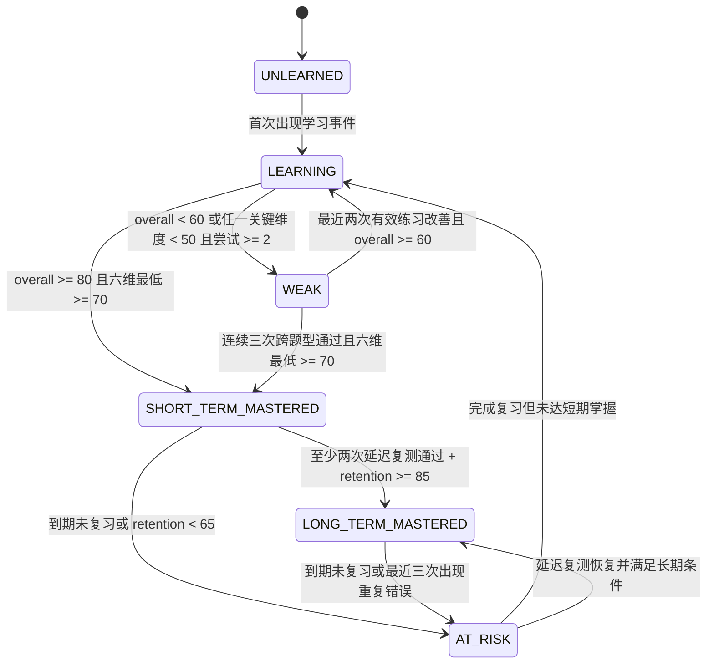
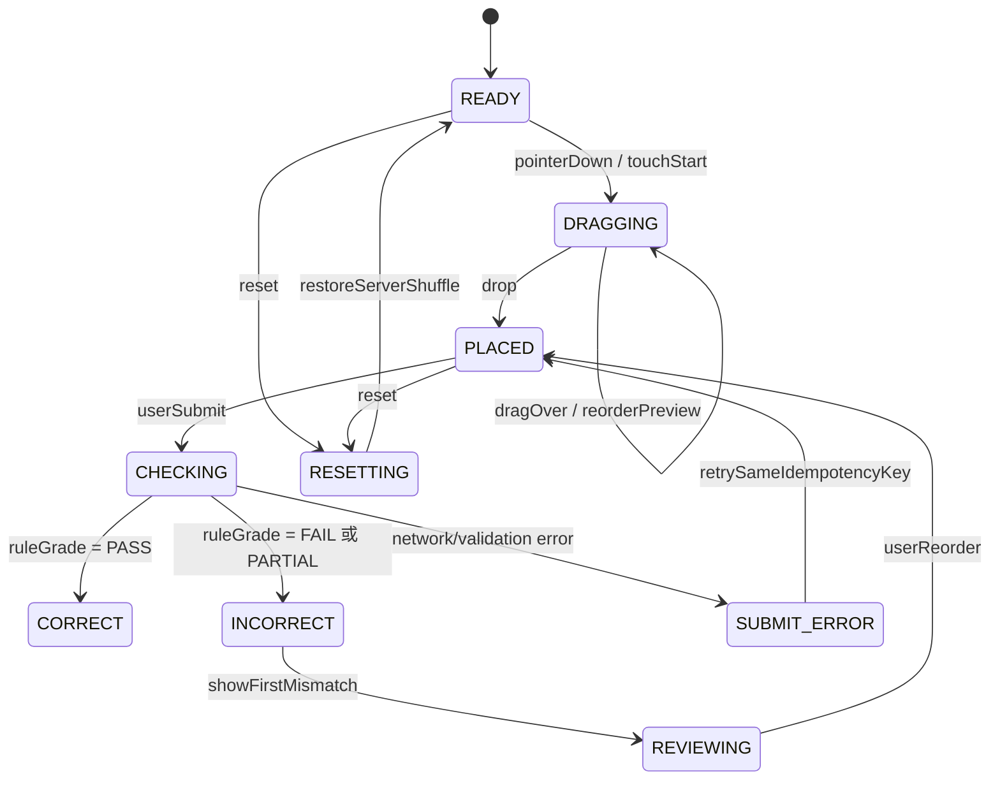

# 03｜语法树、长难句 X-Ray 与写作训练详细设计

> **Historical / Superseded（历史 v1 设计包）**：仅用于 v1 迁移与审计追溯，不是当前实现指令。当前业务设计、任务、契约与验收以 [v2-980plus/README.md](../v2-980plus/README.md) 为唯一入口；本文的旧数量、时间、架构、认证、事件、支付、版权和项目结构表述不得覆盖现行基线。

> **文档版本**：v2.0（Phase 1 可落地契约版）  
> **基线**：`requirements/product-requirements.md`（PRD v3.3）§6.1～§7.3、§11.1～§11.4、§13.9、§18.14、§20.2；`requirements/feature-matrix.md` GRM/WRT 17 项功能  
> **相关设计**：`docs/06-design/detailed-specs/01_Onboarding与自适应首屏详细设计.md`、`docs/05-api/api-conventions.md`、`docs/technical-specs/modules/02_教研内容与多维知识库域详细设计.md`  
> **目标服务承载**：`content-service`（语法/句子/内容版本）+ `learning-service`（训练状态）+ `assessment-service`（规则反馈）；外部请求经 `api-gateway`，权限由 `iam-service`/服务侧 PEP 校验。  
> **迁移兼容**：`services/core-api`（Java 17+ / Spring Boot 3 模块化单体）仅作为 v1 兼容承载；客户端为 `apps/mobile`、`apps/learner-web`。
> **功能范围**：`FEAT-GRM-001～012`、`FEAT-WRT-001～005`，共 17 项，全部属于 Phase 1。

---

## 1. 设计目标、边界与不变量

### 1.1 业务目标

本模块把“语法知识 → 结构理解 → 规则练习 → 受控输出 → 复习复测”串成可审计闭环：

1. 以可下钻的语法知识树和公式化卡片降低长难句理解成本。
2. 以预制的 X-Ray 句法 DAG 展示主干、修饰范围和从句层级，并与音频时间轴同步。
3. 以确定性题目、规则判分和六维掌握模型形成可解释弱点雷达，驱动 10 题靶向强化包。
4. 以句子积木、结构仿写、汉译英和病句改错逐级训练受控产出，不把“生成式批改”混入 Phase 1。
5. 所有内容、评分规则、用户作答、掌握变化、写作报告和纠错工单均可按版本回放。

### 1.2 Phase 1 边界

- 语法点、例句、X-Ray token/slice/node/edge、题目、作文模板和素材均为教研预制并经过内容审核发布。
- 判分仅使用服务端规则引擎：规范化、词典、正则/有限状态规则、词形表、采分点和顺序约束；客户端不得持有标准答案或完整评分规则。
- 不提供任意用户输入的 AI 句法分析、自由作文生成、生成式润色、语义模型评分或隐式 LLM fallback。规则覆盖范围之外统一返回 `RULE_SCOPE_EXCEEDED`，由用户修改、查看参考答案或提交纠错工单解决。
- 仅面向 18 岁以上成人与大学生；未成年人/K12 能力不在本设计范围。
- 所有版权、来源、编辑、审核和发布版本必须可追溯；不得直接搬运未授权真题、教材、影视或课程内容。

### 1.3 领域 ID 与命名不变量

前后端、事件、数据库和报告统一使用以下业务 ID，禁止以 `id`、`grammarId` 等含糊字段替代：

| 业务对象 | 统一字段 | 说明 |
|---|---|---|
| 语法知识点 | `grammar_point_id` / `grammarPointId` | 稳定的语法点身份，版本在 `content_version_id` 中表达 |
| 长难句 | `sentence_id` / `sentenceId` | 稳定的句子身份，X-Ray 文档按内容版本发布 |
| 练习题 | `exercise_id` / `exerciseId` | 选择、填空、改错、积木、仿写、翻译和校对题统一使用 |
| 题目内容版本 | `content_version_id` / `contentVersionId` | 只允许绑定 `PUBLISHED` 版本作答 |
| 写作模板 | `writing_template_id` / `writingTemplateId` | 模板身份；实际使用必须同时记录 `writing_template_version_id` |
| 写作素材 | `material_id` / `materialId` | 素材身份；实际使用必须同时记录 `material_version_id` |
| 用户作答 | `attempt_id` / `attemptId` | 一次不可变作答事实，靠 `idempotencyKey` 幂等 |
| 写作提交 | `writing_submission_id` / `writingSubmissionId` | 用户一次翻译、仿写、改错或段落练习提交 |
| 纠错工单 | `correction_ticket_id` / `correctionTicketId` | 与具体内容版本和业务对象关联 |

数据库使用 `snake_case`，JSON 使用 `camelCase`；所有接口响应包含 `requestId`。业务事件遵守 `domain.action.vN`，事件 payload 必须包含 `schema`、`occurredAt`、`actorId`、`requestId`。

### 1.4 内容审核与版本状态

所有内容身份都可有多个版本，发布版本不可原地编辑：

```text
DRAFT 草稿 -> IN_REVIEW 一审中 -> APPROVED 二审通过 -> PUBLISHED 已发布 -> ARCHIVED 下线
```

- `DRAFT -> IN_REVIEW`：编辑者提交，执行字段完整性、版权、敏感内容和结构校验。
- `IN_REVIEW -> APPROVED`：具有 `CONTENT_REVIEWER` 权限的审核人通过；审核人不得与编辑人相同。
- `APPROVED -> PUBLISHED`：发布者确认生效时间，生成不可变内容快照和 checksum。
- `PUBLISHED -> ARCHIVED`：下线但保留历史作答回放；历史报告显示原 `contentVersionId`。
- 版本回滚通过重新发布旧版本或复制为新版本完成，禁止修改已发布行。
- 前台只读 `PUBLISHED` 版本；内容编辑/审核 API 不在本文件的学习端契约内，但 DDL 为教研 CMS 留出状态和审计字段。

### 1.5 通用判分、掌握和安全不变量

- `gradingMode` 固定为 `RULE_BASED`，写入作答和报告，服务端拒绝客户端传入其他模式。
- 原始回答、规范化回答、命中的规则版本、逐项得分和解释快照均持久化；报告生成后不可覆盖，只能以新报告版本修订。
- 同一用户、同一 `idempotencyKey`、同一接口和请求体只能产生一个业务结果；同 key 不同请求体返回 `IDEMPOTENCY_CONFLICT`。
- 客户端只接收公开题干、选项、提示和已发布媒体，不接收 `answerKey`、完整正则、同义词表或内部解析配置。
- 用户只能读写自己的掌握、尝试、提交和工单；管理员读取需具备显式权限并写审计日志。

---

## 2. 功能树与交付覆盖矩阵

```text
GRM & WRT
├── 语法知识树与规则卡片
│   ├── FEAT-GRM-001 结构化语法知识大纲
│   ├── FEAT-GRM-002 公式化语法规则卡片
│   └── FEAT-GRM-003 经典考试陷阱与易错清单
├── 语法训练与掌握闭环
│   ├── FEAT-GRM-004 单项语法填空与改错
│   ├── FEAT-GRM-005 语法辨析选择题
│   ├── FEAT-GRM-006 动态弱点图谱（六维掌握）
│   └── FEAT-GRM-007 靶向弱点强化包
├── 长难句 X-Ray 与句子实验室
│   ├── FEAT-GRM-008 预制长难句彩色切片透视
│   ├── FEAT-GRM-009 交互式语法树下钻
│   ├── FEAT-GRM-010 慢速/常速原声与成分变色联动
│   ├── FEAT-GRM-011 句子积木成分拖拽重组
│   └── FEAT-GRM-012 黄金句型结构仿写
└── 阶梯式写作与素材
    ├── FEAT-WRT-001 汉译英梯度单句翻译
    ├── FEAT-WRT-002 规则比对参考译文与采分点
    ├── FEAT-WRT-003 议论文/书信高分模板库
    ├── FEAT-WRT-004 短文改错与单句挑错
    └── FEAT-WRT-005 话题高分素材金句库
```

| 功能编号 | 主要资源 | 关键确定性规则 | 接口/页面入口 | 验收章节 |
|---|---|---|---|---|
| FEAT-GRM-001 | `grammar_point_id`、知识树边 | 12 时态、词法/句法分类、DAG 无环 | `GET /api/v1/grammar/tree` | §9.1 |
| FEAT-GRM-002 | 语法卡片版本 | 公式、规则、正反例、关联点 | `GET /api/v1/grammar/points/{grammarPointId}` | §9.2 |
| FEAT-GRM-003 | `cnt_grammar_trap` | 陷阱、对照、适用考种 | `GET /api/v1/grammar/points/{grammarPointId}/traps` | §9.3 |
| FEAT-GRM-004 | `exercise_id`、尝试 | 填空/改错规范化与规则码 | `GET/POST /api/v1/grammar/exercises`、`/attempts` | §9.4 |
| FEAT-GRM-005 | `exercise_id`、选项 | 选项 key 精确判分 | 同上 | §9.5 |
| FEAT-GRM-006 | `usr_grammar_mastery` | 六维 EWMA、状态机、弱点色阶 | `GET /api/v1/grammar/mastery` | §9.6 |
| FEAT-GRM-007 | 靶向题包 | 按薄弱维度取 10 题、去重、前置约束 | `POST /api/v1/grammar/targeted-packs` | §9.7 |
| FEAT-GRM-008 | sentence token/slice | 预制切片、颜色语义、无 AI 分析 | `GET /api/v1/grammar/sentences/{sentenceId}/xray` | §9.8 |
| FEAT-GRM-009 | node/edge DAG | Vue Flow 类型、展开/折叠、拓扑校验 | 同上 | §9.9 |
| FEAT-GRM-010 | audio sync | token/node 时间轴同步、慢/常速 | 同上 | §9.10 |
| FEAT-GRM-011 | 积木 exercise | server shuffle、顺序约束、状态机 | `POST /api/v1/grammar/attempts` | §9.11 |
| FEAT-GRM-012 | imitation exercise | 结构骨架、变量槽、有限词典/词形规则 | `POST /api/v1/grammar/attempts` | §9.12 |
| FEAT-WRT-001 | translation exercise | 梯度提示、原文/译文提交 | `GET /api/v1/writing/translation/exercises` | §9.13 |
| FEAT-WRT-002 | scoring point/report | 同义词、形态、语序容错及解释 | `POST /api/v1/writing/submissions` | §9.14 |
| FEAT-WRT-003 | template/version | 模板骨架、变量槽、不可变版本 | `GET /api/v1/writing/templates` | §9.15 |
| FEAT-WRT-004 | proofreading issue | 多词/漏词/错词预制问题和定位 | `GET /api/v1/writing/proofreading/exercises` | §9.16 |
| FEAT-WRT-005 | material/version | 主题、金句、搭配、来源和版权版本 | `GET /api/v1/writing/materials` | §9.17 |

---

## 3. 语法知识树、规则卡片与内容模型

### 3.1 语法知识树拓扑

树的展示层是有根树，依赖层是有向无环图；`RELATED` 关系以规范化的较小 ID 指向较大 ID，避免重复边。发布前校验 `CONTAINS` 与 `PREREQUISITE` 不能成环。

根节点和最低覆盖要求：

| 分支 | 最低覆盖 |
|---|---|
| `LEXICAL_CATEGORY` 词性 | 名词、代词、动词、形容词、副词、介词、连词、冠词、数词、限定词 |
| `SENTENCE_COMPONENT` 句子成分 | 主语、谓语、宾语、表语、定语、状语、补语、同位语 |
| `TENSE` 时态 | 一般现在、现在进行、现在完成、现在完成进行；一般过去、过去进行、过去完成、过去完成进行；一般将来、将来进行、将来完成、将来完成进行，共 12 项 |
| `VOICE` 语态 | 主动、被动及常见时态组合 |
| `NON_FINITE` 非谓语 | 不定式、动名词、现在分词、过去分词及逻辑主语 |
| `COMPARISON` 比较 | 原级、比较级、最高级、倍数/比较结构 |
| `MODAL` 情态 | 义务、推测、许可、过去推测 |
| `CLAUSE` 从句 | 定语从句、状语从句、宾语从句及其他名词性从句 |
| `SUBJUNCTIVE` 虚拟 | 条件、愿望、建议/命令、混合时间 |
| `INVERSION` 倒装 | 部分倒装、完全倒装、否定副词倒装 |
| `EMPHASIS` 强调 | `it` 强调、`do` 强调、分裂结构 |
| `LONG_SENTENCE` 长句结构 | 主干提取、连接词、修饰范围、嵌套从句、并列与插入语 |

每个知识点包含 `grammar_point_id`、`code`、`parentGrammarPointId`（若为树节点）、`cefrLevel`、`formula`、`oneLineRule`、`explanationMarkdown`、正例、反例、易错点、关联知识和适用题型。知识树返回用户侧掌握摘要，但不返回私有评分规则。

### 3.2 公式化规则卡片

卡片必须有以下字段且与内容版本绑定：

| 字段 | 约束 |
|---|---|
| 一句话规则 | 不超过 160 个中文字符，必须能独立表达适用条件 |
| 结构公式 | 使用受控占位符，如 `S + had + V-ed + O`，占位符来自 `SUBJECT/VERB/OBJECT/CLAUSE` |
| 讲解 | Markdown，包含何时用、如何变形、不能怎么用 |
| 正例/反例 | 至少各 1 条，反例必须标注错误规则码 |
| 关联知识 | 使用 `grammar_point_id`，不得写死名称或 URL |
| 练习入口 | 返回已发布的 `exercise_id`，不得返回标准答案 |

### 3.3 经典陷阱与对照矩阵

每条陷阱最少包含：错误触发条件、错误示例、正确示例、规则解释、易混点、适用考试标签、关联 `grammar_point_id` 和可验证的 `ruleCode`。陷阱内容也遵守内容版本状态机，前台不显示草稿或审核中的版本。

### 3.4 规则引擎输入输出

```text
公开题目/用户回答
        ↓
Unicode NFKC → 大小写/空白/标点规范化 → token 化 → 受控词形/同义词查表
        ↓
exercise.ruleVersion + answerKey（仅服务端）
        ↓
逐规则命中 → scoreBreakdown → attempt/report 持久化 → 更新六维掌握
```

规则引擎不调用网络搜索、向量库或生成式模型；规则表缺失、版本不匹配或解析范围超出时 fail closed，返回稳定错误码，不猜测答案。

---

## 4. 六维语法掌握模型与弱点雷达

### 4.1 六个 canonical dimension

六维是语法知识点级别的固定模型，不等同于入学测评的五维能力雷达。所有 `grammar_point_id` 都使用同一组维度，便于跨题型比较。

| `dimensionCode` | 中文 | 衡量内容 | 主要信号 | 默认权重 |
|---|---|---|---|---:|
| `CONCEPT_RECOGNITION` | 概念辨识 | 能否识别考查的语法点、连接词和结构类别 | 选择题、从句识别 | 15% |
| `FORM_ACCURACY` | 形式准确 | 时态、语态、主谓一致、非谓语和词形是否正确 | 填空、选择、改错 | 20% |
| `CONTEXT_USAGE` | 语境运用 | 规则是否适配时间、语义、语境和逻辑关系 | 语境选择、翻译采分点 | 20% |
| `SYNTAX_ANALYSIS` | 句法拆解 | 能否提取主干、识别成分、从句边界和修饰范围 | X-Ray、成分题、积木 | 15% |
| `PRODUCTION_TRANSFER` | 产出迁移 | 能否在新词槽中复用结构并保持语序 | 仿写、积木、翻译、改写 | 15% |
| `RETENTION_STABILITY` | 延迟保持 | 在不同时间和题型中仍能主动正确使用 | D+1/D+7/到期复测 | 15% |

权重总和必须为 100%。接口使用对象键名返回，不允许客户端自行排序或改名。

### 4.2 确定性更新算法

每次尝试生成 `dimensionSignals`，每个 signal 范围为 0～100。原始题目得分不因信心而改变；信心只影响掌握信号和 SRS：

| 信心 | `confidenceFactor` |
|---|---:|
| `SURE` 确定 | 1.00 |
| `FUZZY` 模糊 | 0.90 |
| `GUESSED` 猜对 | 0.75 |
| `UNKNOWN` 不会 | 0.50 |

若 `attemptCount = 0`，`score_d = clamp(signal_d × confidenceFactor, 0, 100)`；否则：

```text
score_d(new) = round(clamp(0.70 × score_d(old)
                         + 0.30 × signal_d × confidenceFactor, 0, 100), 2)
overall = round(Σ(score_d × weight_d), 2)
weaknessScore = round(100 - overall, 2)
```

信号映射示例：

- 正确选择：`CONCEPT_RECOGNITION=rawScore`，若命中连接词/时态维度则追加对应 `FORM_ACCURACY` 或 `CONTEXT_USAGE`。
- 填空：正确词形给 `FORM_ACCURACY=100`；词义对但词形错给 `CONTEXT_USAGE=80`、`FORM_ACCURACY=30`。
- 改错：正确定位给 `SYNTAX_ANALYSIS=80`，正确修改再给 `FORM_ACCURACY=100`。
- 积木/X-Ray：主干识别和从句边界进入 `SYNTAX_ANALYSIS`，完整重组进入 `PRODUCTION_TRANSFER`。
- 仿写/翻译：采分点按规则分配到 `CONTEXT_USAGE`、`FORM_ACCURACY`、`PRODUCTION_TRANSFER`。
- 延迟复测：按正确率、反应时间稳定性和信心更新 `RETENTION_STABILITY`，不以一次答对直接判长期掌握。

### 4.3 掌握状态机



状态优先级为 `LONG_TERM_MASTERED > SHORT_TERM_MASTERED > AT_RISK > WEAK > LEARNING > UNLEARNED`，但 `AT_RISK` 可以覆盖历史掌握状态。`LONG_TERM_MASTERED` 的最低条件为：至少两次不同日期延迟复测通过、`RETENTION_STABILITY >= 85`、最近三次同点尝试无重复错误、信心不全为 `GUESSED/UNKNOWN`。

### 4.4 雷达、分支颜色与解释

| 条件 | `weaknessLevel` | 前端语义 |
|---|---|---|
| `weaknessScore < 20` 且最低维度 ≥ 75 | `STABLE` | 绿色；允许进入交错练习 |
| `20 ≤ weaknessScore < 40` 或最低维度 60～74 | `WATCH` | 黄色；提示复习 |
| `weaknessScore ≥ 40` 或任一维度 < 60 | `WEAK` | 红色；知识树分支标红并推荐专项包 |
| 无尝试 | `UNLEARNED` | 灰色；显示“尚未学习” |

雷达响应必须带 `explanation[]`：最近 N 次尝试、主要错误规则码、各维度信号来源、下次复习时间和 `masteryRuleVersion`。任何颜色都必须同时有文字/图标/纹理，不能仅靠颜色传达。

---

## 5. 长难句 X-Ray：token / slice / node / edge DAG

### 5.1 分层对象与不变量

| 对象 | 作用 | 关键约束 |
|---|---|---|
| `token` | 句子最小可同步单位，包含词/标点和字符、音频范围 | `ordinal` 从 0 连续；`charStart < charEnd`；音频范围可为空但不能倒序 |
| `slice` | 面向阅读的连续语法切片，如主句主语、谓语、从句 | 使用半开 token 区间 `[tokenStart, tokenEnd)`；同层切片不重叠，嵌套可重叠 |
| `node` | Vue Flow 中的可交互语法语义节点 | `nodeId` 在句子版本内唯一；可绑定一个 slice 或多个 token |
| `edge` | 父子、修饰、依赖、连接关系 | source/target 必须存在；结构边必须可拓扑排序 |

服务端在发布时执行：token 连续性、slice 范围、node 引用、edge 引用、无环、唯一根节点（允许根下多个主句节点）、颜色语义、音频范围和 schema version 校验。X-Ray JSON 是公开读模型，规范化表是教研编辑与校验事实源。

### 5.2 JSON Schema（`sentence-xray-dag.v1`）

```json
{
  "$schema": "https://json-schema.org/draft/2020-12/schema",
  "$id": "https://englishflow.example/schemas/sentence-xray-dag.v1.json",
  "title": "EnglishFlow Sentence X-Ray DAG",
  "type": "object",
  "additionalProperties": false,
  "required": ["schemaVersion", "sentenceId", "contentVersionId", "rawSentence", "tokens", "slices", "nodes", "edges", "audioSync"],
  "properties": {
    "schemaVersion": {"const": "sentence-xray-dag.v1"},
    "sentenceId": {"type": "integer", "minimum": 1},
    "contentVersionId": {"type": "integer", "minimum": 1},
    "rawSentence": {"type": "string", "minLength": 1},
    "translationCn": {"type": "string"},
    "difficultyLevel": {"type": "string", "enum": ["A1", "A2", "B1", "B2", "C1", "C2"]},
    "tokens": {"type": "array", "minItems": 1, "items": {"$ref": "#/$defs/token"}},
    "slices": {"type": "array", "items": {"$ref": "#/$defs/slice"}},
    "nodes": {"type": "array", "minItems": 1, "items": {"$ref": "#/$defs/node"}},
    "edges": {"type": "array", "items": {"$ref": "#/$defs/edge"}},
    "audioSync": {"$ref": "#/$defs/audioSync"},
    "validation": {
      "type": "object",
      "additionalProperties": false,
      "required": ["isValid", "topologicalOrder"],
      "properties": {
        "isValid": {"type": "boolean"},
        "topologicalOrder": {"type": "array", "items": {"type": "string"}},
        "validatedAt": {"type": "string", "format": "date-time"}
      }
    }
  },
  "$defs": {
    "token": {
      "type": "object",
      "additionalProperties": false,
      "required": ["tokenId", "ordinal", "text", "normalizedText", "tokenType", "charStart", "charEnd"],
      "properties": {
        "tokenId": {"type": "string", "pattern": "^tok-[A-Za-z0-9_-]+$"},
        "ordinal": {"type": "integer", "minimum": 0},
        "text": {"type": "string", "minLength": 1},
        "normalizedText": {"type": "string", "minLength": 1},
        "tokenType": {"type": "string", "enum": ["WORD", "PUNCTUATION", "CONTRACTION", "NUMBER"]},
        "partOfSpeech": {"type": ["string", "null"]},
        "charStart": {"type": "integer", "minimum": 0},
        "charEnd": {"type": "integer", "minimum": 1},
        "audioStartMs": {"type": ["integer", "null"], "minimum": 0},
        "audioEndMs": {"type": ["integer", "null"], "minimum": 0}
      }
    },
    "slice": {
      "type": "object",
      "additionalProperties": false,
      "required": ["sliceId", "sliceType", "label", "tokenStart", "tokenEnd", "level", "colorSemantic", "colorHex", "nodeIds"],
      "properties": {
        "sliceId": {"type": "string", "pattern": "^slice-[A-Za-z0-9_-]+$"},
        "sliceType": {"type": "string", "enum": ["MAIN_CLAUSE", "SUBORDINATE_CLAUSE", "PHRASE", "COMPONENT", "CONNECTOR", "MODIFIER"]},
        "label": {"type": "string", "minLength": 1},
        "tokenStart": {"type": "integer", "minimum": 0},
        "tokenEnd": {"type": "integer", "minimum": 1},
        "level": {"type": "integer", "minimum": 0},
        "parentSliceId": {"type": ["string", "null"]},
        "colorSemantic": {"$ref": "#/$defs/colorSemantic"},
        "colorHex": {"type": "string", "pattern": "^#[0-9A-Fa-f]{6}$"},
        "nodeIds": {"type": "array", "items": {"type": "string"}},
        "explanation": {"type": "string"}
      }
    },
    "node": {
      "type": "object",
      "additionalProperties": false,
      "required": ["nodeId", "nodeType", "label", "syntaxRole", "tokenIds", "depth", "position", "expandable", "defaultExpanded", "colorSemantic"],
      "properties": {
        "nodeId": {"type": "string", "pattern": "^node-[A-Za-z0-9_-]+$"},
        "nodeType": {"type": "string", "enum": ["xray-root", "xray-clause", "xray-component", "xray-connector", "xray-function", "xray-token-group"]},
        "label": {"type": "string", "minLength": 1},
        "syntaxRole": {"type": "string", "enum": ["ROOT", "SUBJECT", "PREDICATE", "OBJECT", "PREDICATIVE", "COMPLEMENT", "ATTRIBUTE", "ADVERBIAL", "APPOSITIVE", "CLAUSE", "CONNECTOR", "MODIFIER", "TOKEN_GROUP"]},
        "sliceId": {"type": ["string", "null"]},
        "tokenIds": {"type": "array", "items": {"type": "string"}},
        "grammarPointIds": {"type": "array", "items": {"type": "integer", "minimum": 1}},
        "depth": {"type": "integer", "minimum": 0},
        "position": {"type": "object", "additionalProperties": false, "required": ["x", "y"], "properties": {"x": {"type": "number"}, "y": {"type": "number"}}},
        "expandable": {"type": "boolean"},
        "defaultExpanded": {"type": "boolean"},
        "colorSemantic": {"$ref": "#/$defs/colorSemantic"},
        "ariaLabel": {"type": "string"},
        "explanation": {"type": "string"}
      }
    },
    "edge": {
      "type": "object",
      "additionalProperties": false,
      "required": ["edgeId", "sourceNodeId", "targetNodeId", "edgeType", "relation", "directed"],
      "properties": {
        "edgeId": {"type": "string", "pattern": "^edge-[A-Za-z0-9_-]+$"},
        "sourceNodeId": {"type": "string"},
        "targetNodeId": {"type": "string"},
        "edgeType": {"type": "string", "enum": ["hierarchy", "dependency", "modifier", "coordination", "reference"]},
        "relation": {"type": "string", "enum": ["CONTAINS", "DEPENDS_ON", "MODIFIES", "COORDINATES", "REFERS_TO"]},
        "directed": {"const": true},
        "animated": {"type": "boolean"},
        "label": {"type": "string"}
      }
    },
    "audioSegment": {
      "type": "object",
      "additionalProperties": false,
      "required": ["segmentId", "tokenStart", "tokenEnd", "startMs", "endMs", "nodeIds"],
      "properties": {
        "segmentId": {"type": "string"},
        "tokenStart": {"type": "integer", "minimum": 0},
        "tokenEnd": {"type": "integer", "minimum": 1},
        "startMs": {"type": "integer", "minimum": 0},
        "endMs": {"type": "integer", "minimum": 1},
        "nodeIds": {"type": "array", "items": {"type": "string"}}
      }
    },
    "audioTrack": {
      "type": "object",
      "additionalProperties": false,
      "required": ["trackId", "audioUrl", "durationMs", "segments"],
      "properties": {
        "trackId": {"type": "string", "enum": ["SLOW", "NORMAL"]},
        "audioUrl": {"type": "string", "format": "uri"},
        "durationMs": {"type": "integer", "minimum": 1},
        "segments": {"type": "array", "items": {"$ref": "#/$defs/audioSegment"}}
      }
    },
    "audioSync": {
      "type": "object",
      "additionalProperties": false,
      "required": ["defaultTrack", "tracks"],
      "properties": {
        "defaultTrack": {"type": "string", "enum": ["SLOW", "NORMAL"]},
        "tracks": {"type": "array", "minItems": 1, "items": {"$ref": "#/$defs/audioTrack"}}
      }
    },
    "colorSemantic": {
      "type": "string",
      "enum": ["SUBJECT_BLUE", "PREDICATE_ORANGE", "OBJECT_GREEN", "PREDICATIVE_TEAL", "ATTRIBUTE_PURPLE", "ADVERBIAL_AMBER", "CLAUSE_VIOLET", "CONNECTOR_SLATE", "ROOT_NEUTRAL"]
    }
  }
}
```

JSON Schema 不能表达跨数组引用和无环性，因此发布校验还必须执行以下语义规则：所有 `slice.nodeIds`、`node.tokenIds`、`edge.sourceNodeId/targetNodeId` 均存在；`token.ordinal` 连续；每条结构边可得到拓扑序；不存在自环；`audioSegment.endMs > startMs`；`colorSemantic` 与 `syntaxRole` 组合合法。

### 5.3 Vue Flow 节点类型与颜色语义

| Vue Flow `nodeType` | 视觉职责 | 默认展示 |
|---|---|---|
| `xray-root` | 句子根和全局入口 | 句子标题、整句翻译入口、收起/展开全部 |
| `xray-clause` | 主句/从句容器 | 从句类型、连接词、边界框、子节点数量 |
| `xray-component` | 主谓宾定状补等成分 | 成分标签、彩色切片、关联 `grammar_point_id` |
| `xray-connector` | `although/that/which` 等连接词 | 独立连接词节点，边连接逻辑关系 |
| `xray-function` | 修饰范围、语法功能说明 | 点击后高亮被修饰节点和 token |
| `xray-token-group` | 低层 token 聚合 | 仅在下钻到最底层或 Performance 模式展示 |

颜色仅表达语法角色，且使用文字标签、边框线型和图标冗余表达：

| 语义 | `colorSemantic` | 填充 | 边框/线型 |
|---|---|---|---|
| 主语 | `SUBJECT_BLUE` | `#DBEAFE` | `#2563EB` 实线 |
| 谓语 | `PREDICATE_ORANGE` | `#FFEDD5` | `#EA580C` 实线 |
| 宾语 | `OBJECT_GREEN` | `#DCFCE7` | `#16A34A` 实线 |
| 表语/补语 | `PREDICATIVE_TEAL` | `#CCFBF1` | `#0F766E` 实线 |
| 定语 | `ATTRIBUTE_PURPLE` | `#F5F3FF` | `#7C3AED` 虚线 |
| 状语 | `ADVERBIAL_AMBER` | `#FEF3C7` | `#D97706` 点划线 |
| 从句边界 | `CLAUSE_VIOLET` | 透明/淡紫底纹 | `#8B5CF6` 2px 虚线框 |
| 连接词 | `CONNECTOR_SLATE` | `#F1F5F9` | `#475569` 双向逻辑图标 |
| 根节点 | `ROOT_NEUTRAL` | `#F8FAFC` | `#334155` 粗线 |

### 5.4 展开、折叠、选择与音频同步

- 初始只展示根节点、主句节点和一级从句；`defaultExpanded` 由教研配置，不由客户端猜测。
- 点击或键盘 Enter/Space 作用于可展开节点时，切换 `expandedNodeIds`；折叠只影响可见子树，不改变 DAG 和掌握数据。
- 点击任一 slice/token/node 时，同时高亮其 `sliceId`、关联 token、祖先节点和被 `MODIFIES` 的目标；再次点击取消选择。
- 播放时以当前 `audioSegment` 驱动 token → slice → node 的三级高亮，并自动滚动到可见节点；点击节点从该节点最早 `audioStartMs` 定位播放。
- 切换 `SLOW`/`NORMAL` 只切换音轨，不重新计算树；无音轨时保留透视和手动逐片阅读。
- 浏览器自动播放被阻止时显示“点击播放”，不重复请求或伪造同步事件；拖动进度条后以最近 segment 重新对齐。
- 同步刷新节流为 50～100ms，视觉高亮允许最大 120ms 漂移；超出时显示“重新同步”并记录 `xray.audio_sync_drift.v1`。

### 5.5 AdaptivePerformanceEngine 四级降级

| 级别 | X-Ray 呈现 | 交互与资源策略 |
|---|---|---|
| `ULTRA` | Vue Flow 全节点、动画边、缩略图和渐进布局 | 预取全部已发布 JSON；目标 60 FPS |
| `HIGH` | Vue Flow 全节点、关闭高成本阴影/粒子 | 懒加载深层节点，边动画可关闭 |
| `MEDIUM` | Vue Flow 根+展开子树，静态边 | 节点上限 120；关闭 minimap、边动画和自动布局重算 |
| `PERFORMANCE` | 2.5D SVG/静态切片列表 + 可折叠树 | 不创建 Vue Flow 画布，不渲染动态边；保留颜色语义、文字、键盘操作和音频同步 |

`webglcontextlost`、内存告警或连续两次渲染超时触发降级；切换在 50ms 内完成，保留当前 `sentenceId`、选中节点、展开路径和播放位置。Performance 模式不得让用户失去核心信息，也不得因关闭动画而无法提交练习。

---

## 6. 句子积木与结构仿写

### 6.1 句子积木数据与拖拽状态机

积木题的公开配置只含 `blockId`、显示文本、角色标签、允许槽位和服务端生成的乱序结果；标准顺序和约束留在服务端。



状态约束：

- `DRAGGING` 只存在于客户端，不计入判分；拖拽结束才更新 `placedBlockIds`。
- 服务端保存 `shuffleSeed`、发放的 block 集合、客户端提交顺序和规则版本；客户端不能自行声明正确。
- 默认采用 `EXACT_SEQUENCE`：`placedBlockIds` 与标准 block 序列完全一致才 PASS。
- 教研可配置 `ORDER_CONSTRAINTS`：例如主句必须在从句前、连接词必须位于两个从句之间、同组状语允许有限换位。每条约束写明 `before/after/sameClause/allowedPermutation`，不能使用自然语言模糊判断。
- 部分分计算为 `matchedConstraints / totalConstraints × maxScore`，并返回首个错误位置、受影响约束和下一步提示；不直接泄露完整标准顺序，除非用户点击“查看答案”。
- 重复 block、未知 block、缺失 block、跨题复用 block、过期版本和顺序数组超长均拒绝，不进入掌握更新。

### 6.2 黄金句型仿写变量槽

仿写模板由固定结构与变量槽组成：

```json
{
  "exerciseId": 8201,
  "sentenceId": 1024,
  "templateVersion": "WRT-GRM-IMITATION-1.2",
  "structure": [
    {"kind": "LITERAL", "text": "Although"},
    {"kind": "SLOT", "slotId": "subordinateSubject", "role": "SUBJECT", "required": true},
    {"kind": "LITERAL", "text": "faces"},
    {"kind": "SLOT", "slotId": "subordinateObject", "role": "OBJECT", "required": true},
    {"kind": "LITERAL", "text": ","},
    {"kind": "SLOT", "slotId": "mainSubject", "role": "SUBJECT", "required": true},
    {"kind": "LITERAL", "text": "will maintain"},
    {"kind": "SLOT", "slotId": "mainObject", "role": "OBJECT", "required": true}
  ],
  "slots": {
    "mainSubject": {"allowedLexiconIds": ["LEX_NOUN_PHRASE"], "minWords": 1, "maxWords": 8},
    "mainObject": {"allowedLexiconIds": ["LEX_NOUN_PHRASE"], "minWords": 1, "maxWords": 8}
  }
}
```

服务端逐槽执行：必填检查 → token/词性检查 → 词形规则 → 固定结构/连接词 → 语序约束 → 句末标点。输出 `MATCHED`、`PARTIAL`、`MISSING`、`OUT_OF_SCOPE`，其中 `OUT_OF_SCOPE` 是“规则库未覆盖”，不是 AI 推断出的错误。槽位词汇可来自教研白名单、用户已学词汇或明确的正则形态规则，不能开放隐式生成评分。

---

## 7. 规则化语法判分

### 7.1 题型与答案保护

| `exerciseType` | 用户输入 | 判分方式 | 主要维度 |
|---|---|---|---|
| `GRAMMAR_CHOICE` | `selectedOptionKey` | 服务端选项 key 精确比对 | 概念、形式、语境 |
| `GRAMMAR_FILL_BLANK` | `text` 或多个 blank 值 | NFKC、空白/标点归一、词形表/正则和规则码 | 形式、语境 |
| `GRAMMAR_ERROR_CORRECTION` | 错误 token 范围 + 修改文本 | 位置、错误类型、修正形式分别匹配 | 句法、形式 |
| `SENTENCE_BLOCK_SORT` | `placedBlockIds` | 精确顺序或有限约束 | 句法、产出 |
| `SENTENCE_IMITATION` | `slotValues` 或受控整句 | 模板结构、槽位词类、词形和顺序 | 语境、产出 |

`GET` 题目只返回 `publicConfig`。正确答案、可接受变体、正则、词形表和 `ruleConfig` 只在 assessment-service/content-service 的服务边界内可用；管理员调试读取需经 IAM 策略和服务侧 PEP 校验，并写审计。

### 7.2 通用规范化

1. Unicode NFKC。
2. 英文大小写归一为小写；保留原文供报告展示。
3. 合并连续空白；按英文 token、撇号缩写和标点切分。
4. 去除不影响判分的句末标点；题目声明“标点计分”时按规则保留。
5. 只使用题目绑定的 `ruleVersion` 词形/同义词表；不调用词向量或远程服务。
6. 对不可解析字符、超长输入、HTML/脚本和控制字符返回 `VALIDATION_FAILED` 或 `RULE_SCOPE_EXCEEDED`。

### 7.3 语法填空规则

- 完全命中 canonical form：满分。
- 命中教研批准的词形集合（如时态、单复数、比较级）：按该规则的 `scoreFactor` 计分，报告说明“词形规则命中”。
- 词义正确但形式不匹配：可分别给 `CONTEXT_USAGE` 信号和 `FORM_ACCURACY` 低信号，不把部分掌握伪装成全对。
- 题目支持多个 blank 时逐 blank 记录 `ruleCode`、期望类别、实际 token、得分和解释。

### 7.4 改错规则

用户回答包含 `targetTokenStart/targetTokenEnd`、`replacementText` 或 `insertText/delete=true`。服务端对照预制 `proofreading_issue`：

- `WRONG_WORD`：错误 token 必须定位在允许范围，替换文本命中 canonical/synonym/morphology 规则。
- `MISSING_WORD`：插入点必须在允许边界，插入词命中连接词/冠词/助动词规则。
- `EXTRA_WORD`：删除范围必须精确匹配，跨 token 删除拒绝或给部分分。
- 多个可接受修正以变体表表达；报告展示实际命中的变体和规则解释。

---

## 8. 写作训练、采分点、模板与素材版本

### 8.1 汉译英梯度

梯度固定为：

1. `KEYWORD_HINT`：展示受控关键词中文释义/词性，不展示完整英文。
2. `CHUNK_HINT`：展示预制词块顺序提示和部分连接词。
3. `FULL_PRODUCTION`：只展示中文和必要结构约束，用户完成整句。

用户每次可降低梯度，但报告必须记录使用的 `hintLevel`、`hintCount` 和提示版本；提示不改变参考答案或满分，只能作为学习信号和星级条件。

### 8.2 采分点模型

每个翻译 `exercise_id` 绑定一个采分点集合。每个 `scoringPoint` 至少包含：

- `pointCode`、`pointType`（`KEYWORD`、`GRAMMAR`、`MORPHOLOGY`、`WORD_ORDER`、`CONNECTOR`、`MEANING`）。
- `required`、`maxScore`、`orderGroup`、`orderRank`。
- canonical pattern、允许的同义词组、允许的词形、相邻/同句约束。
- `ruleVersion`、`explanationCode`、教研可读解释。

总分算法：

```text
raw = Σ awardedScore(scoringPoint)
totalScore = round(raw / Σ maxScore(scoringPoint) × 100, 2)
```

#### 容错与可解释性

| 容错 | 接受条件 | 报告解释 |
|---|---|---|
| 同义词 | 命中当前版本批准的 synonym group；可配置满分或 `scoreFactor` | `SYNONYM_ACCEPTED`，展示命中的词和词典版本 |
| 词形 | 词元命中 lemma + 允许的 tense/number/voice 形态集合 | `MORPHOLOGY_ACCEPTED` 或 `MORPHOLOGY_MISMATCH` |
| 语序 | 同一 `orderGroup` 内命中允许排列；跨组/连接词位置错误不接受 | `ORDER_TOLERANCE_ACCEPTED` 或指出应先后的两个采分点 |
| 标点/大小写 | 题目未声明计分时归一 | `NORMALIZATION_IGNORED` |
| 多余/缺失词 | 不影响采分点时标为 `UNSCOPED`；改变逻辑或遗漏必需点时扣相应点 | `EXTRA_TOKEN` / `REQUIRED_POINT_MISSED` |

同义词、词形和语序容错必须来自版本化的显式数据，不能由模型猜测“意思差不多”。报告逐项展示 `matchStatus`、`matchedSpan`、`matchedVariantId`、`awardedScore`、`explanationCode` 和 `explanationText`。

### 8.3 模板版本

模板身份 `writing_template_id` 不变，模板版本 `writing_template_version_id` 不变引用以下内容：

- 模板类型：`ARGUMENTATIVE`、`FORMAL_LETTER`、`EMAIL`、`OPINION_PARAGRAPH`。
- 开头、论证、转折、结尾的结构骨架和可拼接段落。
- 每个变量槽的 `slotId`、语义角色、词性/长度限制、必填性、允许词库、示例和 `ruleVersion`。
- 适用考试/目标、CEFR、主题、来源、版权和审核版本。

用户提交必须携带模板版本；版本下线后历史提交仍可查看，新提交返回 `VERSION_GONE` 并推荐当前发布版本。模板不提供“自动生成下一句”或 AI 改写。

### 8.4 素材版本

素材身份 `material_id` 下可有多个 `material_version_id`，按 `topicCode`、`materialType`（连接词、搭配、句型、主题词、常用表达、段落结构）检索。每个版本保留正文、中文释义、可用例句、标签、难度、来源、版权凭证、编辑/审核人和 checksum。用户收藏记录绑定版本；素材修订不会改变历史收藏快照。

### 8.5 病句改错

病句为教研预制错误，不接受任意文本的开放式批改。每个 `proofreading_issue` 明确错误类别、token 范围、可接受修正、规则说明和分值。报告区分“定位正确、修正正确、修正超出范围、规则未覆盖”，不调用生成式 AI。

---

## 9. 17 项功能逐项验收设计

以下每项均固定包含目标、前置、正常流程、异常、验收和埋点；埋点沿用通用事件 envelope，属性中的 ID 必须使用本文件统一命名。

### 9.1 FEAT-GRM-001｜结构化语法知识大纲

- **目标**：提供覆盖 12 大时态、语态、非谓语、三大从句、虚拟、倒装、强调和长句结构的可展开知识树，并将用户六维掌握摘要映射到分支。
- **前置**：用户已登录；至少有一份 `PUBLISHED` 知识树版本；发布校验已确认 `CONTAINS/PREREQUISITE` 无环。
- **正常流程**：
  1. 客户端请求树根、CEFR、目标和 cursor。
  2. 服务端返回 `grammar_point_id`、子节点、依赖边和用户掌握摘要，不返回内部规则。
  3. 用户展开分支；客户端懒加载后代并显示六维最低分/状态/弱点色阶。
  4. 点击节点进入卡片、陷阱或关联练习。
- **异常与边界**：无发布版本返回 `CONTENT_NOT_PUBLISHED`；检测到环则内容不发布并告警 `DAG_INVALID`；无用户尝试显示 `UNLEARNED`；cursor 失效返回 `INVALID_CURSOR`。
- **验收**：12 时态和指定语法分支均可定位；每个节点有稳定 `grammar_point_id`；弱点分支红色且有文字说明；同一权限下多端结果一致；树接口支持 cursor 分页。
- **埋点**：`grammar.tree.viewed.v1`（`rootGrammarPointId, cefrLevel, renderMode`）；`grammar.tree.expanded.v1`（`grammarPointId, depth, masteryStatus`）；`grammar.tree.node_selected.v1`（`grammarPointId, entry`）。

### 9.2 FEAT-GRM-002｜公式化语法规则卡片

- **目标**：把一个语法点呈现为一句话规则、公式、展开解释、正反例、关联知识和练习入口。
- **前置**：`grammar_point_id` 对应 `PUBLISHED` 内容版本；用户拥有 `LEARNER` 读取权限。
- **正常流程**：
  1. 拉取卡片详情和当前发布 `contentVersionId`。
  2. 先显示一句话规则和公式，用户按需展开解释、正反例、陷阱。
  3. 点击关联知识或 `exercise_id` 进入下一环节。
  4. 页面记录浏览，但不把浏览自动算作答对或掌握。
- **异常与边界**：版本下线但存在历史链接时返回最新发布版本并标示版本变化；正/反例缺失则内容不发布；关联题目无发布版本时隐藏入口并告警。
- **验收**：字段齐全且 Markdown 安全渲染；公式占位符可读；正反例与 `ruleCode` 对应；客户端不能从响应中得到标准答案；支持 Compact/Medium/Expanded 三种布局。
- **埋点**：`grammar.card.viewed.v1`（`grammarPointId, contentVersionId, source`）；`grammar.card.section_expanded.v1`（`grammarPointId, section, expanded`）；`grammar.card.exercise_clicked.v1`（`grammarPointId, exerciseId`）。

### 9.3 FEAT-GRM-003｜经典考试陷阱与易错清单

- **目标**：用可对照、可复用的错误示例帮助用户识别主谓一致、连接词、时态、非谓语等高频陷阱。
- **前置**：`grammar_point_id` 已绑定至少一条 `PUBLISHED` trap 或明确返回空清单；用户已打开语法卡片。
- **正常流程**：
  1. 按语法点、考试标签和难度请求陷阱清单。
  2. 展示错误句、正确句、差异 token、规则解释和易混知识点。
  3. 用户选择“再练一题”进入关联 `exercise_id`，错误类型写入尝试上下文。
- **异常与边界**：无匹配考试标签回退到通用清单；陷阱版本被下线时不展示；教研配置的对照句无法通过规则校验则阻断发布。
- **验收**：每条陷阱有错误/正确对照和 `ruleCode`；差异定位可键盘访问；筛选结果只含发布版本；跳转练习保留 `grammar_point_id` 与错误类型。
- **埋点**：`grammar.trap.viewed.v1`（`grammarPointId, trapId, examTag`）；`grammar.trap.diff_expanded.v1`（`trapId, diffTokenCount`）；`grammar.trap.practice_started.v1`（`trapId, exerciseId, errorCode`）。

### 9.4 FEAT-GRM-004｜单项语法填空与改错

- **目标**：覆盖单句填空、动词形式转换、定位错误和修改错误，以规则判分提供可解释反馈。
- **前置**：`exercise_id` 为 `GRAMMAR_FILL_BLANK` 或 `GRAMMAR_ERROR_CORRECTION` 且内容版本已发布；客户端取得公开题干和题型配置。
- **正常流程**：
  1. 请求题目并创建本地作答上下文。
  2. 用户提交 blank 值，或提交错误 token 范围、删除/插入/替换文本。
  3. 服务端用题目 `ruleVersion` 规范化、匹配并生成逐 blank/逐 issue `scoreBreakdown`。
  4. 写入 `prc_exercise_attempt`，更新 `usr_grammar_mastery`，返回规则解析、错因和复习建议。
- **异常与边界**：未填写按超时/空答处理但不重复写尝试；重复提交同幂等 key返回原结果；规则缺失返回 `GRADING_RULE_UNAVAILABLE`；未知字符、重叠 span、跨题回答拒绝且不更新掌握。
- **验收**：正确、词形错误、定位正确但修改错误、漏词、多词和超时均有不同结果；报告可回放；服务端判分且 Phase 1 不调用 AI；断网重试不产生重复 attempt。
- **埋点**：`grammar.exercise.started.v1`（`exerciseId, grammarPointId, exerciseType`）；`grammar.exercise.submitted.v1`（`exerciseId, attemptId, elapsedTimeMs, confidence`）；`grammar.exercise.feedback_viewed.v1`（`attemptId, score, errorCodes`）。

### 9.5 FEAT-GRM-005｜语法辨析选择题

- **目标**：用 4 选 1 的确定性题型考查时态、从句引导词、非谓语和主谓一致。
- **前置**：题目类型为 `GRAMMAR_CHOICE`，公开响应含 4 个唯一 option key，答案仅存服务端。
- **正常流程**：
  1. 展示题干、选项、关联语法点和可选提示。
  2. 用户选择 option key 并提交 `exercise_id`、耗时和信心。
  3. 服务端精确比对 key，记录命中规则码和解释，返回对错与复习入口。
- **异常与边界**：非 A-D/配置外 key 返回 `VALIDATION_FAILED`；题目版本变化返回 `VERSION_GONE`；重复点击由幂等处理；客户端不因本地缓存答案而直接结算。
- **验收**：四个选项可访问、热区不少于 48px；每个结果都能说明正确规则和错误选项原因；正确答案不在题目接口响应中；结果能更新六维模型。
- **埋点**：`grammar.choice.option_selected.v1`（`exerciseId, optionKey, selectionIndex`）；`grammar.choice.submitted.v1`（`exerciseId, attemptId, elapsedTimeMs`）；`grammar.choice.explanation_viewed.v1`（`attemptId, ruleCode`）。

### 9.6 FEAT-GRM-006｜动态弱点图谱（六维掌握）

- **目标**：按 `grammar_point_id` 展示六维雷达、状态、趋势、主要错因和可执行的专项入口。
- **前置**：用户已登录；学习事件和尝试已完成持久化；若无数据，服务端可返回全维度 0 和 `UNLEARNED`。
- **正常流程**：
  1. 请求用户在指定课程/时间范围内的语法掌握。
  2. 服务端按 §4 的权重和 EWMA 计算六维、overall、weaknessScore 和状态。
  3. 前端绘制雷达和知识树分支色阶，展示“为什么弱”的规则解释。
  4. 用户点击维度或分支进入 10 题强化包。
- **异常与边界**：数据聚合延迟显示最近快照并标记 `staleAt`；同一用户多端事件按 `attemptId` 去重；分母为 0 不显示虚假百分比；非法维度参数返回 `VALIDATION_FAILED`。
- **验收**：六维键名和顺序固定；分数均在 0～100；状态符合状态机；至少展示最近一次错误规则码和下次复习时间；弱点可一键进入专项练习；不使用 AI 解释。
- **埋点**：`grammar.mastery.viewed.v1`（`grammarPointId, scope, masteryRuleVersion`）；`grammar.mastery.dimension_selected.v1`（`grammarPointId, dimensionCode, score`）；`grammar.mastery.explanation_expanded.v1`（`grammarPointId, signalAttemptIds`）。

### 9.7 FEAT-GRM-007｜靶向弱点强化包

- **目标**：从薄弱维度和错因中确定性选出 10 道专项题，快速形成闭环。
- **前置**：用户已登录；目标 `grammar_point_id` 有 `WEAK`/`AT_RISK` 维度或用户主动选择；题库存在已发布练习。
- **正常流程**：
  1. 服务端按薄弱度降序、错误频率、到期时间和题型多样性取候选。
  2. 去除用户最近已连续答对且未到复测时间的题，按 `exercise_id` 去重。
  3. 若候选不少于 10 道，创建 10 题 pack；不足时按同一前置分支扩展并标注原因。
  4. 用户开始、完成 pack，结果进入掌握和复习排程。
- **异常与边界**：候选为 0 返回 `NO_ELIGIBLE_EXERCISES`；候选不足 10 返回 `availableCount`，不得用 AI 生成补题；同幂等请求复用原 pack；内容在生成后下线则跳过并补选已发布题。
- **验收**：有足够内容时恰好 10 题；至少覆盖目标薄弱维度和两个题型（若题库允许）；每题有 `grammar_point_id`；pack 可重放、可过期、不可篡改。
- **埋点**：`grammar.targeted_pack.created.v1`（`packId, grammarPointId, targetDimension, exerciseCount`）；`grammar.targeted_pack.started.v1`（`packId, firstExerciseId`）；`grammar.targeted_pack.completed.v1`（`packId, accuracy, elapsedTimeMs`）。

### 9.8 FEAT-GRM-008｜预制长难句彩色切片透视

- **目标**：把教研预制的长难句显示为主语蓝、谓语橙、宾语绿、从句边界框等彩色切片，不自动分析用户任意输入。
- **前置**：`sentence_id` 存在且 X-Ray JSON 通过 schema/语义校验；至少有一个发布音轨或明确无音频。
- **正常流程**：
  1. 请求 `sentence_id` 的 X-Ray 文档和摘要信息。
  2. 先展示原句，再激活切片；点击切片高亮 token、节点、解释和翻译对应区间。
  3. 用户切换主干/从句视图，进入树下钻或句子积木。
- **异常与边界**：DAG 无效返回 `DAG_INVALID` 并只展示安全的原句/切片列表；音频缺失仍允许阅读；媒体 404 显示重试和文字模式；未发布内容不泄漏。
- **验收**：token/slice 可追溯到句子版本；主谓宾和从句颜色符合 §5.3；颜色有文字/线型兜底；Compact/Performance 模式仍可阅读和选择；不生成新句法标注。
- **埋点**：`xray.sentence.opened.v1`（`sentenceId, contentVersionId, renderMode`）；`xray.slice.selected.v1`（`sentenceId, sliceId, sliceType`）；`xray.translation.toggled.v1`（`sentenceId, visible`）。

### 9.9 FEAT-GRM-009｜交互式语法树下钻（Vue Flow）

- **目标**：让用户从根节点逐级展开/折叠从句内部主谓宾和修饰关系，保持拓扑和选中状态一致。
- **前置**：GRM-008 X-Ray 文档加载成功；节点和边均已通过引用及无环校验；设备能力已由 `AdaptivePerformanceEngine` 判定。
- **正常流程**：
  1. Vue Flow 挂载 `xray-root` 和一级节点。
  2. 用户点击 `xray-clause` 或 `xray-component` 节点展开子树。
  3. 节点选中联动 slice/token；再次点击折叠；提供“展开路径”和“收起全部”。
  4. Performance 模式切换为 SVG/列表而不改变 JSON 语义。
- **异常与边界**：节点超限启用懒加载；自动布局超时保留教研坐标；WebGL/渲染上下文丢失在 50ms 内降级；发现环时阻断边动画并提示内容异常。
- **验收**：节点类型映射完整；展开/折叠不丢失选中和音频位置；移动端支持触控和键盘等效操作；四级画质达到 §5.5 策略；不出现卡死或无法关闭动画。
- **埋点**：`xray.node.expanded.v1`（`sentenceId, nodeId, nodeType, depth`）；`xray.node.collapsed.v1`（`sentenceId, nodeId, visibleNodeCount`）；`xray.render.downgraded.v1`（`sentenceId, fromLevel, toLevel, reason`）。

### 9.10 FEAT-GRM-010｜慢速/常速原声与成分变色联动

- **目标**：提供慢速/常速原声，播放时按 token/slice/node 时间轴同步高亮。
- **前置**：至少存在一条 `PUBLISHED` 音轨和合法 segment；浏览器已获得用户播放手势或用户主动点击播放。
- **正常流程**：
  1. 用户选择 `SLOW` 或 `NORMAL`，播放对应音轨。
  2. 以音频 currentTime 查询 segment，更新 token、slice 和节点高亮。
  3. 用户点击节点/切片从起始音频位置播放；暂停/拖动后保留并重新对齐选中状态。
- **异常与边界**：浏览器禁止自动播放时不强播；音频加载失败显示文字模式；segment 缺失记录同步漂移并选择最近有效 segment；设备切换或后台恢复后重新读取播放位置。
- **验收**：两条音轨可独立播放；高亮漂移不超过 120ms（可测区间）；节点点击定位正确；无音频仍可完成 X-Ray/积木；播放不会阻塞提交。
- **埋点**：`xray.audio.started.v1`（`sentenceId, trackId, startMs`）；`xray.audio.segment_highlighted.v1`（`sentenceId, trackId, segmentId, nodeIds`）；`xray.audio.completed.v1`（`sentenceId, trackId, durationMs`）。

### 9.11 FEAT-GRM-011｜语法成分拖拽重组

- **目标**：将长难句拆成 4～6 个成分积木，训练主干到修饰成分的语序和从句嵌套。
- **前置**：`exercise_id` 为 `SENTENCE_BLOCK_SORT`；服务端已有标准 block 集合、shuffle seed、精确顺序或有限顺序约束。
- **正常流程**：
  1. 拉取题目和服务端乱序 block，进入 `READY`。
  2. 用户拖拽，客户端实时展示 `DRAGGING/PLACED` 预览，支持撤销和重置。
  3. 提交 `placedBlockIds`，服务端校验题目版本、block 完整性和顺序约束。
  4. 返回 PASS/PARTIAL/FAIL、首个错位、约束解释和可选答案，写入 attempt。
- **异常与边界**：缺 block/重复 block/未知 block/过期 shuffle 拒绝；网络失败用相同 idempotency key重试；候选有允许换位时按教研规则判分；不得使用客户端排列结果直接奖励。
- **验收**：随机顺序每次可复现且服务端掌握 seed；精确序列全对、首错可定位、有限换位按配置通过；状态机事件完整；低配模式仍可用列表排序提交。
- **埋点**：`grammar.block_sort.started.v1`（`exerciseId, sentenceId, blockCount, shuffleSeedHash`）；`grammar.block_sort.reordered.v1`（`exerciseId, fromIndex, toIndex`）；`grammar.block_sort.submitted.v1`（`attemptId, score, mismatchIndex`）。

### 9.12 FEAT-GRM-012｜黄金句型结构仿写

- **目标**：在原句、结构模板和替换槽位的约束下完成受控仿写，并解释结构是否迁移成功。
- **前置**：`exercise_id` 绑定发布的模板 schema、变量槽、有限词库/词形规则和参考答案；用户已进入仿写页。
- **正常流程**：
  1. 展示原句和结构骨架，逐个提示必填槽位及词性/长度要求。
  2. 用户输入 slot values 或受控整句，客户端只做格式预检。
  3. 服务端按槽位、固定词、词形、连接词和顺序规则判分，返回命中/部分/未覆盖项。
  4. 用户查看参考答案和结构解释，可再次提交新 attempt。
- **异常与边界**：必填槽为空、超长、词类不符、未授权 HTML、超出词库或规则覆盖范围分别返回稳定原因；`OUT_OF_SCOPE` 不伪装为语法错误；参考答案版本不一致时拒绝评分。
- **验收**：变量槽可逐项保存/恢复；正确替换不改变固定结构；词形和从句边界可解释；无 AI 语义自由评分；每次提交绑定 `grammar_point_id`、`sentence_id`、`exercise_id` 和规则版本。
- **埋点**：`grammar.imitation.started.v1`（`exerciseId, sentenceId, templateVersion`）；`grammar.imitation.slot_filled.v1`（`exerciseId, slotId, charCount`）；`grammar.imitation.submitted.v1`（`attemptId, score, outOfScopeSlotIds`）。

### 9.13 FEAT-WRT-001｜汉译英梯度单句翻译

- **目标**：从关键词提示、词块提示到完整产出，训练用户把中文意义映射为受控英文句子。
- **前置**：`exercise_id` 为已发布 `TRANSLATION`；存在中文题干、参考译文和采分点；用户已登录。
- **正常流程**：
  1. 请求题目和当前 `hintLevel`，不返回标准答案。
  2. 用户逐步查看提示或直接完成译文，客户端保存未提交草稿。
  3. 提交 `writing_submission_id`，服务端按采分点判分并生成报告。
  4. 用户查看参考译文、采分点和可接受表达，手动标记掌握/模糊/猜对。
- **异常与边界**：超时、草稿恢复、重复提交、版本下线、空回答和超出规则覆盖均有明确状态；降低提示级别不能绕过服务端判分；不生成参考译文。
- **验收**：三档梯度可切换；提示次数记录；完整提交有 `writingSubmissionId` 和 `contentVersionId`；支持弱网幂等重试；Phase 1 无生成式 AI。
- **埋点**：`writing.translation.started.v1`（`exerciseId, hintLevel`）；`writing.translation.hint_viewed.v1`（`exerciseId, hintLevel, hintCode`）；`writing.translation.submitted.v1`（`writingSubmissionId, hintLevel, charCount`）。

### 9.14 FEAT-WRT-002｜规则比对参考译文与采分点

- **目标**：以采分点、同义词、词形和语序容错给出可解释分数，而不是只返回“像/不像”。
- **前置**：提交绑定的 `exercise_id` 和已发布 scoring point 版本；规则引擎健康；用户没有越权读取答案配置。
- **正常流程**：
  1. 规范化译文并 token 化。
  2. 按 required/optional 采分点、变体、词形和顺序规则逐项匹配。
  3. 计算 0～100 分，生成 `MATCHED/PARTIAL/MISSED/UNUSED` 明细。
  4. 返回参考译文、命中片段、变体 ID、扣分点、规则解释和后续练习。
- **异常与边界**：规则缺失返回 `GRADING_RULE_UNAVAILABLE`；同义词表版本失效返回 `VERSION_GONE`；超出规则范围返回 `RULE_SCOPE_EXCEEDED` 且保留已确定项；不调用 AI 猜测剩余项。
- **验收**：canonical、批准同义词、合法词形和允许语序均按配置通过；错误语序/漏关键点可定位；总分等于采分点加总；报告可用原 `ruleVersion` 回放；中文解释与实际命中一致。
- **埋点**：`writing.translation.graded.v1`（`writingSubmissionId, score, matchedCount, missedCount, ruleVersion`）；`writing.scoring_point.expanded.v1`（`writingSubmissionId, scoringPointId, matchStatus`）；`writing.translation.mastery_marked.v1`（`writingSubmissionId, confidence, grammarPointId`）。

### 9.15 FEAT-WRT-003｜议论文/书信高分模板库

- **目标**：提供可版本化的开头、论证、转折、结尾和书信段落模板，并支持变量槽受控仿写。
- **前置**：模板身份存在 `PUBLISHED` 版本；用户具备对应学习目标/考试标签的读取权限；版权元数据完整。
- **正常流程**：
  1. 按 `templateType`、examTag、CEFR、topicCode 和 cursor 筛选。
  2. 查看模板结构、槽位、示例和适用场景，固定选择一个 `writingTemplateVersionId`。
  3. 进入仿写/段落拼接，提交时带上模板版本和使用的素材版本。
- **异常与边界**：旧版本下线显示只读历史，不允许新提交；槽位配置缺失的版本不发布；未授权模板不出现在列表；收藏以版本绑定，不能静默替换。
- **验收**：议论文/书信首发分类齐全；每个槽位有类型、长度、必填和规则；版本号、发布时间、来源和版权可见；模板练习不提供 AI 自动补全。
- **埋点**：`writing.template.list_viewed.v1`（`templateType, examTag, cursorUsed`）；`writing.template.version_selected.v1`（`writingTemplateId, writingTemplateVersionId`）；`writing.template.practice_started.v1`（`writingTemplateVersionId, exerciseId`）。

### 9.16 FEAT-WRT-004｜短文改错与单句挑错

- **目标**：模拟预制多词、漏词、错词问题，训练错误定位和规则化修正。
- **前置**：`exercise_id` 绑定发布短文/单句和至少一条 `proofreading_issue`；错误 span 与 token 版本一致。
- **正常流程**：
  1. 展示原文，不标示预制错误位置。
  2. 用户选择错误 token 或插入点，输入替换/删除/新增内容。
  3. 服务端按 issue 类型、位置和批准变体判分，返回定位分、修正分和规则解析。
  4. 所有 issue 完成后生成报告并更新相关语法点掌握。
- **异常与边界**：重叠 span、跨句 span、重复修正、超出版本和未覆盖的自由改写拒绝；多个合法修正均以 variant 表示；漏答可保存草稿但不生成最终报告。
- **验收**：多词/漏词/错词均可配置；定位与修正分开计算；每条错误有 `ruleCode` 和解释；报告保留原文版本；不存在 AI 自由批改。
- **埋点**：`writing.proofreading.issue_selected.v1`（`exerciseId, issueId, issueType, tokenStart`）；`writing.proofreading.corrected.v1`（`exerciseId, issueId, correctionType`）；`writing.proofreading.submitted.v1`（`writingSubmissionId, correctedCount, score`）。

### 9.17 FEAT-WRT-005｜话题高分素材金句库

- **目标**：按环保、科技、教育、文化等主题提供可引用的连接词、搭配、句型、主题词、常用表达和段落结构。
- **前置**：存在至少一个对应主题的 `PUBLISHED` `material_version_id`；来源、版权和审核链完整。
- **正常流程**：
  1. 按 topic、materialType、CEFR、examTag 和 cursor 获取素材。
  2. 查看金句、中文释义、可替换槽位、例句和来源；收藏时记录版本。
  3. 从素材进入模板或仿写，提交使用的素材版本列表。
- **异常与边界**：素材版本下线后历史收藏仍可读但不可新引用；版权状态不完整不展示；搜索无结果返回空分页而非随机生成内容；重复收藏幂等。
- **验收**：五类以上素材类型可筛选；每条素材显示主题、难度、来源、版权/版本和关联模板；内容更新不破坏历史报告；不生成 AI 金句。
- **埋点**：`writing.material.list_viewed.v1`（`topicCode, materialType, cursorUsed`）；`writing.material.version_opened.v1`（`materialId, materialVersionId`）；`writing.material.favorited.v1`（`materialId, materialVersionId, action`）。

---

## 10. REST API 与 OpenAPI 3.0.3 契约

### 10.1 通用接口约定

- Base path 仅使用 `/api/v1/grammar` 和 `/api/v1/writing`；所有请求/响应媒体类型为 `application/json`。
- `Authorization: Bearer <accessToken>` 必填；学习端权限为 `LEARNER`，服务端从 token 获取 `userId`，忽略请求体中的 userId。
- 所有写操作必须带 `Idempotency-Key`（长度 16～128，客户端生成并持久化）；重复请求返回相同 `data`，响应头 `Idempotency-Replayed: true`。
- 所有响应外层为 `{requestId, data}`；错误为 `{requestId, error: {errorCode, message, details}}`。
- 列表使用 cursor 优先：`limit` 默认 20、最大 100，按 `createdAt desc, id desc` 稳定排序，响应返回 `nextCursor` 和 `hasMore`。
- 读取仅返回已发布内容；用户只能读取自己的 mastery、attempt、submission、report 和 correction ticket；管理员接口如需扩展必须增加显式 `ADMIN_CONTENT_READ`/`CONTENT_REVIEWER` 权限。

### 10.2 稳定错误码

| HTTP | `errorCode` | 说明 |
|---:|---|---|
| 400 | `VALIDATION_FAILED` | 字段、类型、长度、枚举或 JSON 不合法 |
| 400 | `INVALID_CURSOR` | cursor 过期、损坏或不属于该查询 |
| 400 | `RULE_SCOPE_EXCEEDED` | Phase 1 规则未覆盖，不转 AI |
| 401 | `AUTH_REQUIRED` | 缺少/失效 Bearer token |
| 403 | `FORBIDDEN` | 无权限或资源不属于当前用户 |
| 404 | `RESOURCE_NOT_FOUND` | 资源不存在或对当前用户不可见 |
| 409 | `IDEMPOTENCY_CONFLICT` | 同 key 对应不同请求体 |
| 409 | `VERSION_GONE` | 绑定内容版本已下线且不能继续提交 |
| 409 | `DAG_INVALID` | X-Ray 内容引用、颜色或无环校验失败 |
| 409 | `EXERCISE_ALREADY_SUBMITTED` | 题目策略禁止再次提交 |
| 422 | `GRADING_RULE_UNAVAILABLE` | 绑定评分规则未发布/不可用 |
| 422 | `NO_ELIGIBLE_EXERCISES` | 没有满足条件的强化题 |
| 429 | `RATE_LIMITED` | 超出提交或报告查询频率 |
| 500 | `INTERNAL_ERROR` | 服务端未知错误，带 requestId 便于排障 |

### 10.3 OpenAPI YAML

```yaml
openapi: 3.0.3
info:
  title: EnglishFlow Grammar and Writing API
  version: 1.0.0
  description: Phase 1 规则化语法、长难句 X-Ray、翻译与写作训练契约；不提供生成式 AI 能力。
servers:
  - url: https://api.example.com
security:
  - bearerAuth: []
tags:
  - name: Grammar
  - name: SentenceXRay
  - name: Writing
  - name: Correction
paths:
  /api/v1/grammar/tree:
    get:
      tags: [Grammar]
      operationId: getGrammarTree
      summary: 获取已发布语法知识树和用户掌握摘要
      x-permissions: [LEARNER]
      parameters:
        - $ref: '#/components/parameters/Cursor'
        - $ref: '#/components/parameters/Limit'
        - name: rootGrammarPointId
          in: query
          schema: {type: integer, format: int64, minimum: 1}
        - name: cefrLevel
          in: query
          schema: {type: string, enum: [A1, A2, B1, B2, C1, C2]}
      responses:
        '200': {$ref: '#/components/responses/GrammarTreeResponse'}
        '400': {$ref: '#/components/responses/BadRequest'}
        '401': {$ref: '#/components/responses/Unauthorized'}
        '403': {$ref: '#/components/responses/Forbidden'}

  /api/v1/grammar/points/{grammarPointId}:
    get:
      tags: [Grammar]
      operationId: getGrammarPoint
      summary: 获取公式化语法规则卡片
      x-permissions: [LEARNER]
      parameters:
        - $ref: '#/components/parameters/GrammarPointId'
      responses:
        '200': {$ref: '#/components/responses/GrammarPointResponse'}
        '401': {$ref: '#/components/responses/Unauthorized'}
        '404': {$ref: '#/components/responses/NotFound'}

  /api/v1/grammar/points/{grammarPointId}/traps:
    get:
      tags: [Grammar]
      operationId: listGrammarTraps
      summary: 获取经典考试陷阱与对照矩阵
      x-permissions: [LEARNER]
      parameters:
        - $ref: '#/components/parameters/GrammarPointId'
        - name: examTag
          in: query
          schema: {type: string, maxLength: 64}
        - $ref: '#/components/parameters/Cursor'
        - $ref: '#/components/parameters/Limit'
      responses:
        '200': {$ref: '#/components/responses/TrapListResponse'}
        '401': {$ref: '#/components/responses/Unauthorized'}

  /api/v1/grammar/exercises:
    get:
      tags: [Grammar]
      operationId: listGrammarExercises
      summary: 获取公开语法练习题（不含标准答案）
      x-permissions: [LEARNER]
      parameters:
        - name: grammarPointId
          in: query
          schema: {type: integer, format: int64, minimum: 1}
        - name: exerciseType
          in: query
          schema:
            type: string
            enum: [GRAMMAR_CHOICE, GRAMMAR_FILL_BLANK, GRAMMAR_ERROR_CORRECTION, SENTENCE_BLOCK_SORT, SENTENCE_IMITATION]
        - name: dimensionCode
          in: query
          schema: {$ref: '#/components/schemas/MasteryDimensionCode'}
        - $ref: '#/components/parameters/Cursor'
        - $ref: '#/components/parameters/Limit'
      responses:
        '200': {$ref: '#/components/responses/ExerciseListResponse'}
        '400': {$ref: '#/components/responses/BadRequest'}
        '401': {$ref: '#/components/responses/Unauthorized'}

  /api/v1/grammar/exercises/{exerciseId}:
    get:
      tags: [Grammar]
      operationId: getGrammarExercise
      summary: 获取单题公开渲染配置
      x-permissions: [LEARNER]
      parameters:
        - $ref: '#/components/parameters/ExerciseId'
      responses:
        '200': {$ref: '#/components/responses/ExerciseResponse'}
        '401': {$ref: '#/components/responses/Unauthorized'}
        '404': {$ref: '#/components/responses/NotFound'}

  /api/v1/grammar/attempts:
    post:
      tags: [Grammar]
      operationId: submitGrammarAttempt
      summary: 提交语法、积木或仿写练习并返回规则判分
      x-permissions: [LEARNER]
      parameters:
        - $ref: '#/components/parameters/IdempotencyKey'
      requestBody:
        required: true
        content:
          application/json:
            schema: {$ref: '#/components/schemas/GrammarAttemptRequest'}
      responses:
        '200': {$ref: '#/components/responses/GrammarAttemptResponse'}
        '400': {$ref: '#/components/responses/BadRequest'}
        '401': {$ref: '#/components/responses/Unauthorized'}
        '403': {$ref: '#/components/responses/Forbidden'}
        '409': {$ref: '#/components/responses/Conflict'}
        '422': {$ref: '#/components/responses/RuleUnavailable'}

  /api/v1/grammar/mastery:
    get:
      tags: [Grammar]
      operationId: getGrammarMastery
      summary: 获取用户语法六维掌握与弱点雷达
      x-permissions: [LEARNER]
      parameters:
        - name: grammarPointId
          in: query
          schema: {type: integer, format: int64, minimum: 1}
        - name: status
          in: query
          schema: {$ref: '#/components/schemas/MasteryStatus'}
        - name: scope
          in: query
          schema: {type: string, enum: [ALL, COURSE, TARGETED_PACK]}
        - $ref: '#/components/parameters/Cursor'
        - $ref: '#/components/parameters/Limit'
      responses:
        '200': {$ref: '#/components/responses/MasteryListResponse'}
        '401': {$ref: '#/components/responses/Unauthorized'}

  /api/v1/grammar/targeted-packs:
    post:
      tags: [Grammar]
      operationId: createGrammarTargetedPack
      summary: 根据薄弱语法生成规则化 10 题专项包
      x-permissions: [LEARNER]
      parameters:
        - $ref: '#/components/parameters/IdempotencyKey'
      requestBody:
        required: true
        content:
          application/json:
            schema: {$ref: '#/components/schemas/TargetedPackRequest'}
      responses:
        '201': {$ref: '#/components/responses/TargetedPackResponse'}
        '400': {$ref: '#/components/responses/BadRequest'}
        '401': {$ref: '#/components/responses/Unauthorized'}
        '422': {$ref: '#/components/responses/NoEligibleExercises'}

  /api/v1/grammar/targeted-packs/{packId}:
    get:
      tags: [Grammar]
      operationId: getGrammarTargetedPack
      summary: 获取用户专项包及完成进度
      x-permissions: [LEARNER]
      parameters:
        - name: packId
          in: path
          required: true
          schema: {type: string, minLength: 1, maxLength: 96}
      responses:
        '200': {$ref: '#/components/responses/TargetedPackResponse'}
        '401': {$ref: '#/components/responses/Unauthorized'}
        '403': {$ref: '#/components/responses/Forbidden'}
        '404': {$ref: '#/components/responses/NotFound'}

  /api/v1/grammar/sentences/{sentenceId}/xray:
    get:
      tags: [SentenceXRay]
      operationId: getSentenceXray
      summary: 获取预制长难句 X-Ray DAG、音频同步和渲染提示
      x-permissions: [LEARNER]
      parameters:
        - $ref: '#/components/parameters/SentenceId'
        - name: contentVersionId
          in: query
          schema: {type: integer, format: int64, minimum: 1}
      responses:
        '200': {$ref: '#/components/responses/XrayResponse'}
        '401': {$ref: '#/components/responses/Unauthorized'}
        '404': {$ref: '#/components/responses/NotFound'}
        '409': {$ref: '#/components/responses/DagInvalid'}

  /api/v1/grammar/correction-tickets:
    post:
      tags: [Correction]
      operationId: createGrammarCorrectionTicket
      summary: 提交语法、句子或题目内容纠错工单
      x-permissions: [LEARNER]
      parameters:
        - $ref: '#/components/parameters/IdempotencyKey'
      requestBody:
        required: true
        content:
          application/json:
            schema: {$ref: '#/components/schemas/CorrectionTicketRequest'}
      responses:
        '201': {$ref: '#/components/responses/CorrectionTicketResponse'}
        '400': {$ref: '#/components/responses/BadRequest'}
        '401': {$ref: '#/components/responses/Unauthorized'}
        '404': {$ref: '#/components/responses/NotFound'}

  /api/v1/writing/translation/exercises:
    get:
      tags: [Writing]
      operationId: listTranslationExercises
      summary: 获取已发布汉译英练习
      x-permissions: [LEARNER]
      parameters:
        - name: grammarPointId
          in: query
          schema: {type: integer, format: int64, minimum: 1}
        - name: hintLevel
          in: query
          schema: {type: string, enum: [KEYWORD_HINT, CHUNK_HINT, FULL_PRODUCTION]}
        - name: cefrLevel
          in: query
          schema: {type: string, enum: [A1, A2, B1, B2, C1, C2]}
        - $ref: '#/components/parameters/Cursor'
        - $ref: '#/components/parameters/Limit'
      responses:
        '200': {$ref: '#/components/responses/ExerciseListResponse'}
        '401': {$ref: '#/components/responses/Unauthorized'}

  /api/v1/writing/templates:
    get:
      tags: [Writing]
      operationId: listWritingTemplates
      summary: 获取作文模板及当前发布版本
      x-permissions: [LEARNER]
      parameters:
        - name: templateType
          in: query
          schema: {type: string, enum: [ARGUMENTATIVE, FORMAL_LETTER, EMAIL, OPINION_PARAGRAPH]}
        - name: examTag
          in: query
          schema: {type: string, maxLength: 64}
        - name: topicCode
          in: query
          schema: {type: string, maxLength: 64}
        - $ref: '#/components/parameters/Cursor'
        - $ref: '#/components/parameters/Limit'
      responses:
        '200': {$ref: '#/components/responses/TemplateListResponse'}
        '401': {$ref: '#/components/responses/Unauthorized'}

  /api/v1/writing/templates/{writingTemplateId}:
    get:
      tags: [Writing]
      operationId: getWritingTemplate
      summary: 获取模板结构、变量槽和当前版本
      x-permissions: [LEARNER]
      parameters:
        - $ref: '#/components/parameters/WritingTemplateId'
      responses:
        '200': {$ref: '#/components/responses/TemplateResponse'}
        '401': {$ref: '#/components/responses/Unauthorized'}
        '404': {$ref: '#/components/responses/NotFound'}

  /api/v1/writing/materials:
    get:
      tags: [Writing]
      operationId: listWritingMaterials
      summary: 获取话题素材与当前发布版本
      x-permissions: [LEARNER]
      parameters:
        - name: topicCode
          in: query
          schema: {type: string, maxLength: 64}
        - name: materialType
          in: query
          schema: {type: string, enum: [CONNECTOR, COLLOCATION, SENTENCE_PATTERN, TOPIC_WORD, COMMON_EXPRESSION, PARAGRAPH_STRUCTURE]}
        - name: examTag
          in: query
          schema: {type: string, maxLength: 64}
        - $ref: '#/components/parameters/Cursor'
        - $ref: '#/components/parameters/Limit'
      responses:
        '200': {$ref: '#/components/responses/MaterialListResponse'}
        '401': {$ref: '#/components/responses/Unauthorized'}

  /api/v1/writing/materials/{materialId}:
    get:
      tags: [Writing]
      operationId: getWritingMaterial
      summary: 获取素材的当前发布版本和来源信息
      x-permissions: [LEARNER]
      parameters:
        - $ref: '#/components/parameters/MaterialId'
      responses:
        '200': {$ref: '#/components/responses/MaterialResponse'}
        '401': {$ref: '#/components/responses/Unauthorized'}
        '404': {$ref: '#/components/responses/NotFound'}

  /api/v1/writing/proofreading/exercises:
    get:
      tags: [Writing]
      operationId: listProofreadingExercises
      summary: 获取预制短文改错/单句挑错题
      x-permissions: [LEARNER]
      parameters:
        - name: exerciseType
          in: query
          schema: {type: string, enum: [PROOFREADING_PASSAGE, PROOFREADING_SENTENCE]}
        - name: grammarPointId
          in: query
          schema: {type: integer, format: int64, minimum: 1}
        - $ref: '#/components/parameters/Cursor'
        - $ref: '#/components/parameters/Limit'
      responses:
        '200': {$ref: '#/components/responses/ExerciseListResponse'}
        '401': {$ref: '#/components/responses/Unauthorized'}

  /api/v1/writing/submissions:
    get:
      tags: [Writing]
      operationId: listWritingSubmissions
      summary: 获取当前用户自己的写作提交和报告状态
      x-permissions: [LEARNER]
      parameters:
        - name: submissionType
          in: query
          schema: {type: string, enum: [TRANSLATION, IMITATION, PROOFREADING, PARAGRAPH]}
        - name: status
          in: query
          schema: {$ref: '#/components/schemas/WritingSubmissionStatus'}
        - $ref: '#/components/parameters/Cursor'
        - $ref: '#/components/parameters/Limit'
      responses:
        '200': {$ref: '#/components/responses/WritingSubmissionListResponse'}
        '401': {$ref: '#/components/responses/Unauthorized'}
    post:
      tags: [Writing]
      operationId: createWritingSubmission
      summary: 提交翻译、仿写或病句改错，启动规则判分
      x-permissions: [LEARNER]
      parameters:
        - $ref: '#/components/parameters/IdempotencyKey'
      requestBody:
        required: true
        content:
          application/json:
            schema: {$ref: '#/components/schemas/WritingSubmissionRequest'}
      responses:
        '201': {$ref: '#/components/responses/WritingSubmissionResponse'}
        '400': {$ref: '#/components/responses/BadRequest'}
        '401': {$ref: '#/components/responses/Unauthorized'}
        '403': {$ref: '#/components/responses/Forbidden'}
        '409': {$ref: '#/components/responses/Conflict'}
        '422': {$ref: '#/components/responses/RuleUnavailable'}

  /api/v1/writing/submissions/{writingSubmissionId}:
    get:
      tags: [Writing]
      operationId: getWritingSubmission
      summary: 获取自己的写作提交状态
      x-permissions: [LEARNER]
      parameters:
        - $ref: '#/components/parameters/WritingSubmissionId'
      responses:
        '200': {$ref: '#/components/responses/WritingSubmissionResponse'}
        '401': {$ref: '#/components/responses/Unauthorized'}
        '403': {$ref: '#/components/responses/Forbidden'}
        '404': {$ref: '#/components/responses/NotFound'}

  /api/v1/writing/submissions/{writingSubmissionId}/report:
    get:
      tags: [Writing]
      operationId: getWritingReport
      summary: 获取逐采分点的可解释规则报告
      x-permissions: [LEARNER]
      parameters:
        - $ref: '#/components/parameters/WritingSubmissionId'
      responses:
        '200': {$ref: '#/components/responses/WritingReportResponse'}
        '401': {$ref: '#/components/responses/Unauthorized'}
        '403': {$ref: '#/components/responses/Forbidden'}
        '404': {$ref: '#/components/responses/NotFound'}

  /api/v1/writing/submissions/{writingSubmissionId}/mastery-signal:
    post:
      tags: [Writing]
      operationId: recordWritingMasterySignal
      summary: 记录用户对本次输出的掌握/信心自评
      x-permissions: [LEARNER]
      parameters:
        - $ref: '#/components/parameters/WritingSubmissionId'
        - $ref: '#/components/parameters/IdempotencyKey'
      requestBody:
        required: true
        content:
          application/json:
            schema:
              type: object
              required: [confidence]
              properties:
                confidence: {$ref: '#/components/schemas/Confidence'}
                mastered: {type: boolean}
      responses:
        '200': {$ref: '#/components/responses/MasterySignalResponse'}
        '400': {$ref: '#/components/responses/BadRequest'}
        '401': {$ref: '#/components/responses/Unauthorized'}
        '403': {$ref: '#/components/responses/Forbidden'}

  /api/v1/writing/correction-tickets:
    post:
      tags: [Correction]
      operationId: createWritingCorrectionTicket
      summary: 提交写作题、模板、素材或报告纠错工单
      x-permissions: [LEARNER]
      parameters:
        - $ref: '#/components/parameters/IdempotencyKey'
      requestBody:
        required: true
        content:
          application/json:
            schema: {$ref: '#/components/schemas/CorrectionTicketRequest'}
      responses:
        '201': {$ref: '#/components/responses/CorrectionTicketResponse'}
        '400': {$ref: '#/components/responses/BadRequest'}
        '401': {$ref: '#/components/responses/Unauthorized'}
        '404': {$ref: '#/components/responses/NotFound'}

components:
  securitySchemes:
    bearerAuth:
      type: http
      scheme: bearer
      bearerFormat: JWT
  parameters:
    IdempotencyKey:
      name: Idempotency-Key
      in: header
      required: true
      schema: {type: string, minLength: 16, maxLength: 128}
    Cursor:
      name: cursor
      in: query
      required: false
      schema: {type: string, maxLength: 512}
    Limit:
      name: limit
      in: query
      required: false
      schema: {type: integer, minimum: 1, maximum: 100, default: 20}
    GrammarPointId:
      name: grammarPointId
      in: path
      required: true
      schema: {type: integer, format: int64, minimum: 1}
    SentenceId:
      name: sentenceId
      in: path
      required: true
      schema: {type: integer, format: int64, minimum: 1}
    ExerciseId:
      name: exerciseId
      in: path
      required: true
      schema: {type: integer, format: int64, minimum: 1}
    WritingTemplateId:
      name: writingTemplateId
      in: path
      required: true
      schema: {type: integer, format: int64, minimum: 1}
    MaterialId:
      name: materialId
      in: path
      required: true
      schema: {type: integer, format: int64, minimum: 1}
    WritingSubmissionId:
      name: writingSubmissionId
      in: path
      required: true
      schema: {type: integer, format: int64, minimum: 1}
  responses:
    BadRequest: {description: 请求校验失败, content: {application/json: {schema: {$ref: '#/components/schemas/ErrorResponse'}}}}
    Unauthorized: {description: 未认证, content: {application/json: {schema: {$ref: '#/components/schemas/ErrorResponse'}}}}
    Forbidden: {description: 无权限或资源不属于当前用户, content: {application/json: {schema: {$ref: '#/components/schemas/ErrorResponse'}}}}
    NotFound: {description: 资源不存在, content: {application/json: {schema: {$ref: '#/components/schemas/ErrorResponse'}}}}
    Conflict: {description: 幂等或版本冲突, content: {application/json: {schema: {$ref: '#/components/schemas/ErrorResponse'}}}}
    RuleUnavailable: {description: 规则不可用, content: {application/json: {schema: {$ref: '#/components/schemas/ErrorResponse'}}}}
    NoEligibleExercises: {description: 没有可用强化题, content: {application/json: {schema: {$ref: '#/components/schemas/ErrorResponse'}}}}
    DagInvalid: {description: X-Ray DAG 无效, content: {application/json: {schema: {$ref: '#/components/schemas/ErrorResponse'}}}}
    GrammarTreeResponse: {description: 语法树, content: {application/json: {schema: {$ref: '#/components/schemas/GrammarTreeResponse'}}}}
    GrammarPointResponse: {description: 语法卡片, content: {application/json: {schema: {$ref: '#/components/schemas/GrammarPointResponse'}}}}
    TrapListResponse: {description: 陷阱列表, content: {application/json: {schema: {$ref: '#/components/schemas/TrapListResponse'}}}}
    ExerciseListResponse: {description: 练习列表, content: {application/json: {schema: {$ref: '#/components/schemas/ExerciseListResponse'}}}}
    ExerciseResponse: {description: 练习题, content: {application/json: {schema: {$ref: '#/components/schemas/ExerciseResponse'}}}}
    GrammarAttemptResponse: {description: 语法判分结果, content: {application/json: {schema: {$ref: '#/components/schemas/GrammarAttemptResponse'}}}}
    MasteryListResponse: {description: 六维掌握, content: {application/json: {schema: {$ref: '#/components/schemas/MasteryListResponse'}}}}
    TargetedPackResponse: {description: 专项包, content: {application/json: {schema: {$ref: '#/components/schemas/TargetedPackResponse'}}}}
    XrayResponse: {description: X-Ray DAG, content: {application/json: {schema: {$ref: '#/components/schemas/XrayResponse'}}}}
    TemplateListResponse: {description: 模板列表, content: {application/json: {schema: {$ref: '#/components/schemas/TemplateListResponse'}}}}
    TemplateResponse: {description: 模板详情, content: {application/json: {schema: {$ref: '#/components/schemas/TemplateResponse'}}}}
    MaterialListResponse: {description: 素材列表, content: {application/json: {schema: {$ref: '#/components/schemas/MaterialListResponse'}}}}
    MaterialResponse: {description: 素材详情, content: {application/json: {schema: {$ref: '#/components/schemas/MaterialResponse'}}}}
    WritingSubmissionResponse: {description: 写作提交, content: {application/json: {schema: {$ref: '#/components/schemas/WritingSubmissionResponse'}}}}
    WritingSubmissionListResponse: {description: 写作提交列表, content: {application/json: {schema: {$ref: '#/components/schemas/WritingSubmissionListResponse'}}}}
    WritingReportResponse: {description: 规则报告, content: {application/json: {schema: {$ref: '#/components/schemas/WritingReportResponse'}}}}
    MasterySignalResponse: {description: 掌握信号, content: {application/json: {schema: {$ref: '#/components/schemas/MasterySignalResponse'}}}}
    CorrectionTicketResponse: {description: 纠错工单, content: {application/json: {schema: {$ref: '#/components/schemas/CorrectionTicketResponse'}}}}
  schemas:
    Envelope:
      type: object
      required: [requestId, data]
      properties:
        requestId: {type: string}
        data: {type: object, additionalProperties: true}
    ErrorResponse:
      type: object
      required: [requestId, error]
      properties:
        requestId: {type: string}
        error:
          type: object
          required: [errorCode, message]
          properties:
            errorCode: {type: string}
            message: {type: string}
            details: {type: object, additionalProperties: true}
    PageInfo:
      type: object
      required: [hasMore]
      properties:
        nextCursor: {type: string, nullable: true}
        hasMore: {type: boolean}
    MasteryDimensionCode:
      type: string
      enum: [CONCEPT_RECOGNITION, FORM_ACCURACY, CONTEXT_USAGE, SYNTAX_ANALYSIS, PRODUCTION_TRANSFER, RETENTION_STABILITY]
    MasteryStatus:
      type: string
      enum: [UNLEARNED, LEARNING, WEAK, SHORT_TERM_MASTERED, LONG_TERM_MASTERED, AT_RISK]
    Confidence:
      type: string
      enum: [SURE, FUZZY, GUESSED, UNKNOWN]
    MasterySixDimensions:
      type: object
      required: [conceptRecognition, formAccuracy, contextUsage, syntaxAnalysis, productionTransfer, retentionStability]
      properties:
        conceptRecognition: {type: number, minimum: 0, maximum: 100}
        formAccuracy: {type: number, minimum: 0, maximum: 100}
        contextUsage: {type: number, minimum: 0, maximum: 100}
        syntaxAnalysis: {type: number, minimum: 0, maximum: 100}
        productionTransfer: {type: number, minimum: 0, maximum: 100}
        retentionStability: {type: number, minimum: 0, maximum: 100}
    MasteryNode:
      type: object
      required: [grammarPointId, dimensions, overallScore, weaknessScore, masteryStatus, masteryRuleVersion]
      properties:
        grammarPointId: {type: integer, format: int64}
        dimensions: {$ref: '#/components/schemas/MasterySixDimensions'}
        overallScore: {type: number, minimum: 0, maximum: 100}
        weaknessScore: {type: number, minimum: 0, maximum: 100}
        weaknessLevel: {type: string, enum: [UNLEARNED, STABLE, WATCH, WEAK]}
        masteryStatus: {$ref: '#/components/schemas/MasteryStatus'}
        nextReviewAt: {type: string, format: date-time, nullable: true}
        masteryRuleVersion: {type: string}
        explanation: {type: array, items: {type: object, additionalProperties: true}}
    GrammarTreeResponse:
      allOf:
        - $ref: '#/components/schemas/Envelope'
        - type: object
          properties:
            data:
              type: object
              required: [items, page]
              properties:
                items: {type: array, items: {type: object, additionalProperties: true}}
                page: {$ref: '#/components/schemas/PageInfo'}
    GrammarPointResponse:
      allOf:
        - $ref: '#/components/schemas/Envelope'
        - type: object
          properties:
            data:
              type: object
              required: [grammarPointId, contentVersionId, formula, oneLineRule, explanationMarkdown]
              properties:
                grammarPointId: {type: integer, format: int64}
                contentVersionId: {type: integer, format: int64}
                code: {type: string}
                titleCn: {type: string}
                cefrLevel: {type: string}
                formula: {type: string}
                oneLineRule: {type: string}
                explanationMarkdown: {type: string}
                examples: {type: array, items: {type: object, additionalProperties: true}}
                traps: {type: array, items: {type: object, additionalProperties: true}}
                relatedGrammarPointIds: {type: array, items: {type: integer, format: int64}}
                exerciseIds: {type: array, items: {type: integer, format: int64}}
    TrapListResponse:
      allOf:
        - $ref: '#/components/schemas/Envelope'
        - type: object
          properties:
            data:
              type: object
              required: [items, page]
              properties:
                items: {type: array, items: {type: object, additionalProperties: true}}
                page: {$ref: '#/components/schemas/PageInfo'}
    PublicExercise:
      type: object
      required: [exerciseId, contentVersionId, exerciseType, stem, publicConfig, grammarPointIds]
      properties:
        exerciseId: {type: integer, format: int64}
        contentVersionId: {type: integer, format: int64}
        exerciseType: {type: string}
        stem: {type: object, additionalProperties: true}
        publicConfig: {type: object, additionalProperties: true}
        grammarPointIds: {type: array, items: {type: integer, format: int64}}
        sentenceId: {type: integer, format: int64, nullable: true}
        difficultyLevel: {type: string}
        gradingMode: {type: string, enum: [RULE_BASED]}
    ExerciseListResponse:
      allOf:
        - $ref: '#/components/schemas/Envelope'
        - type: object
          properties:
            data:
              type: object
              required: [items, page]
              properties:
                items: {type: array, items: {$ref: '#/components/schemas/PublicExercise'}}
                page: {$ref: '#/components/schemas/PageInfo'}
    ExerciseResponse:
      allOf:
        - $ref: '#/components/schemas/Envelope'
        - type: object
          properties:
            data: {$ref: '#/components/schemas/PublicExercise'}
    GrammarAttemptRequest:
      type: object
      required: [exerciseId, contentVersionId, answer, elapsedTimeMs]
      properties:
        exerciseId: {type: integer, format: int64}
        contentVersionId: {type: integer, format: int64}
        sentenceId: {type: integer, format: int64, nullable: true}
        grammarPointId: {type: integer, format: int64, nullable: true}
        answer: {type: object, additionalProperties: true}
        elapsedTimeMs: {type: integer, minimum: 0, maximum: 3600000}
        hintCount: {type: integer, minimum: 0}
        confidence: {$ref: '#/components/schemas/Confidence'}
        clientAttemptId: {type: string, minLength: 16, maxLength: 128}
    ScoreBreakdown:
      type: object
      required: [score, maxScore, isCorrect, ruleVersion, dimensions]
      properties:
        score: {type: number, minimum: 0}
        maxScore: {type: number, minimum: 0}
        isCorrect: {type: boolean}
        ruleVersion: {type: string}
        errorCodes: {type: array, items: {type: string}}
        dimensions: {type: object, additionalProperties: {type: number}}
        explanation: {type: array, items: {type: object, additionalProperties: true}}
    GrammarAttemptResponse:
      allOf:
        - $ref: '#/components/schemas/Envelope'
        - type: object
          properties:
            data:
              type: object
              required: [attemptId, exerciseId, gradingMode, result]
              properties:
                attemptId: {type: integer, format: int64}
                exerciseId: {type: integer, format: int64}
                sentenceId: {type: integer, format: int64, nullable: true}
                gradingMode: {type: string, enum: [RULE_BASED]}
                result: {$ref: '#/components/schemas/ScoreBreakdown'}
                masteryUpdates: {type: array, items: {$ref: '#/components/schemas/MasteryNode'}}
    MasteryListResponse:
      allOf:
        - $ref: '#/components/schemas/Envelope'
        - type: object
          properties:
            data:
              type: object
              required: [items, page]
              properties:
                items: {type: array, items: {$ref: '#/components/schemas/MasteryNode'}}
                page: {$ref: '#/components/schemas/PageInfo'}
    TargetedPackRequest:
      type: object
      required: [grammarPointId]
      properties:
        grammarPointId: {type: integer, format: int64}
        dimensionCode: {$ref: '#/components/schemas/MasteryDimensionCode'}
        exerciseCount: {type: integer, enum: [10], default: 10}
        includePrerequisites: {type: boolean, default: true}
    TargetedPackResponse:
      allOf:
        - $ref: '#/components/schemas/Envelope'
        - type: object
          properties:
            data:
              type: object
              required: [packId, grammarPointId, exerciseIds, targetRuleVersion]
              properties:
                packId: {type: string}
                grammarPointId: {type: integer, format: int64}
                targetDimension: {$ref: '#/components/schemas/MasteryDimensionCode'}
                exerciseIds: {type: array, minItems: 1, maxItems: 10, items: {type: integer, format: int64}}
                availableCount: {type: integer, minimum: 0}
                targetRuleVersion: {type: string}
                status: {type: string, enum: [READY, IN_PROGRESS, COMPLETED, EXPIRED]}
    XrayResponse:
      allOf:
        - $ref: '#/components/schemas/Envelope'
        - type: object
          properties:
            data:
              type: object
              required: [sentenceId, contentVersionId, schemaVersion, rawSentence, tokens, slices, nodes, edges, audioSync]
              properties:
                sentenceId: {type: integer, format: int64}
                contentVersionId: {type: integer, format: int64}
                schemaVersion: {type: string, enum: [sentence-xray-dag.v1]}
                rawSentence: {type: string}
                translationCn: {type: string}
                tokens: {type: array, items: {type: object, additionalProperties: true}}
                slices: {type: array, items: {type: object, additionalProperties: true}}
                nodes: {type: array, items: {type: object, additionalProperties: true}}
                edges: {type: array, items: {type: object, additionalProperties: true}}
                audioSync: {type: object, additionalProperties: true}
                renderHints: {type: object, additionalProperties: true}
    WritingTemplate:
      type: object
      required: [writingTemplateId, writingTemplateVersionId, contentVersionId, templateType, title, structure, variableSlots]
      properties:
        writingTemplateId: {type: integer, format: int64}
        writingTemplateVersionId: {type: integer, format: int64}
        contentVersionId: {type: integer, format: int64}
        templateType: {type: string}
        title: {type: string}
        structure: {type: array, items: {type: object, additionalProperties: true}}
        variableSlots: {type: array, items: {type: object, additionalProperties: true}}
        examTags: {type: array, items: {type: string}}
        topicCode: {type: string}
        versionNo: {type: integer}
    TemplateListResponse:
      allOf:
        - $ref: '#/components/schemas/Envelope'
        - type: object
          properties:
            data:
              type: object
              required: [items, page]
              properties:
                items: {type: array, items: {$ref: '#/components/schemas/WritingTemplate'}}
                page: {$ref: '#/components/schemas/PageInfo'}
    TemplateResponse:
      allOf:
        - $ref: '#/components/schemas/Envelope'
        - type: object
          properties:
            data: {$ref: '#/components/schemas/WritingTemplate'}
    WritingMaterial:
      type: object
      required: [materialId, materialVersionId, contentVersionId, topicCode, materialType, body]
      properties:
        materialId: {type: integer, format: int64}
        materialVersionId: {type: integer, format: int64}
        contentVersionId: {type: integer, format: int64}
        topicCode: {type: string}
        materialType: {type: string}
        body: {type: object, additionalProperties: true}
        source: {type: object, additionalProperties: true}
        versionNo: {type: integer}
    MaterialListResponse:
      allOf:
        - $ref: '#/components/schemas/Envelope'
        - type: object
          properties:
            data:
              type: object
              required: [items, page]
              properties:
                items: {type: array, items: {$ref: '#/components/schemas/WritingMaterial'}}
                page: {$ref: '#/components/schemas/PageInfo'}
    MaterialResponse:
      allOf:
        - $ref: '#/components/schemas/Envelope'
        - type: object
          properties:
            data: {$ref: '#/components/schemas/WritingMaterial'}
    WritingSubmissionStatus:
      type: string
      enum: [DRAFT, SUBMITTED, GRADING, GRADED, REVIEWED, FAILED, VOID]
    WritingSubmissionRequest:
      type: object
      required: [submissionType, exerciseId, contentVersionId, content]
      properties:
        submissionType: {type: string, enum: [TRANSLATION, IMITATION, PROOFREADING, PARAGRAPH]}
        exerciseId: {type: integer, format: int64}
        contentVersionId: {type: integer, format: int64}
        sentenceId: {type: integer, format: int64, nullable: true}
        writingTemplateId: {type: integer, format: int64, nullable: true}
        writingTemplateVersionId: {type: integer, format: int64, nullable: true}
        materialIds: {type: array, items: {type: integer, format: int64}}
        materialVersionIds: {type: array, items: {type: integer, format: int64}}
        hintLevel: {type: string, enum: [KEYWORD_HINT, CHUNK_HINT, FULL_PRODUCTION]}
        hintCount: {type: integer, minimum: 0}
        content: {type: object, additionalProperties: true}
        elapsedTimeMs: {type: integer, minimum: 0, maximum: 7200000}
        confidence: {$ref: '#/components/schemas/Confidence'}
        clientSubmissionId: {type: string, minLength: 16, maxLength: 128}
    WritingSubmission:
      type: object
      required: [writingSubmissionId, exerciseId, submissionType, status, gradingMode, contentVersionId]
      properties:
        writingSubmissionId: {type: integer, format: int64}
        exerciseId: {type: integer, format: int64}
        sentenceId: {type: integer, format: int64, nullable: true}
        submissionType: {type: string}
        status: {$ref: '#/components/schemas/WritingSubmissionStatus'}
        gradingMode: {type: string, enum: [RULE_BASED]}
        contentVersionId: {type: integer, format: int64}
        reportId: {type: integer, format: int64, nullable: true}
        score: {type: number, minimum: 0, maximum: 100, nullable: true}
        submittedAt: {type: string, format: date-time}
    WritingSubmissionResponse:
      allOf:
        - $ref: '#/components/schemas/Envelope'
        - type: object
          properties:
            data: {$ref: '#/components/schemas/WritingSubmission'}
    WritingSubmissionListResponse:
      allOf:
        - $ref: '#/components/schemas/Envelope'
        - type: object
          properties:
            data:
              type: object
              required: [items, page]
              properties:
                items: {type: array, items: {$ref: '#/components/schemas/WritingSubmission'}}
                page: {$ref: '#/components/schemas/PageInfo'}
    WritingReportResponse:
      allOf:
        - $ref: '#/components/schemas/Envelope'
        - type: object
          properties:
            data:
              type: object
              required: [reportId, writingSubmissionId, score, gradingMode, ruleVersion, scoringPoints]
              properties:
                reportId: {type: integer, format: int64}
                writingSubmissionId: {type: integer, format: int64}
                score: {type: number, minimum: 0, maximum: 100}
                gradingMode: {type: string, enum: [RULE_BASED]}
                ruleVersion: {type: string}
                referenceTranslation: {type: string, nullable: true}
                scoringPoints: {type: array, items: {type: object, additionalProperties: true}}
                grammarMasteryUpdates: {type: array, items: {$ref: '#/components/schemas/MasteryNode'}}
    MasterySignalResponse:
      allOf:
        - $ref: '#/components/schemas/Envelope'
        - type: object
          properties:
            data:
              type: object
              required: [writingSubmissionId, confidence, masteryUpdates]
              properties:
                writingSubmissionId: {type: integer, format: int64}
                confidence: {$ref: '#/components/schemas/Confidence'}
                masteryUpdates: {type: array, items: {$ref: '#/components/schemas/MasteryNode'}}
    CorrectionTicketRequest:
      type: object
      required: [targetType, category, description]
      properties:
        targetType: {type: string, enum: [GRAMMAR_POINT, SENTENCE, EXERCISE, WRITING_TEMPLATE, WRITING_MATERIAL, WRITING_REPORT]}
        grammarPointId: {type: integer, format: int64, nullable: true}
        sentenceId: {type: integer, format: int64, nullable: true}
        exerciseId: {type: integer, format: int64, nullable: true}
        writingTemplateId: {type: integer, format: int64, nullable: true}
        materialId: {type: integer, format: int64, nullable: true}
        writingSubmissionId: {type: integer, format: int64, nullable: true}
        contentVersionId: {type: integer, format: int64, nullable: true}
        category: {type: string, enum: [MEANING, ANSWER, AUDIO, SYNC, TYPO, RULE, COPYRIGHT, LAYOUT, OTHER]}
        description: {type: string, minLength: 1, maxLength: 4000}
        evidence: {type: object, additionalProperties: true}
    CorrectionTicketResponse:
      allOf:
        - $ref: '#/components/schemas/Envelope'
        - type: object
          properties:
            data:
              type: object
              required: [correctionTicketId, status, targetType]
              properties:
                correctionTicketId: {type: integer, format: int64}
                targetType: {type: string}
                status: {type: string, enum: [SUBMITTED, UNDER_REVIEW, CONFIRMED, REJECTED, FIXED, SECOND_REVIEW, PUBLISHED, NOTIFIED]}
                createdAt: {type: string, format: date-time}
```

### 10.4 JSON 示例、权限与审计矩阵

#### Grammar attempt request/response

```json
{
  "request": {
    "exerciseId": 8201,
    "contentVersionId": 71,
    "sentenceId": 1024,
    "grammarPointId": 3101,
    "answer": {"placedBlockIds": ["block-3", "block-1", "block-2"]},
    "elapsedTimeMs": 18400,
    "hintCount": 0,
    "confidence": "FUZZY",
    "clientAttemptId": "att-client-01J123456789"
  },
  "response": {
    "requestId": "req-01J123456789",
    "data": {
      "attemptId": 90001,
      "exerciseId": 8201,
      "gradingMode": "RULE_BASED",
      "result": {
        "score": 66.67,
        "maxScore": 100,
        "isCorrect": false,
        "ruleVersion": "GRM-RULE-1.4",
        "errorCodes": ["WORD_ORDER"],
        "dimensions": {"syntaxAnalysis": 66.67, "productionTransfer": 66.67},
        "explanation": [{"code": "FIRST_MISMATCH", "tokenIndex": 1, "text": "连接词应位于从句边界前。"}]
      }
    }
  }
}
```

| 操作 | `LEARNER` | `CONTENT_EDITOR` | `CONTENT_REVIEWER` | 资源归属/审计 |
|---|---:|---:|---:|---|
| 读取发布树、卡片、X-Ray、题目、模板、素材 | ✓ | ✓ | ✓ | 只读发布版本 |
| 提交 grammar attempt | ✓ | ✓（按本人） | ✓（按本人） | `userId` 来自 token，记录 attempt |
| 读取本人 mastery/attempt/report | ✓ | ✓ | ✓ | 仅本人；每次 requestId |
| 创建专项 pack | ✓ | ✓ | ✓ | 记录目标掌握快照 |
| 提交写作 submission/信心 | ✓ | ✓（按本人） | ✓（按本人） | 绑定版本和幂等 key |
| 创建纠错工单 | ✓ | ✓ | ✓ | 绑定内容版本和快照 |
| 编辑/审核/发布内容 | 不在学习端 API | 需 CMS 契约 | 需 CMS 契约 | 另有双审和审计流 |

### 10.5 Contract-First 落地要求

本节 YAML 是本模块的设计契约；实现前必须将等价 OpenAPI 文件同步到 `packages/contracts/`，再由 `openapi-generator` 生成 Java DTO、TypeScript 类型和请求客户端。任何路径、字段、枚举、错误码或状态变化都必须先改契约并更新本文件的版本说明；不得在客户端手写裸 `any` 或绕过 `contentVersionId` 的发布校验。

---

## 11. MySQL 8.x 完整领域 DDL

### 11.1 DDL 约定

- 表名采用 `cnt_`（内容）、`usr_`（用户学习）、`prc_`（练习）、`wrt_`（写作）、`ops_`（运营纠错）。
- 所有分数使用 `DECIMAL(5,2)`；布尔使用 `TINYINT(1)`；业务状态使用 `VARCHAR` 并由服务端枚举校验。
- 为避免跨服务迁移顺序耦合，跨域 `user_id`、编辑人和审核人不建立物理外键，由 iam-service 与服务侧 PEP 校验身份/归属；域内 ID 通过唯一键和发布校验保证一致。
- `created_at/updated_at` 统一 UTC 存储；内容版本、规则版本和报告快照不可变。
- `cnt_grammar_point`、`cnt_sentence`、`cnt_exercise`、`wrt_writing_template`、`wrt_material` 是稳定身份/当前投影表；`content_id` 唯一约束保证新增版本不会生成新的 `grammar_point_id`、`sentence_id` 或 `exercise_id`。历史字段由 `cnt_content_version`、版本子表和报告快照保存。

### 11.2 内容身份、版本、语法树与陷阱

```sql
CREATE TABLE `cnt_content_item` (
  `content_id` BIGINT UNSIGNED NOT NULL AUTO_INCREMENT,
  `content_type` VARCHAR(32) NOT NULL COMMENT 'GRAMMAR_POINT/SENTENCE/EXERCISE/WRITING_TEMPLATE/WRITING_MATERIAL',
  `business_key` VARCHAR(128) NOT NULL,
  `current_version_no` INT UNSIGNED NOT NULL DEFAULT 0,
  `status` VARCHAR(16) NOT NULL DEFAULT 'DRAFT' COMMENT 'DRAFT/IN_REVIEW/APPROVED/PUBLISHED/ARCHIVED',
  `source_type` VARCHAR(32) NOT NULL DEFAULT 'IN_HOUSE',
  `copyright_status` VARCHAR(32) NOT NULL DEFAULT 'ORIGINAL',
  `license_ref` VARCHAR(255) DEFAULT NULL,
  `created_by` BIGINT UNSIGNED NOT NULL,
  `updated_by` BIGINT UNSIGNED NOT NULL,
  `created_at` DATETIME(3) NOT NULL DEFAULT CURRENT_TIMESTAMP(3),
  `updated_at` DATETIME(3) NOT NULL DEFAULT CURRENT_TIMESTAMP(3) ON UPDATE CURRENT_TIMESTAMP(3),
  PRIMARY KEY (`content_id`),
  UNIQUE KEY `uk_content_type_key` (`content_type`, `business_key`),
  KEY `idx_content_status_type` (`status`, `content_type`, `updated_at`)
) ENGINE=InnoDB DEFAULT CHARSET=utf8mb4 COLLATE=utf8mb4_unicode_ci COMMENT='内容身份与版权追溯';

CREATE TABLE `cnt_content_version` (
  `content_version_id` BIGINT UNSIGNED NOT NULL AUTO_INCREMENT,
  `content_id` BIGINT UNSIGNED NOT NULL,
  `version_no` INT UNSIGNED NOT NULL,
  `status` VARCHAR(16) NOT NULL DEFAULT 'DRAFT' COMMENT 'DRAFT/IN_REVIEW/APPROVED/PUBLISHED/ARCHIVED',
  `payload_checksum` CHAR(64) NOT NULL,
  `source_snapshot_json` JSON NOT NULL,
  `editor_user_id` BIGINT UNSIGNED NOT NULL,
  `first_reviewer_user_id` BIGINT UNSIGNED DEFAULT NULL,
  `second_reviewer_user_id` BIGINT UNSIGNED DEFAULT NULL,
  `published_by` BIGINT UNSIGNED DEFAULT NULL,
  `review_note` VARCHAR(1000) DEFAULT NULL,
  `published_at` DATETIME(3) DEFAULT NULL,
  `created_at` DATETIME(3) NOT NULL DEFAULT CURRENT_TIMESTAMP(3),
  `updated_at` DATETIME(3) NOT NULL DEFAULT CURRENT_TIMESTAMP(3) ON UPDATE CURRENT_TIMESTAMP(3),
  PRIMARY KEY (`content_version_id`),
  UNIQUE KEY `uk_content_version` (`content_id`, `version_no`),
  KEY `idx_version_publish` (`content_id`, `status`, `published_at`),
  KEY `idx_version_checksum` (`payload_checksum`)
) ENGINE=InnoDB DEFAULT CHARSET=utf8mb4 COLLATE=utf8mb4_unicode_ci COMMENT='不可变内容版本与双审记录';

CREATE TABLE `cnt_grammar_point` (
  `grammar_point_id` BIGINT UNSIGNED NOT NULL AUTO_INCREMENT,
  `content_id` BIGINT UNSIGNED NOT NULL,
  `content_version_id` BIGINT UNSIGNED NOT NULL,
  `code` VARCHAR(96) NOT NULL,
  `parent_grammar_point_id` BIGINT UNSIGNED DEFAULT NULL,
  `category_code` VARCHAR(32) NOT NULL,
  `title_cn` VARCHAR(160) NOT NULL,
  `cefr_level` VARCHAR(8) NOT NULL,
  `formula` VARCHAR(512) NOT NULL,
  `one_line_rule` VARCHAR(500) NOT NULL,
  `explanation_markdown` MEDIUMTEXT NOT NULL,
  `positive_examples_json` JSON NOT NULL,
  `negative_examples_json` JSON NOT NULL,
  `related_grammar_point_ids_json` JSON DEFAULT NULL,
  `sort_order` INT NOT NULL DEFAULT 0,
  `status` VARCHAR(16) NOT NULL DEFAULT 'DRAFT',
  `created_at` DATETIME(3) NOT NULL DEFAULT CURRENT_TIMESTAMP(3),
  `updated_at` DATETIME(3) NOT NULL DEFAULT CURRENT_TIMESTAMP(3) ON UPDATE CURRENT_TIMESTAMP(3),
  PRIMARY KEY (`grammar_point_id`),
  UNIQUE KEY `uk_grammar_content_identity` (`content_id`),
  UNIQUE KEY `uk_grammar_code_version` (`code`, `content_version_id`),
  KEY `idx_grammar_parent_status` (`parent_grammar_point_id`, `status`, `sort_order`),
  KEY `idx_grammar_category_cefr` (`category_code`, `cefr_level`, `status`),
  KEY `idx_grammar_content_version` (`content_id`, `content_version_id`)
) ENGINE=InnoDB DEFAULT CHARSET=utf8mb4 COLLATE=utf8mb4_unicode_ci COMMENT='语法知识点卡片';

CREATE TABLE `cnt_grammar_point_edge` (
  `grammar_point_edge_id` BIGINT UNSIGNED NOT NULL AUTO_INCREMENT,
  `content_version_id` BIGINT UNSIGNED NOT NULL,
  `parent_grammar_point_id` BIGINT UNSIGNED NOT NULL,
  `child_grammar_point_id` BIGINT UNSIGNED NOT NULL,
  `edge_type` VARCHAR(16) NOT NULL COMMENT 'CONTAINS/PREREQUISITE/RELATED',
  `sort_order` INT NOT NULL DEFAULT 0,
  `status` VARCHAR(16) NOT NULL DEFAULT 'DRAFT',
  `created_at` DATETIME(3) NOT NULL DEFAULT CURRENT_TIMESTAMP(3),
  PRIMARY KEY (`grammar_point_edge_id`),
  UNIQUE KEY `uk_grammar_edge` (`content_version_id`, `parent_grammar_point_id`, `child_grammar_point_id`, `edge_type`),
  KEY `idx_grammar_edge_child` (`child_grammar_point_id`, `edge_type`, `status`),
  KEY `idx_grammar_edge_parent` (`parent_grammar_point_id`, `edge_type`, `sort_order`),
  CONSTRAINT `ck_grammar_edge_no_self` CHECK (`parent_grammar_point_id` <> `child_grammar_point_id`)
) ENGINE=InnoDB DEFAULT CHARSET=utf8mb4 COLLATE=utf8mb4_unicode_ci COMMENT='语法树与前置依赖边';

CREATE TABLE `cnt_grammar_trap` (
  `trap_id` BIGINT UNSIGNED NOT NULL AUTO_INCREMENT,
  `grammar_point_id` BIGINT UNSIGNED NOT NULL,
  `content_version_id` BIGINT UNSIGNED NOT NULL,
  `trap_code` VARCHAR(96) NOT NULL,
  `exam_tags_json` JSON DEFAULT NULL,
  `wrong_example` TEXT NOT NULL,
  `correct_example` TEXT NOT NULL,
  `diff_json` JSON NOT NULL,
  `rule_code` VARCHAR(96) NOT NULL,
  `explanation_markdown` TEXT NOT NULL,
  `status` VARCHAR(16) NOT NULL DEFAULT 'DRAFT',
  `sort_order` INT NOT NULL DEFAULT 0,
  `created_at` DATETIME(3) NOT NULL DEFAULT CURRENT_TIMESTAMP(3),
  `updated_at` DATETIME(3) NOT NULL DEFAULT CURRENT_TIMESTAMP(3) ON UPDATE CURRENT_TIMESTAMP(3),
  PRIMARY KEY (`trap_id`),
  UNIQUE KEY `uk_trap_version_code` (`content_version_id`, `trap_code`),
  KEY `idx_trap_grammar_status` (`grammar_point_id`, `status`, `sort_order`)
) ENGINE=InnoDB DEFAULT CHARSET=utf8mb4 COLLATE=utf8mb4_unicode_ci COMMENT='语法考试陷阱与对照矩阵';
```

### 11.3 长难句 sentence/token/slice/node/edge 与音频

```sql
CREATE TABLE `cnt_sentence` (
  `sentence_id` BIGINT UNSIGNED NOT NULL AUTO_INCREMENT,
  `content_id` BIGINT UNSIGNED NOT NULL,
  `content_version_id` BIGINT UNSIGNED NOT NULL,
  `sentence_en` TEXT NOT NULL,
  `translation_cn` TEXT NOT NULL,
  `source_tag` VARCHAR(255) DEFAULT NULL,
  `difficulty_level` VARCHAR(8) NOT NULL DEFAULT 'B2',
  `xray_schema_version` VARCHAR(32) NOT NULL DEFAULT 'sentence-xray-dag.v1',
  `status` VARCHAR(16) NOT NULL DEFAULT 'DRAFT',
  `created_at` DATETIME(3) NOT NULL DEFAULT CURRENT_TIMESTAMP(3),
  `updated_at` DATETIME(3) NOT NULL DEFAULT CURRENT_TIMESTAMP(3) ON UPDATE CURRENT_TIMESTAMP(3),
  PRIMARY KEY (`sentence_id`),
  UNIQUE KEY `uk_sentence_content_identity` (`content_id`),
  UNIQUE KEY `uk_sentence_content_version` (`content_id`, `content_version_id`),
  KEY `idx_sentence_status_difficulty` (`status`, `difficulty_level`, `updated_at`)
) ENGINE=InnoDB DEFAULT CHARSET=utf8mb4 COLLATE=utf8mb4_unicode_ci COMMENT='长难句身份与译文';

CREATE TABLE `cnt_sentence_audio` (
  `sentence_audio_id` BIGINT UNSIGNED NOT NULL AUTO_INCREMENT,
  `sentence_id` BIGINT UNSIGNED NOT NULL,
  `content_version_id` BIGINT UNSIGNED NOT NULL,
  `track_id` VARCHAR(16) NOT NULL COMMENT 'SLOW/NORMAL',
  `audio_url` VARCHAR(1024) NOT NULL,
  `duration_ms` INT UNSIGNED NOT NULL,
  `status` VARCHAR(16) NOT NULL DEFAULT 'DRAFT',
  `created_at` DATETIME(3) NOT NULL DEFAULT CURRENT_TIMESTAMP(3),
  PRIMARY KEY (`sentence_audio_id`),
  UNIQUE KEY `uk_sentence_audio_track` (`sentence_id`, `content_version_id`, `track_id`),
  KEY `idx_sentence_audio_status` (`sentence_id`, `status`)
) ENGINE=InnoDB DEFAULT CHARSET=utf8mb4 COLLATE=utf8mb4_unicode_ci COMMENT='长难句慢速/常速音轨';

CREATE TABLE `cnt_sentence_token` (
  `token_id` BIGINT UNSIGNED NOT NULL AUTO_INCREMENT,
  `sentence_id` BIGINT UNSIGNED NOT NULL,
  `content_version_id` BIGINT UNSIGNED NOT NULL,
  `token_key` VARCHAR(64) NOT NULL,
  `ordinal` INT UNSIGNED NOT NULL,
  `token_text` VARCHAR(255) NOT NULL,
  `normalized_text` VARCHAR(255) NOT NULL,
  `token_type` VARCHAR(24) NOT NULL,
  `part_of_speech` VARCHAR(32) DEFAULT NULL,
  `char_start` INT UNSIGNED NOT NULL,
  `char_end` INT UNSIGNED NOT NULL,
  `audio_start_ms_slow` INT UNSIGNED DEFAULT NULL,
  `audio_end_ms_slow` INT UNSIGNED DEFAULT NULL,
  `audio_start_ms_normal` INT UNSIGNED DEFAULT NULL,
  `audio_end_ms_normal` INT UNSIGNED DEFAULT NULL,
  `status` VARCHAR(16) NOT NULL DEFAULT 'DRAFT',
  PRIMARY KEY (`token_id`),
  UNIQUE KEY `uk_sentence_token_key` (`sentence_id`, `content_version_id`, `token_key`),
  UNIQUE KEY `uk_sentence_token_ordinal` (`sentence_id`, `content_version_id`, `ordinal`),
  KEY `idx_token_normalized` (`normalized_text`, `token_type`),
  CONSTRAINT `ck_token_char_range` CHECK (`char_end` > `char_start`)
) ENGINE=InnoDB DEFAULT CHARSET=utf8mb4 COLLATE=utf8mb4_unicode_ci COMMENT='X-Ray 最小 token 与音频时间点';

CREATE TABLE `cnt_sentence_slice` (
  `slice_id` BIGINT UNSIGNED NOT NULL AUTO_INCREMENT,
  `sentence_id` BIGINT UNSIGNED NOT NULL,
  `content_version_id` BIGINT UNSIGNED NOT NULL,
  `slice_key` VARCHAR(64) NOT NULL,
  `slice_type` VARCHAR(32) NOT NULL,
  `label` VARCHAR(160) NOT NULL,
  `token_start` INT UNSIGNED NOT NULL,
  `token_end` INT UNSIGNED NOT NULL,
  `level` INT UNSIGNED NOT NULL DEFAULT 0,
  `parent_slice_id` BIGINT UNSIGNED DEFAULT NULL,
  `color_semantic` VARCHAR(32) NOT NULL,
  `color_hex` CHAR(7) NOT NULL,
  `explanation_markdown` TEXT DEFAULT NULL,
  `status` VARCHAR(16) NOT NULL DEFAULT 'DRAFT',
  PRIMARY KEY (`slice_id`),
  UNIQUE KEY `uk_sentence_slice_key` (`sentence_id`, `content_version_id`, `slice_key`),
  KEY `idx_slice_range` (`sentence_id`, `content_version_id`, `token_start`, `token_end`),
  KEY `idx_slice_parent` (`parent_slice_id`, `status`),
  CONSTRAINT `ck_slice_range` CHECK (`token_end` > `token_start`)
) ENGINE=InnoDB DEFAULT CHARSET=utf8mb4 COLLATE=utf8mb4_unicode_ci COMMENT='X-Ray 连续语法切片';

CREATE TABLE `cnt_sentence_xray_document` (
  `xray_document_id` BIGINT UNSIGNED NOT NULL AUTO_INCREMENT,
  `sentence_id` BIGINT UNSIGNED NOT NULL,
  `content_version_id` BIGINT UNSIGNED NOT NULL,
  `schema_version` VARCHAR(32) NOT NULL DEFAULT 'sentence-xray-dag.v1',
  `document_json` JSON NOT NULL,
  `validation_status` VARCHAR(16) NOT NULL DEFAULT 'PENDING' COMMENT 'PENDING/PASSED/FAILED',
  `validation_errors_json` JSON DEFAULT NULL,
  `payload_checksum` CHAR(64) NOT NULL,
  `status` VARCHAR(16) NOT NULL DEFAULT 'DRAFT',
  `created_at` DATETIME(3) NOT NULL DEFAULT CURRENT_TIMESTAMP(3),
  `updated_at` DATETIME(3) NOT NULL DEFAULT CURRENT_TIMESTAMP(3) ON UPDATE CURRENT_TIMESTAMP(3),
  PRIMARY KEY (`xray_document_id`),
  UNIQUE KEY `uk_xray_sentence_version` (`sentence_id`, `content_version_id`),
  KEY `idx_xray_validation_status` (`validation_status`, `status`)
) ENGINE=InnoDB DEFAULT CHARSET=utf8mb4 COLLATE=utf8mb4_unicode_ci COMMENT='X-Ray DAG JSON 读模型与校验快照';

CREATE TABLE `cnt_sentence_node` (
  `node_id` BIGINT UNSIGNED NOT NULL AUTO_INCREMENT,
  `sentence_id` BIGINT UNSIGNED NOT NULL,
  `content_version_id` BIGINT UNSIGNED NOT NULL,
  `node_key` VARCHAR(64) NOT NULL,
  `vue_flow_node_type` VARCHAR(32) NOT NULL,
  `syntax_role` VARCHAR(32) NOT NULL,
  `label` VARCHAR(255) NOT NULL,
  `slice_id` BIGINT UNSIGNED DEFAULT NULL,
  `token_keys_json` JSON NOT NULL,
  `grammar_point_ids_json` JSON DEFAULT NULL,
  `depth` INT UNSIGNED NOT NULL DEFAULT 0,
  `position_json` JSON NOT NULL,
  `data_json` JSON DEFAULT NULL,
  `is_root` TINYINT(1) NOT NULL DEFAULT 0,
  `is_expandable` TINYINT(1) NOT NULL DEFAULT 0,
  `default_expanded` TINYINT(1) NOT NULL DEFAULT 0,
  `color_semantic` VARCHAR(32) NOT NULL,
  `status` VARCHAR(16) NOT NULL DEFAULT 'DRAFT',
  PRIMARY KEY (`node_id`),
  UNIQUE KEY `uk_sentence_node_key` (`sentence_id`, `content_version_id`, `node_key`),
  KEY `idx_node_slice` (`slice_id`, `status`),
  KEY `idx_node_role_depth` (`sentence_id`, `content_version_id`, `syntax_role`, `depth`),
  KEY `idx_node_root` (`sentence_id`, `content_version_id`, `is_root`)
) ENGINE=InnoDB DEFAULT CHARSET=utf8mb4 COLLATE=utf8mb4_unicode_ci COMMENT='Vue Flow X-Ray 语法节点';

CREATE TABLE `cnt_sentence_edge` (
  `edge_id` BIGINT UNSIGNED NOT NULL AUTO_INCREMENT,
  `sentence_id` BIGINT UNSIGNED NOT NULL,
  `content_version_id` BIGINT UNSIGNED NOT NULL,
  `edge_key` VARCHAR(64) NOT NULL,
  `source_node_id` BIGINT UNSIGNED NOT NULL,
  `target_node_id` BIGINT UNSIGNED NOT NULL,
  `edge_type` VARCHAR(24) NOT NULL,
  `relation` VARCHAR(24) NOT NULL,
  `directed` TINYINT(1) NOT NULL DEFAULT 1,
  `topological_order` INT UNSIGNED DEFAULT NULL,
  `animated` TINYINT(1) NOT NULL DEFAULT 0,
  `label` VARCHAR(255) DEFAULT NULL,
  `status` VARCHAR(16) NOT NULL DEFAULT 'DRAFT',
  PRIMARY KEY (`edge_id`),
  UNIQUE KEY `uk_sentence_edge_key` (`sentence_id`, `content_version_id`, `edge_key`),
  UNIQUE KEY `uk_sentence_edge_pair` (`sentence_id`, `content_version_id`, `source_node_id`, `target_node_id`, `relation`),
  KEY `idx_edge_source` (`source_node_id`, `relation`, `status`),
  KEY `idx_edge_target` (`target_node_id`, `relation`, `status`),
  CONSTRAINT `ck_sentence_edge_no_self` CHECK (`source_node_id` <> `target_node_id`)
) ENGINE=InnoDB DEFAULT CHARSET=utf8mb4 COLLATE=utf8mb4_unicode_ci COMMENT='X-Ray DAG 有向边';

CREATE TABLE `cnt_sentence_audio_segment` (
  `audio_segment_id` BIGINT UNSIGNED NOT NULL AUTO_INCREMENT,
  `sentence_audio_id` BIGINT UNSIGNED NOT NULL,
  `segment_key` VARCHAR(64) NOT NULL,
  `token_start` INT UNSIGNED NOT NULL,
  `token_end` INT UNSIGNED NOT NULL,
  `start_ms` INT UNSIGNED NOT NULL,
  `end_ms` INT UNSIGNED NOT NULL,
  `node_keys_json` JSON NOT NULL,
  `status` VARCHAR(16) NOT NULL DEFAULT 'DRAFT',
  PRIMARY KEY (`audio_segment_id`),
  UNIQUE KEY `uk_audio_segment_key` (`sentence_audio_id`, `segment_key`),
  KEY `idx_audio_segment_time` (`sentence_audio_id`, `start_ms`, `end_ms`),
  CONSTRAINT `ck_audio_segment_range` CHECK (`end_ms` > `start_ms` AND `token_end` > `token_start`)
) ENGINE=InnoDB DEFAULT CHARSET=utf8mb4 COLLATE=utf8mb4_unicode_ci COMMENT='X-Ray 音频 token/node 对齐片段';
```

### 11.4 练习、规则与素材/模板版本

```sql
CREATE TABLE `cnt_exercise` (
  `exercise_id` BIGINT UNSIGNED NOT NULL AUTO_INCREMENT,
  `content_id` BIGINT UNSIGNED NOT NULL,
  `content_version_id` BIGINT UNSIGNED NOT NULL,
  `exercise_type` VARCHAR(40) NOT NULL COMMENT 'GRAMMAR_CHOICE/GRAMMAR_FILL_BLANK/GRAMMAR_ERROR_CORRECTION/SENTENCE_BLOCK_SORT/SENTENCE_IMITATION/TRANSLATION/PROOFREADING_PASSAGE/PROOFREADING_SENTENCE',
  `sentence_id` BIGINT UNSIGNED DEFAULT NULL,
  `primary_grammar_point_id` BIGINT UNSIGNED DEFAULT NULL,
  `grammar_point_ids_json` JSON DEFAULT NULL,
  `stem_json` JSON NOT NULL,
  `public_config_json` JSON NOT NULL,
  `answer_key_json` JSON NOT NULL,
  `rule_config_json` JSON NOT NULL,
  `grading_mode` VARCHAR(16) NOT NULL DEFAULT 'RULE_BASED',
  `rule_version` VARCHAR(64) NOT NULL,
  `difficulty_level` VARCHAR(8) NOT NULL DEFAULT 'B2',
  `status` VARCHAR(16) NOT NULL DEFAULT 'DRAFT',
  `created_at` DATETIME(3) NOT NULL DEFAULT CURRENT_TIMESTAMP(3),
  `updated_at` DATETIME(3) NOT NULL DEFAULT CURRENT_TIMESTAMP(3) ON UPDATE CURRENT_TIMESTAMP(3),
  PRIMARY KEY (`exercise_id`),
  UNIQUE KEY `uk_exercise_content_identity` (`content_id`),
  UNIQUE KEY `uk_exercise_content_version` (`content_id`, `content_version_id`),
  KEY `idx_exercise_type_status` (`exercise_type`, `status`, `difficulty_level`),
  KEY `idx_exercise_grammar_status` (`primary_grammar_point_id`, `status`, `exercise_type`),
  KEY `idx_exercise_sentence` (`sentence_id`, `status`),
  CONSTRAINT `ck_exercise_rule_based` CHECK (`grading_mode` = 'RULE_BASED')
) ENGINE=InnoDB DEFAULT CHARSET=utf8mb4 COLLATE=utf8mb4_unicode_ci COMMENT='统一练习题与服务端规则配置';

CREATE TABLE `wrt_writing_template` (
  `writing_template_id` BIGINT UNSIGNED NOT NULL AUTO_INCREMENT,
  `content_id` BIGINT UNSIGNED NOT NULL,
  `template_code` VARCHAR(96) NOT NULL,
  `template_type` VARCHAR(32) NOT NULL COMMENT 'ARGUMENTATIVE/FORMAL_LETTER/EMAIL/OPINION_PARAGRAPH',
  `title_cn` VARCHAR(255) NOT NULL,
  `status` VARCHAR(16) NOT NULL DEFAULT 'DRAFT',
  `created_at` DATETIME(3) NOT NULL DEFAULT CURRENT_TIMESTAMP(3),
  `updated_at` DATETIME(3) NOT NULL DEFAULT CURRENT_TIMESTAMP(3) ON UPDATE CURRENT_TIMESTAMP(3),
  PRIMARY KEY (`writing_template_id`),
  UNIQUE KEY `uk_template_content_identity` (`content_id`),
  UNIQUE KEY `uk_template_code` (`template_code`),
  KEY `idx_template_type_status` (`template_type`, `status`, `updated_at`)
) ENGINE=InnoDB DEFAULT CHARSET=utf8mb4 COLLATE=utf8mb4_unicode_ci COMMENT='作文模板身份';

CREATE TABLE `wrt_writing_template_version` (
  `writing_template_version_id` BIGINT UNSIGNED NOT NULL AUTO_INCREMENT,
  `writing_template_id` BIGINT UNSIGNED NOT NULL,
  `content_version_id` BIGINT UNSIGNED NOT NULL,
  `version_no` INT UNSIGNED NOT NULL,
  `structure_json` JSON NOT NULL,
  `variable_slots_json` JSON NOT NULL,
  `example_json` JSON DEFAULT NULL,
  `exam_tags_json` JSON DEFAULT NULL,
  `topic_code` VARCHAR(64) DEFAULT NULL,
  `cefr_level` VARCHAR(8) DEFAULT NULL,
  `rule_version` VARCHAR(64) NOT NULL,
  `source_snapshot_json` JSON NOT NULL,
  `status` VARCHAR(16) NOT NULL DEFAULT 'DRAFT',
  `published_at` DATETIME(3) DEFAULT NULL,
  `created_at` DATETIME(3) NOT NULL DEFAULT CURRENT_TIMESTAMP(3),
  PRIMARY KEY (`writing_template_version_id`),
  UNIQUE KEY `uk_template_version` (`writing_template_id`, `version_no`),
  KEY `idx_template_version_publish` (`writing_template_id`, `status`, `published_at`),
  KEY `idx_template_version_topic` (`topic_code`, `cefr_level`, `status`)
) ENGINE=InnoDB DEFAULT CHARSET=utf8mb4 COLLATE=utf8mb4_unicode_ci COMMENT='作文模板不可变版本';

CREATE TABLE `wrt_material` (
  `material_id` BIGINT UNSIGNED NOT NULL AUTO_INCREMENT,
  `content_id` BIGINT UNSIGNED NOT NULL,
  `material_code` VARCHAR(96) NOT NULL,
  `material_type` VARCHAR(32) NOT NULL COMMENT 'CONNECTOR/COLLOCATION/SENTENCE_PATTERN/TOPIC_WORD/COMMON_EXPRESSION/PARAGRAPH_STRUCTURE',
  `topic_code` VARCHAR(64) NOT NULL,
  `status` VARCHAR(16) NOT NULL DEFAULT 'DRAFT',
  `created_at` DATETIME(3) NOT NULL DEFAULT CURRENT_TIMESTAMP(3),
  `updated_at` DATETIME(3) NOT NULL DEFAULT CURRENT_TIMESTAMP(3) ON UPDATE CURRENT_TIMESTAMP(3),
  PRIMARY KEY (`material_id`),
  UNIQUE KEY `uk_material_content_identity` (`content_id`),
  UNIQUE KEY `uk_material_code` (`material_code`),
  KEY `idx_material_topic_type` (`topic_code`, `material_type`, `status`)
) ENGINE=InnoDB DEFAULT CHARSET=utf8mb4 COLLATE=utf8mb4_unicode_ci COMMENT='写作素材身份';

CREATE TABLE `wrt_material_version` (
  `material_version_id` BIGINT UNSIGNED NOT NULL AUTO_INCREMENT,
  `material_id` BIGINT UNSIGNED NOT NULL,
  `content_version_id` BIGINT UNSIGNED NOT NULL,
  `version_no` INT UNSIGNED NOT NULL,
  `body_json` JSON NOT NULL,
  `meaning_cn` TEXT DEFAULT NULL,
  `example_json` JSON DEFAULT NULL,
  `exam_tags_json` JSON DEFAULT NULL,
  `cefr_level` VARCHAR(8) DEFAULT NULL,
  `source_snapshot_json` JSON NOT NULL,
  `copyright_status` VARCHAR(32) NOT NULL DEFAULT 'ORIGINAL',
  `license_ref` VARCHAR(255) DEFAULT NULL,
  `status` VARCHAR(16) NOT NULL DEFAULT 'DRAFT',
  `published_at` DATETIME(3) DEFAULT NULL,
  `created_at` DATETIME(3) NOT NULL DEFAULT CURRENT_TIMESTAMP(3),
  PRIMARY KEY (`material_version_id`),
  UNIQUE KEY `uk_material_version` (`material_id`, `version_no`),
  KEY `idx_material_version_publish` (`material_id`, `status`, `published_at`),
  KEY `idx_material_version_level` (`cefr_level`, `status`)
) ENGINE=InnoDB DEFAULT CHARSET=utf8mb4 COLLATE=utf8mb4_unicode_ci COMMENT='写作素材不可变版本';
```

### 11.5 翻译采分点、变体、语序规则与改错问题

```sql
CREATE TABLE `wrt_translation_scoring_point` (
  `scoring_point_id` BIGINT UNSIGNED NOT NULL AUTO_INCREMENT,
  `exercise_id` BIGINT UNSIGNED NOT NULL,
  `content_version_id` BIGINT UNSIGNED NOT NULL,
  `point_code` VARCHAR(96) NOT NULL,
  `point_type` VARCHAR(24) NOT NULL COMMENT 'KEYWORD/GRAMMAR/MORPHOLOGY/WORD_ORDER/CONNECTOR/MEANING',
  `required` TINYINT(1) NOT NULL DEFAULT 1,
  `max_score` DECIMAL(6,2) NOT NULL,
  `order_group` VARCHAR(64) DEFAULT NULL,
  `order_rank` INT DEFAULT NULL,
  `canonical_patterns_json` JSON NOT NULL,
  `lemma` VARCHAR(128) DEFAULT NULL,
  `morphology_rule_json` JSON DEFAULT NULL,
  `tolerance_policy_json` JSON NOT NULL,
  `explanation_code` VARCHAR(96) NOT NULL,
  `explanation_text` VARCHAR(1000) NOT NULL,
  `rule_version` VARCHAR(64) NOT NULL,
  `status` VARCHAR(16) NOT NULL DEFAULT 'DRAFT',
  `sort_order` INT NOT NULL DEFAULT 0,
  PRIMARY KEY (`scoring_point_id`),
  UNIQUE KEY `uk_scoring_point` (`exercise_id`, `content_version_id`, `point_code`),
  KEY `idx_scoring_point_type` (`exercise_id`, `point_type`, `status`),
  KEY `idx_scoring_point_order` (`exercise_id`, `order_group`, `order_rank`)
) ENGINE=InnoDB DEFAULT CHARSET=utf8mb4 COLLATE=utf8mb4_unicode_ci COMMENT='翻译逐项采分点';

CREATE TABLE `wrt_translation_variant` (
  `variant_id` BIGINT UNSIGNED NOT NULL AUTO_INCREMENT,
  `scoring_point_id` BIGINT UNSIGNED NOT NULL,
  `variant_type` VARCHAR(24) NOT NULL COMMENT 'CANONICAL/SYNONYM/MORPHOLOGY/SPELLING/ORDER_PERMUTATION',
  `pattern` VARCHAR(512) NOT NULL,
  `normalized_form` VARCHAR(512) DEFAULT NULL,
  `score_factor` DECIMAL(5,4) NOT NULL DEFAULT 1.0000,
  `explanation_code` VARCHAR(96) NOT NULL,
  `explanation_text` VARCHAR(1000) NOT NULL,
  `rule_version` VARCHAR(64) NOT NULL,
  `status` VARCHAR(16) NOT NULL DEFAULT 'DRAFT',
  PRIMARY KEY (`variant_id`),
  UNIQUE KEY `uk_scoring_variant` (`scoring_point_id`, `variant_type`, `pattern`),
  KEY `idx_variant_lookup` (`scoring_point_id`, `variant_type`, `status`)
) ENGINE=InnoDB DEFAULT CHARSET=utf8mb4 COLLATE=utf8mb4_unicode_ci COMMENT='翻译批准同义词/词形/拼写变体';

CREATE TABLE `wrt_translation_order_rule` (
  `order_rule_id` BIGINT UNSIGNED NOT NULL AUTO_INCREMENT,
  `exercise_id` BIGINT UNSIGNED NOT NULL,
  `left_scoring_point_id` BIGINT UNSIGNED NOT NULL,
  `right_scoring_point_id` BIGINT UNSIGNED NOT NULL,
  `relation` VARCHAR(16) NOT NULL COMMENT 'BEFORE/AFTER/SAME_CLAUSE',
  `tolerance_window` INT UNSIGNED NOT NULL DEFAULT 0,
  `penalty_factor` DECIMAL(5,4) NOT NULL DEFAULT 1.0000,
  `explanation_code` VARCHAR(96) NOT NULL,
  `explanation_text` VARCHAR(1000) NOT NULL,
  `rule_version` VARCHAR(64) NOT NULL,
  `status` VARCHAR(16) NOT NULL DEFAULT 'DRAFT',
  PRIMARY KEY (`order_rule_id`),
  UNIQUE KEY `uk_translation_order_rule` (`exercise_id`, `left_scoring_point_id`, `right_scoring_point_id`, `relation`),
  KEY `idx_order_rule_status` (`exercise_id`, `status`)
) ENGINE=InnoDB DEFAULT CHARSET=utf8mb4 COLLATE=utf8mb4_unicode_ci COMMENT='翻译采分点语序容错规则';

CREATE TABLE `wrt_proofreading_issue` (
  `proofreading_issue_id` BIGINT UNSIGNED NOT NULL AUTO_INCREMENT,
  `exercise_id` BIGINT UNSIGNED NOT NULL,
  `sentence_id` BIGINT UNSIGNED DEFAULT NULL,
  `issue_code` VARCHAR(96) NOT NULL,
  `issue_type` VARCHAR(16) NOT NULL COMMENT 'WRONG_WORD/MISSING_WORD/EXTRA_WORD',
  `token_start` INT UNSIGNED NOT NULL,
  `token_end` INT UNSIGNED NOT NULL,
  `accepted_corrections_json` JSON NOT NULL,
  `max_score` DECIMAL(6,2) NOT NULL,
  `rule_code` VARCHAR(96) NOT NULL,
  `explanation_text` VARCHAR(1000) NOT NULL,
  `rule_version` VARCHAR(64) NOT NULL,
  `status` VARCHAR(16) NOT NULL DEFAULT 'DRAFT',
  PRIMARY KEY (`proofreading_issue_id`),
  UNIQUE KEY `uk_proofreading_issue` (`exercise_id`, `issue_code`),
  KEY `idx_proofreading_range` (`exercise_id`, `token_start`, `token_end`, `status`),
  CONSTRAINT `ck_proofreading_range` CHECK (`token_end` > `token_start`)
) ENGINE=InnoDB DEFAULT CHARSET=utf8mb4 COLLATE=utf8mb4_unicode_ci COMMENT='预制病句改错问题';
```

### 11.6 用户掌握、练习尝试和写作提交/报告

```sql
CREATE TABLE `usr_grammar_mastery` (
  `grammar_mastery_id` BIGINT UNSIGNED NOT NULL AUTO_INCREMENT,
  `user_id` BIGINT UNSIGNED NOT NULL,
  `grammar_point_id` BIGINT UNSIGNED NOT NULL,
  `concept_recognition_score` DECIMAL(5,2) NOT NULL DEFAULT 0.00,
  `form_accuracy_score` DECIMAL(5,2) NOT NULL DEFAULT 0.00,
  `context_usage_score` DECIMAL(5,2) NOT NULL DEFAULT 0.00,
  `syntax_analysis_score` DECIMAL(5,2) NOT NULL DEFAULT 0.00,
  `production_transfer_score` DECIMAL(5,2) NOT NULL DEFAULT 0.00,
  `retention_stability_score` DECIMAL(5,2) NOT NULL DEFAULT 0.00,
  `overall_score` DECIMAL(5,2) NOT NULL DEFAULT 0.00,
  `weakness_score` DECIMAL(5,2) NOT NULL DEFAULT 100.00,
  `mastery_status` VARCHAR(24) NOT NULL DEFAULT 'UNLEARNED' COMMENT 'UNLEARNED/LEARNING/WEAK/SHORT_TERM_MASTERED/LONG_TERM_MASTERED/AT_RISK',
  `weakness_level` VARCHAR(16) NOT NULL DEFAULT 'UNLEARNED',
  `attempt_count` INT UNSIGNED NOT NULL DEFAULT 0,
  `correct_count` INT UNSIGNED NOT NULL DEFAULT 0,
  `consecutive_error_count` INT UNSIGNED NOT NULL DEFAULT 0,
  `delayed_pass_count` INT UNSIGNED NOT NULL DEFAULT 0,
  `last_attempt_at` DATETIME(3) DEFAULT NULL,
  `last_correct_at` DATETIME(3) DEFAULT NULL,
  `next_review_at` DATETIME(3) DEFAULT NULL,
  `last_error_codes_json` JSON DEFAULT NULL,
  `last_signal_attempt_ids_json` JSON DEFAULT NULL,
  `mastery_rule_version` VARCHAR(64) NOT NULL DEFAULT 'GRM-MASTERY-V1',
  `created_at` DATETIME(3) NOT NULL DEFAULT CURRENT_TIMESTAMP(3),
  `updated_at` DATETIME(3) NOT NULL DEFAULT CURRENT_TIMESTAMP(3) ON UPDATE CURRENT_TIMESTAMP(3),
  PRIMARY KEY (`grammar_mastery_id`),
  UNIQUE KEY `uk_user_grammar_mastery` (`user_id`, `grammar_point_id`),
  KEY `idx_mastery_user_status` (`user_id`, `mastery_status`, `weakness_score`),
  KEY `idx_mastery_user_review` (`user_id`, `next_review_at`),
  KEY `idx_mastery_grammar_status` (`grammar_point_id`, `mastery_status`),
  CONSTRAINT `ck_mastery_scores` CHECK (
    `concept_recognition_score` BETWEEN 0 AND 100 AND `form_accuracy_score` BETWEEN 0 AND 100 AND
    `context_usage_score` BETWEEN 0 AND 100 AND `syntax_analysis_score` BETWEEN 0 AND 100 AND
    `production_transfer_score` BETWEEN 0 AND 100 AND `retention_stability_score` BETWEEN 0 AND 100
  )
) ENGINE=InnoDB DEFAULT CHARSET=utf8mb4 COLLATE=utf8mb4_unicode_ci COMMENT='用户语法六维掌握快照';

CREATE TABLE `prc_exercise_attempt` (
  `attempt_id` BIGINT UNSIGNED NOT NULL AUTO_INCREMENT,
  `user_id` BIGINT UNSIGNED NOT NULL,
  `exercise_id` BIGINT UNSIGNED NOT NULL,
  `content_version_id` BIGINT UNSIGNED NOT NULL,
  `grammar_point_id` BIGINT UNSIGNED DEFAULT NULL,
  `sentence_id` BIGINT UNSIGNED DEFAULT NULL,
  `practice_session_id` VARCHAR(96) DEFAULT NULL,
  `client_attempt_id` VARCHAR(128) DEFAULT NULL,
  `idempotency_key` VARCHAR(128) NOT NULL,
  `attempt_no` INT UNSIGNED NOT NULL DEFAULT 1,
  `answer_json` JSON NOT NULL,
  `normalized_answer_json` JSON DEFAULT NULL,
  `status` VARCHAR(16) NOT NULL DEFAULT 'SUBMITTED' COMMENT 'SUBMITTED/GRADING/COMPLETED/FAILED/VOID',
  `grading_mode` VARCHAR(16) NOT NULL DEFAULT 'RULE_BASED',
  `rule_version` VARCHAR(64) NOT NULL,
  `score` DECIMAL(6,2) DEFAULT NULL,
  `max_score` DECIMAL(6,2) DEFAULT NULL,
  `is_correct` TINYINT(1) DEFAULT NULL,
  `confidence` VARCHAR(16) DEFAULT NULL,
  `hint_count` INT UNSIGNED NOT NULL DEFAULT 0,
  `elapsed_time_ms` BIGINT UNSIGNED NOT NULL DEFAULT 0,
  `error_codes_json` JSON DEFAULT NULL,
  `score_breakdown_json` JSON DEFAULT NULL,
  `mastery_signal_json` JSON DEFAULT NULL,
  `request_id` VARCHAR(96) NOT NULL,
  `submitted_at` DATETIME(3) NOT NULL DEFAULT CURRENT_TIMESTAMP(3),
  `graded_at` DATETIME(3) DEFAULT NULL,
  `created_at` DATETIME(3) NOT NULL DEFAULT CURRENT_TIMESTAMP(3),
  PRIMARY KEY (`attempt_id`),
  UNIQUE KEY `uk_attempt_user_idempotency` (`user_id`, `idempotency_key`),
  UNIQUE KEY `uk_attempt_client_id` (`user_id`, `client_attempt_id`),
  KEY `idx_attempt_user_time` (`user_id`, `submitted_at`),
  KEY `idx_attempt_exercise_time` (`exercise_id`, `submitted_at`),
  KEY `idx_attempt_grammar_status` (`grammar_point_id`, `status`, `submitted_at`),
  KEY `idx_attempt_sentence` (`sentence_id`, `submitted_at`),
  CONSTRAINT `ck_attempt_rule_based` CHECK (`grading_mode` = 'RULE_BASED')
) ENGINE=InnoDB DEFAULT CHARSET=utf8mb4 COLLATE=utf8mb4_unicode_ci COMMENT='用户练习尝试与规则判分快照';

CREATE TABLE `wrt_writing_submission` (
  `writing_submission_id` BIGINT UNSIGNED NOT NULL AUTO_INCREMENT,
  `user_id` BIGINT UNSIGNED NOT NULL,
  `exercise_id` BIGINT UNSIGNED NOT NULL,
  `content_version_id` BIGINT UNSIGNED NOT NULL,
  `sentence_id` BIGINT UNSIGNED DEFAULT NULL,
  `writing_template_id` BIGINT UNSIGNED DEFAULT NULL,
  `writing_template_version_id` BIGINT UNSIGNED DEFAULT NULL,
  `material_ids_json` JSON DEFAULT NULL,
  `material_version_ids_json` JSON DEFAULT NULL,
  `submission_type` VARCHAR(24) NOT NULL COMMENT 'TRANSLATION/IMITATION/PROOFREADING/PARAGRAPH',
  `hint_level` VARCHAR(24) DEFAULT NULL,
  `hint_count` INT UNSIGNED NOT NULL DEFAULT 0,
  `raw_content_json` JSON NOT NULL,
  `normalized_content_json` JSON DEFAULT NULL,
  `status` VARCHAR(16) NOT NULL DEFAULT 'SUBMITTED' COMMENT 'DRAFT/SUBMITTED/GRADING/GRADED/REVIEWED/FAILED/VOID',
  `grading_mode` VARCHAR(16) NOT NULL DEFAULT 'RULE_BASED',
  `rule_version` VARCHAR(64) NOT NULL,
  `score` DECIMAL(6,2) DEFAULT NULL,
  `max_score` DECIMAL(6,2) DEFAULT NULL,
  `confidence` VARCHAR(16) DEFAULT NULL,
  `elapsed_time_ms` BIGINT UNSIGNED NOT NULL DEFAULT 0,
  `idempotency_key` VARCHAR(128) NOT NULL,
  `request_id` VARCHAR(96) NOT NULL,
  `submitted_at` DATETIME(3) NOT NULL DEFAULT CURRENT_TIMESTAMP(3),
  `graded_at` DATETIME(3) DEFAULT NULL,
  `created_at` DATETIME(3) NOT NULL DEFAULT CURRENT_TIMESTAMP(3),
  `updated_at` DATETIME(3) NOT NULL DEFAULT CURRENT_TIMESTAMP(3) ON UPDATE CURRENT_TIMESTAMP(3),
  PRIMARY KEY (`writing_submission_id`),
  UNIQUE KEY `uk_writing_user_idempotency` (`user_id`, `idempotency_key`),
  KEY `idx_writing_user_time` (`user_id`, `submitted_at`),
  KEY `idx_writing_user_status` (`user_id`, `status`, `updated_at`),
  KEY `idx_writing_exercise_type` (`exercise_id`, `submission_type`, `submitted_at`),
  KEY `idx_writing_template_version` (`writing_template_id`, `writing_template_version_id`),
  CONSTRAINT `ck_writing_rule_based` CHECK (`grading_mode` = 'RULE_BASED')
) ENGINE=InnoDB DEFAULT CHARSET=utf8mb4 COLLATE=utf8mb4_unicode_ci COMMENT='用户翻译/仿写/改错提交';

CREATE TABLE `wrt_writing_report` (
  `report_id` BIGINT UNSIGNED NOT NULL AUTO_INCREMENT,
  `writing_submission_id` BIGINT UNSIGNED NOT NULL,
  `report_version` INT UNSIGNED NOT NULL DEFAULT 1,
  `status` VARCHAR(16) NOT NULL DEFAULT 'FINAL' COMMENT 'DRAFT/FINAL/VOID',
  `grading_mode` VARCHAR(16) NOT NULL DEFAULT 'RULE_BASED',
  `rule_version` VARCHAR(64) NOT NULL,
  `total_score` DECIMAL(6,2) NOT NULL,
  `max_score` DECIMAL(6,2) NOT NULL,
  `dimension_breakdown_json` JSON NOT NULL,
  `reference_translation` TEXT DEFAULT NULL,
  `summary_explanation` TEXT NOT NULL,
  `report_snapshot_json` JSON NOT NULL,
  `generated_at` DATETIME(3) NOT NULL DEFAULT CURRENT_TIMESTAMP(3),
  PRIMARY KEY (`report_id`),
  UNIQUE KEY `uk_report_submission_version` (`writing_submission_id`, `report_version`),
  KEY `idx_report_status_time` (`status`, `generated_at`),
  CONSTRAINT `ck_report_rule_based` CHECK (`grading_mode` = 'RULE_BASED')
) ENGINE=InnoDB DEFAULT CHARSET=utf8mb4 COLLATE=utf8mb4_unicode_ci COMMENT='写作规则报告';

CREATE TABLE `wrt_writing_report_item` (
  `report_item_id` BIGINT UNSIGNED NOT NULL AUTO_INCREMENT,
  `report_id` BIGINT UNSIGNED NOT NULL,
  `scoring_point_id` BIGINT UNSIGNED DEFAULT NULL,
  `proofreading_issue_id` BIGINT UNSIGNED DEFAULT NULL,
  `item_code` VARCHAR(96) NOT NULL,
  `match_status` VARCHAR(16) NOT NULL COMMENT 'MATCHED/PARTIAL/MISSED/UNUSED/OUT_OF_SCOPE',
  `matched_span_json` JSON DEFAULT NULL,
  `matched_variant_id` BIGINT UNSIGNED DEFAULT NULL,
  `awarded_score` DECIMAL(6,2) NOT NULL DEFAULT 0.00,
  `max_score` DECIMAL(6,2) NOT NULL,
  `explanation_code` VARCHAR(96) NOT NULL,
  `explanation_text` VARCHAR(1000) NOT NULL,
  `created_at` DATETIME(3) NOT NULL DEFAULT CURRENT_TIMESTAMP(3),
  PRIMARY KEY (`report_item_id`),
  UNIQUE KEY `uk_report_item_code` (`report_id`, `item_code`),
  KEY `idx_report_item_scoring` (`scoring_point_id`, `match_status`),
  KEY `idx_report_item_issue` (`proofreading_issue_id`, `match_status`)
) ENGINE=InnoDB DEFAULT CHARSET=utf8mb4 COLLATE=utf8mb4_unicode_ci COMMENT='写作报告逐采分点/逐错误项';
```

### 11.7 内容纠错工单关联

```sql
CREATE TABLE `ops_content_correction_ticket` (
  `correction_ticket_id` BIGINT UNSIGNED NOT NULL AUTO_INCREMENT,
  `reporter_user_id` BIGINT UNSIGNED NOT NULL,
  `target_type` VARCHAR(32) NOT NULL COMMENT 'GRAMMAR_POINT/SENTENCE/EXERCISE/WRITING_TEMPLATE/WRITING_MATERIAL/WRITING_REPORT',
  `target_content_id` BIGINT UNSIGNED DEFAULT NULL,
  `content_version_id` BIGINT UNSIGNED DEFAULT NULL,
  `grammar_point_id` BIGINT UNSIGNED DEFAULT NULL,
  `sentence_id` BIGINT UNSIGNED DEFAULT NULL,
  `exercise_id` BIGINT UNSIGNED DEFAULT NULL,
  `writing_template_id` BIGINT UNSIGNED DEFAULT NULL,
  `material_id` BIGINT UNSIGNED DEFAULT NULL,
  `writing_submission_id` BIGINT UNSIGNED DEFAULT NULL,
  `category` VARCHAR(24) NOT NULL COMMENT 'MEANING/ANSWER/AUDIO/SYNC/TYPO/RULE/COPYRIGHT/LAYOUT/OTHER',
  `description` VARCHAR(4000) NOT NULL,
  `evidence_json` JSON DEFAULT NULL,
  `reported_snapshot_json` JSON NOT NULL,
  `app_version` VARCHAR(64) DEFAULT NULL,
  `device_info_json` JSON DEFAULT NULL,
  `status` VARCHAR(16) NOT NULL DEFAULT 'SUBMITTED' COMMENT 'SUBMITTED/UNDER_REVIEW/CONFIRMED/REJECTED/FIXED/SECOND_REVIEW/PUBLISHED/NOTIFIED',
  `assigned_to` BIGINT UNSIGNED DEFAULT NULL,
  `resolution_note` VARCHAR(2000) DEFAULT NULL,
  `created_at` DATETIME(3) NOT NULL DEFAULT CURRENT_TIMESTAMP(3),
  `updated_at` DATETIME(3) NOT NULL DEFAULT CURRENT_TIMESTAMP(3) ON UPDATE CURRENT_TIMESTAMP(3),
  `resolved_at` DATETIME(3) DEFAULT NULL,
  PRIMARY KEY (`correction_ticket_id`),
  KEY `idx_ticket_reporter_time` (`reporter_user_id`, `created_at`),
  KEY `idx_ticket_target` (`target_type`, `target_content_id`, `content_version_id`),
  KEY `idx_ticket_grammar` (`grammar_point_id`, `status`),
  KEY `idx_ticket_sentence` (`sentence_id`, `status`),
  KEY `idx_ticket_exercise` (`exercise_id`, `status`),
  KEY `idx_ticket_writing` (`writing_template_id`, `material_id`, `writing_submission_id`, `status`)
) ENGINE=InnoDB DEFAULT CHARSET=utf8mb4 COLLATE=utf8mb4_unicode_ci COMMENT='内容纠错工单及业务对象关联';
```

### 11.8 状态与索引验收

- 发布链路必须验证所有 `status` 迁移，禁止从 `DRAFT` 直接对学习端可见。
- `cnt_sentence_edge`、`cnt_grammar_point_edge` 发布前必须跑拓扑排序；DDL 的唯一键只能防重复，不能替代 DAG 校验。
- 关键用户查询走 `user_id + status/time`；题库查询走 `exercise_type + status`、`grammar_point_id + status`；报告走 `writing_submission_id + report_version`；纠错工单走对象和状态索引。
- 所有 JSON 字段仍需 Java DTO/Pydantic/Zod schema 校验；数据库 JSON 类型不等于免校验。
- 迁移必须先建身份/版本表，再建具体内容、规则、用户和报告表；上线前运行“无未发布引用、无跨版本引用、无孤儿报告项、无 DAG 环”的一致性检查。

---

## 12. 端到端流程、埋点 envelope 与测试验收

### 12.1 主链路

```text
发布内容版本
  -> 获取 grammar_point/sentence/exercise/template/material
  -> 用户阅读/拖拽/输入/提交（Idempotency-Key）
  -> assessment-service 规则规范化与判分
  -> attempt/submission + score breakdown/report 快照
  -> 更新六维 mastery 与 SRS nextReviewAt
  -> 弱点雷达 -> 10题专项包 -> 延迟复测
  -> 纠错工单可关联原内容版本和用户看到的快照
```

### 12.2 事件公共 envelope

```json
{
  "schema": "grammar.exercise.submitted.v1",
  "occurredAt": "2026-08-20T10:15:30.500Z",
  "actorId": "user-100293",
  "requestId": "req-01J...",
  "properties": {
    "exerciseId": 8201,
    "grammarPointId": 3101,
    "sentenceId": 1024,
    "attemptId": 90001,
    "contentVersionId": 71,
    "ruleVersion": "GRM-RULE-1.4"
  }
}
```

事件消费必须按事件唯一键幂等并可重放；埋点不得上传原始用户隐私、音频或 API Key，写作全文只在受控业务存储中按权限访问。

### 12.3 最小自动化验收集

| 层级 | 必测内容 |
|---|---|
| Schema | X-Ray JSON Schema；OpenAPI JSON request/response；错误 envelope；ID 字段命名 |
| 内容发布 | 版本状态迁移；版权/双审字段；无环、token/slice/node/edge 引用完整 |
| 规则引擎 | 选择、填空、改错、积木精确/部分/非法；模板槽；翻译 canonical/同义词/词形/语序/漏项 |
| 掌握闭环 | 六维权重和范围；EWMA；状态迁移；信心不改考试分数；D+1/D+7 延迟复测；专项包 10 题/不足降级 |
| 交互 | 展开折叠、节点选择、音频 ±120ms、慢/常速、拖拽状态机、撤销重置、错误恢复 |
| 性能 | Ultra/High/Medium/Performance；WebGL context lost 50ms 内降级；低配仍可提交 |
| API | Bearer 权限、资源归属、幂等重放/冲突、cursor、版本下线、无答案泄露、限流 |
| 数据 | attempt/submission/report 可回放；report item 与 scoring point/issue 关联；纠错工单带内容版本快照 |
| 端到端 | “树→卡片→题目→判分→掌握→专项包”和“翻译→采分点报告→信心→复测”两条链路 |

### 12.4 完成定义

本文件对应功能只有在以下条件同时满足时才可标记完成：

1. 17 个功能 ID 在 Feature Matrix、页面、API、DDL、测试和埋点中均可追溯。
2. 公开接口只读已发布内容，写操作具备幂等、权限和 requestId。
3. Phase 1 所有评分都可用保存的规则版本和输入重放，且不依赖生成式 AI。
4. 六维掌握能从尝试更新、解释并进入弱点专项包/延迟复测。
5. X-Ray DAG、颜色语义、Vue Flow 节点、音频同步和四级降级在目标终端通过验收。
6. MySQL DDL、OpenAPI、前端生成类型和后端 DTO 的单一事实源同步；内容/模板/素材版本和纠错链路可审计。
