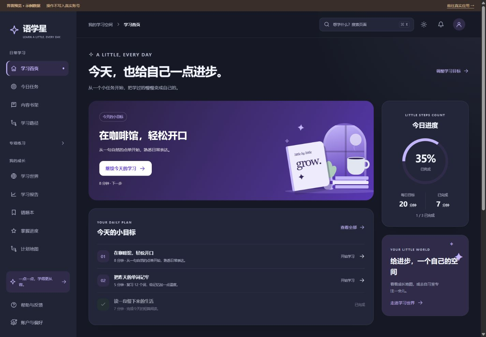
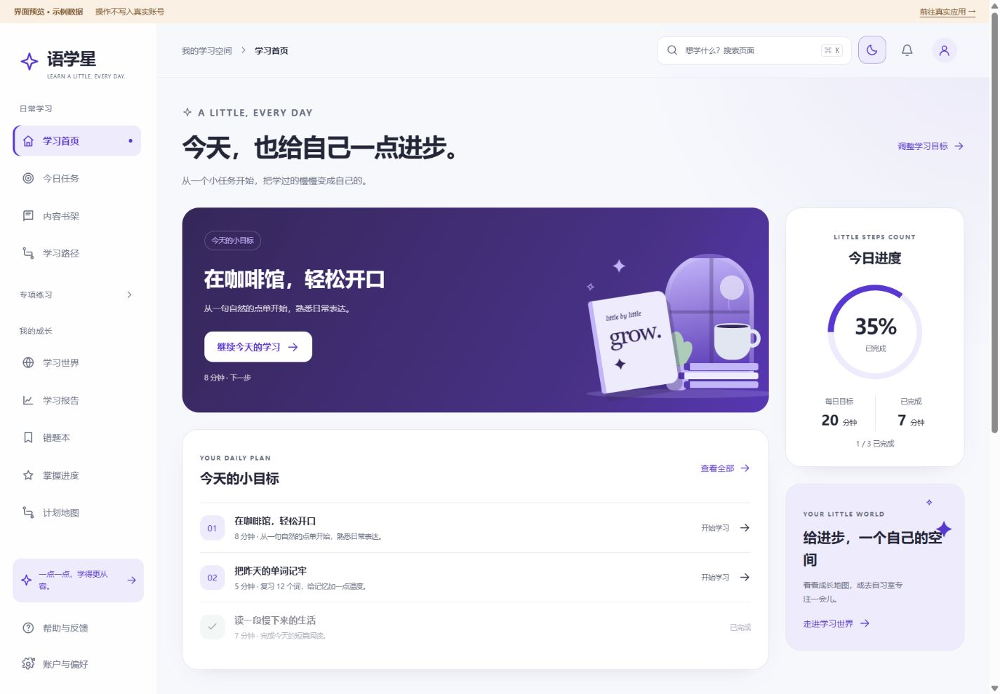
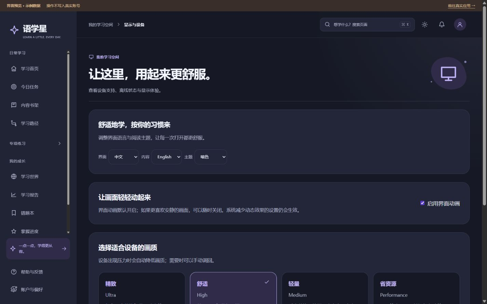
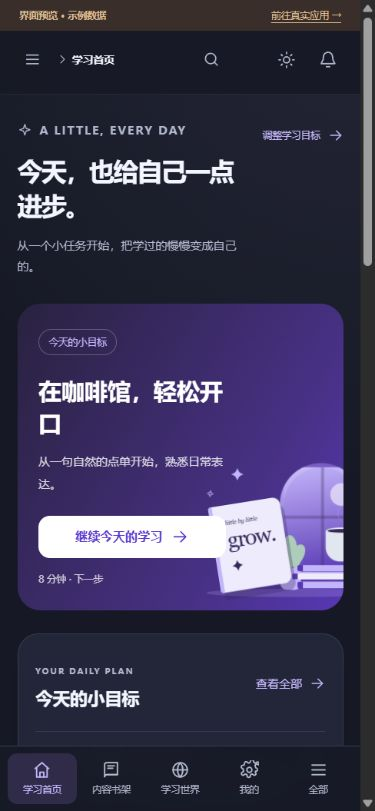

# Web 学习端官网风格改造 · 2026-09-22

本轮把已批准官网的深紫、冷白、圆角、线性图标和轻量插画应用到 **apps/learner-web 的真实页面源码**。覆盖当前 35 个页面组件，其中 29 个由当前路由使用，6 个为兼容页面；当前路由共有 36 条记录（32 条页面记录、4 条重定向），另保留原有听读说别名。没有新增第五个前端项目。

这是 UI 与交互实现记录，不是后端、生产或 P1R 验收结论。本轮不调整任务台账状态。

## 本地查看

- 真实应用：http://127.0.0.1:18180/ 。继续使用现有 IAM 登录、成人确认、权限与业务 API。
- 深色效果：http://127.0.0.1:18180/design-review.html?theme=dark#/home
- 浅色效果：http://127.0.0.1:18180/design-review.html#/home
- 空书架：http://127.0.0.1:18180/design-review.html?state=empty#/courses
- 请求失败：http://127.0.0.1:18180/design-review.html?state=error#/courses

设计预览使用相同页面组件和样式，但独立挂载开发环境路由与内存数据。顶部持续标注“界面预览 · 示例数据”；不创建真实账号会话，不保存学习记录。所有未知请求和业务写请求均返回不可提交状态，只有词汇批次和练习初始化返回合成题面。音频、录音、游戏、衣柜等未准备示例资源的部分会保留不可用或空状态。

预览只在 Vite 开发环境开放，生产构建入口不导入它，dist 不包含 design-review.html。不能用预览替代真实登录和业务验收。

从仓库根目录启动：

```sh
pnpm --filter @englishflow/learner-web dev
```

固定监听 127.0.0.1:18180，保留端口检查与 strictPort。启动全栈前仍需遵循仓库 pnpm ports:check；不要因占用自动换端口。

## 设计与交互

1. **页面框架**：桌面左侧分组导航，专项练习可收起；顶部保留搜索、主题、通知、个人入口。窄屏使用完整导航弹层及底部入口；这属于 Web 的响应式适配，不新增移动 H5 业务实现。
2. **学习首页**：一个清晰的“继续学习”主入口，配合今日目标、进度、内容推荐和世界入口。任务点击进入实际内容；不再在首页/任务页直接把任务标为完成。
3. **内容与练习**：书架增加类别筛选、关键词搜索、筛选无结果与空书架区分。词汇、听读说、语法、写作、综合练习统一标题、卡片、表单、按钮与反馈样式。
4. **成长与账户**：报告、错题、掌握度、计划地图、消息、客服、学习权益、资料、隐私和设备列表统一视觉层次。
5. **世界**：成长、游戏、自习室、角色衣柜、离线内容五个分区。使用官网一致的本地角色插画；显示“2D 示意”，不将它描述为已接通的 3D 角色引擎。未知成长状态不再伪装为 0/0 进度。
6. **显示偏好**：提供语言、主题、界面动画和四档画质。移除学习者无需理解的发布矩阵、验收指标、链路追踪面板。动画默认开启，尊重减少动态效果与 Performance 降级，不在顶部放动画开关。
7. **操作细节**：搜索支持 Ctrl/Cmd+K、方向键、Enter 和 Escape；“设置”等常用词可以找到对应页；跳转后关闭移动导航。阅读段落可用键盘选择。修正阅读重试、缓存和口语部分按钮仅引用函数而不执行的问题，以及偏好下拉框当前值不回显的问题。

### 共享资源与边界

- 配色入口：packages/design-tokens/src/learner-web.ts，复用 official-site 的原子配色，输出学习端语义变量和旧变量适配。
- 文案入口：packages/i18n/src/learner-experience.ts；原学习文案原位迁移到共享 learner-base.ts，保留键名。新增体验文案提供中英资源，现存部分业务页中文硬编码仍需后续国际化治理。
- 单一性能实例：src/platform/experience-ui.ts；页面与 store 使用同一状态，避免页面设置与实际动效各自控制。
- 主题：亮、暗、跟随系统、高对比。正式入口恢复已保存设置。
- 登录和业务请求边界保持 Gateway/IAM 归属，不改 API 契约、不新增数据表、不启用 AI/K12。
- 本轮没有修改 admin-web/mobile 的并行工作；共享 package.json 保留其他端已有导出。

## 页面覆盖清单

下表涵盖当前 29 个实际路由组件。重复路径共用同一组件，设置页三个分区分别检查。

| 页面组件 | 路由 | 本轮处理 |
|---|---|---|
| LoginPage | /login | 官网式左右布局、密码显示、注册与重置入口 |
| RegisterPage | /register | 统一认证布局、表单与条款区域 |
| PasswordResetPage | /reset-password | 统一找回流程呈现 |
| OnboardingPage | /onboarding | 目标、成人确认、同意流程样式 |
| AssessmentPage | /assessment | 学习框架、题面与反馈 |
| HomePage | /home | 重排首页与任务入口 |
| TodayPage | /today | 任务层次与进入学习 |
| CoursesPage | /courses | 内容网格、搜索与分类 |
| LearningLoopPage | /learn | 学习路径与继续入口 |
| LearnPage | /learn/session | 专注内容与完成反馈 |
| VocabularyPage | /vocabulary | 词卡、复习状态与控制 |
| B2PracticePage | /practice | 题型、输入、反馈与恢复状态 |
| B2ReportPage | /b2/report、/reports/weakness | 日/周报告与信息层次 |
| B3GrammarPage | /grammar | 语法知识与练习区域 |
| B3WritingPage | /writing、/writing/practice | 写作编辑、模板与反馈区域 |
| B11ListeningPage | /listening 及别名 | 音频、字幕、循环与缓存控制 |
| B11ReadingPage | /reading、/reader 及别名 | 内容、译文、字号与键盘操作 |
| B11SpeakingPage | /speaking 及别名 | 音标、录音与自练布局 |
| B4WorldPage | /world | 成长、游戏、自习室、角色、离线五分区 |
| B5CommercePage | /commerce | 权益、激活与订单布局 |
| B6PlatformPage | /platform | 用户可理解的显示与性能设置 |
| MasteryPage | /mastery | 掌握度与复习概况 |
| MistakesPage | /mistakes | 错题列表、空态与反馈 |
| PlanMapPage | /plan-map | 计划与进度 |
| MessagesPage | /messages | 消息列表与详情 |
| SettingsPage | /settings/profile、privacy、devices | 账户/隐私/设备与退出 |
| SupportPage | /support | 客服提交、进度与详情 |
| ForbiddenPage | /forbidden | 权限提示与返回 |
| EmptyPage | 未匹配路径 | 404 与恢复入口 |

兼容页面同样完成样式适配：AdultGatePage、WelcomePage、B11SyncPage、B3ListeningPage、B3ReadingPage、B3SpeakingPage。它们不是新增公开业务路由，未单独做浏览器运行验收。/adult-gate 仍转至 onboarding，/me 和 /settings 转至账户页，根路径仍转至登录。

## 验证记录

| 检查 | 结果与范围 |
|---|---|
| learner-web 类型检查 | 通过，包含 src 和 dev 预览文件 |
| learner-web 生产构建 | 通过；原有静态/动态混合导入分包提示仍在 |
| design-tokens、i18n 类型检查 | 通过 |
| 定向回归测试 | 28/28：B10/B11/B12、学习流、测评链、基础 UI、预览隔离和按钮调用 |
| 路由与布局 | 31 个入口 × 1440/390/320 宽度；发现并修复 commerce 在 320 下的 2px 溢出 |
| 收尾复查 | world/platform 在 320/768/1024/1440 的 8 组检查通过 |
| 交互 | 搜索筛选、搜索键盘跳转、Escape、移动导航、译文开关、世界五分区、主题、动画、Performance |
| 异常与空态 | 书架分别验证请求错误与无内容，未混为同一状态 |
| 浏览器日志 | 检查过程未捕获 warn/error |
| 样例隔离 | 未知/外部请求及提交被阻止，真实 storage 未改写；生产启动不导入预览 |

[浏览器原始检查记录](browser-checks.json) 保留首次 commerce 溢出及修复复验，不抹去初次失败。装饰插画在容器边缘裁切属于视觉设计，整页不应出现横向滚动。

定向测试：

```sh
node --test apps/learner-web/tests/experience-regressions.test.mjs apps/learner-web/tests/b10-boundaries.test.mjs apps/learner-web/tests/b11-boundaries.test.mjs apps/learner-web/tests/b12-boundaries.test.mjs apps/learner-web/tests/c03-learning-flow.test.mjs apps/learner-web/tests/c04-assessment-chain.test.mjs apps/learner-web/tests/b14-fe-005.test.mjs
pnpm --filter @englishflow/learner-web typecheck
pnpm --filter @englishflow/learner-web build
pnpm --filter @englishflow/design-tokens --filter @englishflow/i18n typecheck
```

测试更新说明：原静态断言引用的内联文案、首页直接完成动作与已过期 IAM/Gateway 字符串已更新到实际实现；未删除认证、版本/报告来源和服务归属的检查。新增测试执行代表性按钮表达式，并隔离验证预览网络与存储行为。

## 需求追溯与未关闭范围

本轮是既有 P1R 页面的 UI 修复，不认领或晋升业务功能状态。关联基线：

- [编号任务台账](../../../../requirements/backlog/v2-phase1-rebaseline/02-编号任务台账.md)：M4-001…009 的登录、成人确认、目标、测评、首页/任务/书架与首日旅程；PAGE-P1-AUTH-LOGIN/REGISTER-RESET、ONB-GOAL、ASSESSMENT、LEARN-HOME/TODAY/PLAN-MAP/COURSE-SHELF，JNY-P1-01…05、E2E-P1-FIRST-DAY。
- M5-003…006：PAGE-P1-VOCAB/GRAMMAR/LISTENING/READING/SPEAKING/WRITING/PRACTICE-HUB/SESSION/CHECKPOINT/REPORT；学习与反馈规则、owner 和 INT 保持原任务定义。
- M7-002…006：PAGE-P1-GAME/WORLD/AVATAR-REWARD/SOCIAL/COMMERCE；INT-P1-009、JNY-P1-11、E2E-P1-SOCIAL 的既有归属不变。
- M8-007…009：响应式、主题/国际化/无障碍与四级性能。本轮浏览器只提供其中局部证据，不能覆盖真机、读屏、弱网耐久等完整矩阵。
- [平台能力矩阵](../../../02-architecture/v2-platform-capability-matrix.md)：四项目边界；设计资源共享、UI 按平台实现。

尚未覆盖或确认：

1. 本地 Gateway/IAM 业务链路未启动联验；本轮不声称真实注册、登录、测评提交、学习完成、奖励、客服或权益写入通过。
2. 录音权限、真实音频/波形、上传、低配硬件、离线恢复、多浏览器/真机、200% 缩放和读屏仍需专项验证。
3. 角色插画是 2D 静态资源，真实 3D 资产、角色墙装扮与游戏玩法仍依赖已有后端和后续联调；本轮没有补成新的 3D 引擎。
4. 全部页面完成视觉与样式适配，不等于所有业务分支已重新设计、服务端能力已补齐或完整商业版本可上线。游戏会话等少量既有技术化操作仍需结合真实题包进一步梳理。
5. 新增中英文体验文案已接共享资源；原业务页残留中文不是全量国际化验收通过。
6. 开发时保留了工作区 admin/mobile 修改；用户随后明确授权三端一并提交，现纳入[统一交付](../frontend-ui-delivery-2026-09-22.md)。本次不部署。

## 效果截图

所有截图都来自明确标注的示例数据预览。








