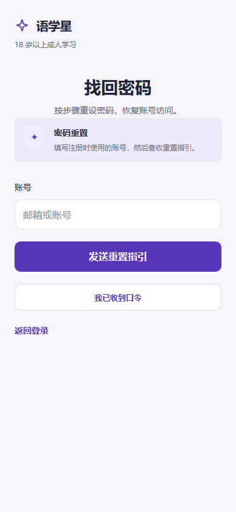
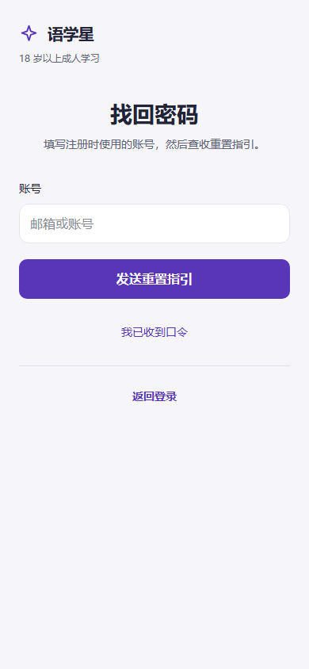
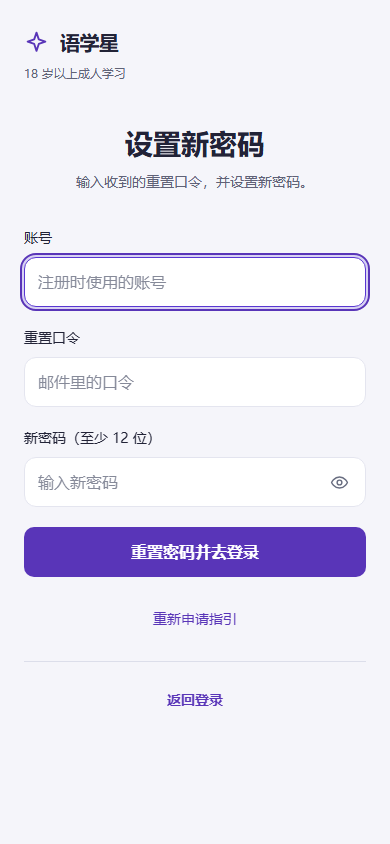
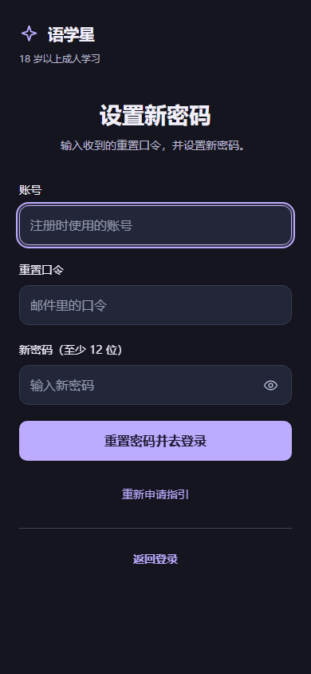
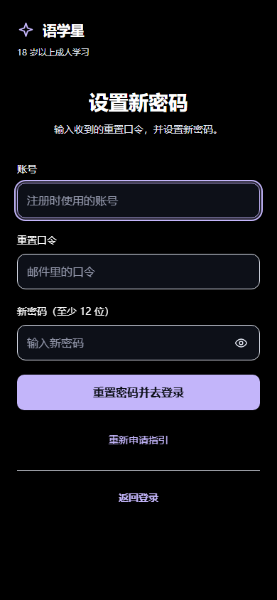
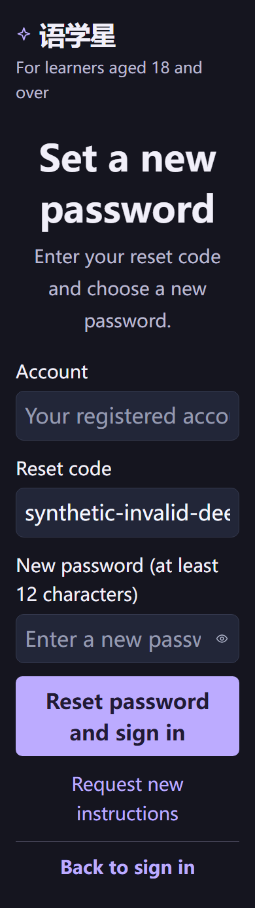

# 学员 Web 找回密码：简约重设计与页面验收

日期：2026-10-13。状态：**UI_SCOPE_PASS / PUSH_PENDING**。根Agent已独立读源码、查看两步骤真实截图并重跑64组矩阵与具名交互，复验PASS；待逐页提交推送。本记录不代表全部 UI 重设计完成，也不代替真实 IAM 重置与邮件送达验收。

## 范围与追溯

- 正式入口：`http://127.0.0.1:18180/reset-password`；申请与设置新密码是同一路由的两个步骤。
- 任务映射：R1-012（BC-012，不枚举账号的密码重置申请）、R1-015（IC-054 重置表单）、IC-007 申请回执。沿用 [DESIGN-DIRECTION](../DESIGN-DIRECTION.md)。
- UI owner：`apps/learner-web`；密码重置事实与服务调用 owner：`iam-service`。调用仍直达 IAM TLS 的 `/auth/password-reset/request` 与 `/auth/password-reset/confirm`；无契约、schema、Gateway、存储或权限变更。
- 修改：`PasswordResetPage.vue`、`ui-reset.e2e.cjs` 和本目录。共享 AuthLayout 与中文/英文资源由根 Agent 提供，本实现未修改共享文件。
- 测试源码快照：本目录 [report.json](report.json) 中的 `sourceHashes` 记录页面、共享布局、共享文案及浏览器脚本 SHA-256。

## 已复现问题与修改

| 问题 | 修改与证据 |
|---|---|
| 默认在标题下展示大面积“密码重置”状态卡，和说明重复 | 删除默认状态卡；申请只显示说明、账号和主按钮。设置新密码使用独立标题及说明。真实响应以简短文字显示 |
| 申请空提交后切到确认，旧“请输入账号”错误还在，字段没有焦点 | 切换清除旧错误、字段验证与旧回执；缺项聚焦当前首个错误字段。见 [修改前观察](before-observation.json) |
| 申请仍在提交时可以切到确认 | 提交中禁用换步、输入、密码显示及主按钮；处理函数也检查提交状态，直接派发点击不能绕过 |
| 字段错误只有全局提示，缺少具体关联 | 显式 label；账号、口令、新密码各自有错误 ID、`aria-invalid`、`aria-describedby`，全部修正后移除错误且不移走焦点 |
| 新密码不能检查输入；重复提交缺乏页面证据 | 增加沿用 AppIcon 的 44×44 显示按钮，保留至少 12 位规则；实测同一事件周期派发两次提交只发一次确认请求 |
| 两个整行按钮争夺主次 | 仅重置动作使用主按钮；“我已收到口令 / 重新申请指引”改为文本按钮，返回登录置于底部，控件命中区均至少 44×44 |

切回申请会清除旧口令、新密码及密码显示状态，保留账号；已有账号时进入确认聚焦口令，否则聚焦账号。输入账号变化会移除属于旧账号输入的申请回执。服务错误不会随普通编辑被误清除，也不会被当成字段填写错误。

## 验证

浏览器路径：Browser plugin 不在本会话可用技能列表，按 `frontend-testing-debugging` 使用现有 Playwright。全部使用隔离上下文和合成账号/口令，IAM 请求均由浏览器拦截；未重置真实账号、未发送真实邮件、未读真实凭据或敏感存储。

| 检查 | 结果 |
|---|---|
| 320 / 390 / 768 / 1280 × 亮 / 暗 / 高对比 / 跟随系统 × 中 / 英 × 两步骤 | 64/64 PASS；无横向溢出、空白页、Vite 覆盖层、裸文案 key；输入 16px；控件命中区达标 |
| 申请与确认的缺项、短密码 | 对应错误可读、正确关联并聚焦；零服务请求 |
| 提交锁定与重复提交 | PASS；换步点击不能绕过，重复确认只发一次请求 |
| 申请负向 fixture 503 / 429 | 503 保持原有反枚举条件回执；不同合成账号同文案；429 明确提示稍后重试 |
| 确认负向 fixture 400 | 无效或过期口令明确提示重新申请，不暴露内部错误码、不误标合规字段 |
| 步骤切换、口令深链、登录出口 | 清理旧错误与密码；保留账号；深链仍进入确认；返回登录保留安全回跳地址 |
| 英文 200% 字号放大（模拟） | 无横向溢出，主动作可滚动到达；不等同原生浏览器缩放 |
| 页面异常 / Console | 无 pageerror；Console 仅有拦截 fixture 预期的 400 / 429 / 503 HTTP 错误 |
| 类型检查 | `pnpm --filter @englishflow/learner-web typecheck` PASS |
| 认证传输与公开偏好回跳专项 | `public-auth-handoff.test.mjs`、`iam-auth-transport.test.mjs` 共 5/5 PASS |

截图已实际查看：390 的亮、暗、高对比两步骤；1280 的亮色两步骤；390 英文文本放大。正常 390 申请主按钮底部约 377px、确认约 577px，主按钮与辅助出口均在 844px 首屏内。标题 28px、说明/标签 14px、输入/主按钮 16px、字段错误 13px；无装饰状态卡、重影或额外艺术字。

复跑（从仓库根目录）：

```powershell
$env:UI_AUDIT_OUTPUT='docs/takeover/ui-audit-20261013/learner-reset'
node apps/learner-web/tests/ui-reset.e2e.cjs
```

只需要临时证据时，省略 `UI_AUDIT_OUTPUT`；脚本默认写入 Git 内部的本地备份目录，避免覆盖已签收的报告快照。

## 开放边界

真实 IAM 请求、邮件送达、有效一次性口令、真实密码更新与成功后的登录链本轮未执行。未测试原生 iOS/Android、原生浏览器缩放或读屏软件；ARIA、键盘与字体放大有浏览器证据。未据本页 UI PASS 改写 R1 历史签收、旧失败证据或产品发布状态。

根Agent独立复验：源码保持IAM/反枚举边界，两个步骤默认均没有大状态框；查看390申请亮色/确认暗色截图，布局、字体、主次动作可签本页UI范围。重跑64组合及全部具名交互PASS，Git外收据 `.git/codex-local-backups/reset-ui-1791906317423/report.json`。

## 主要截图







