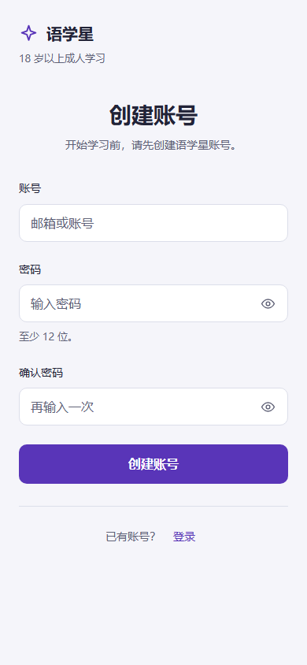
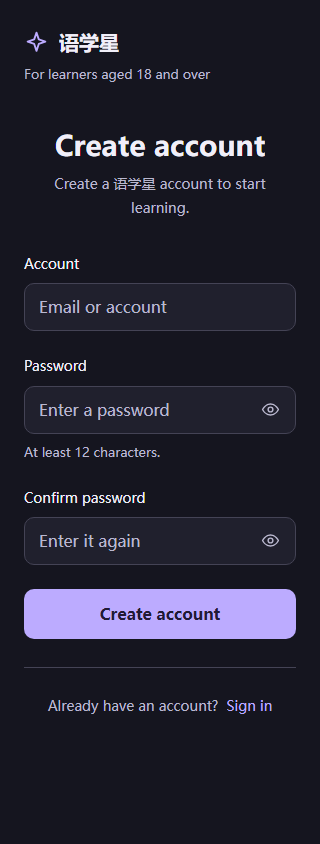
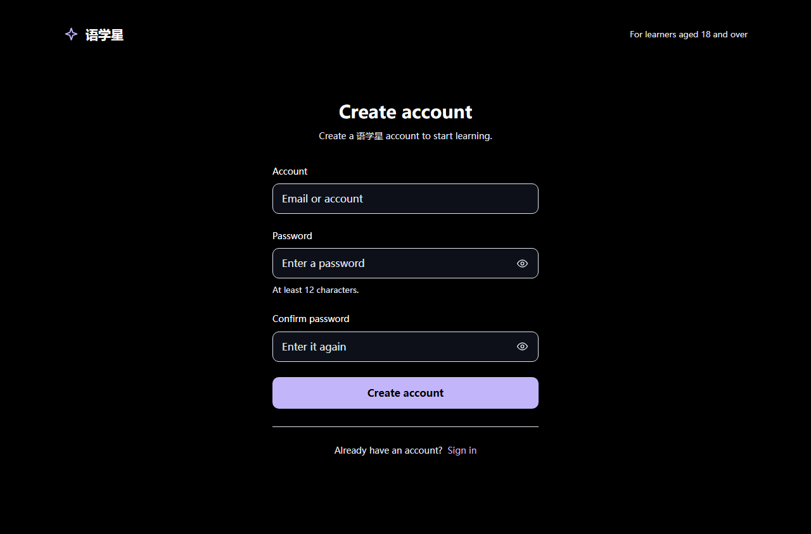
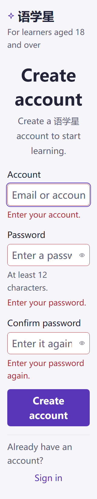
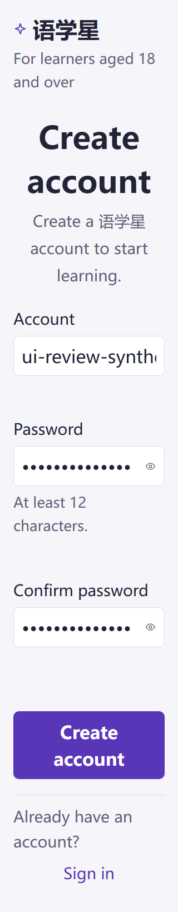

# MB-002 最终独立视觉复审

日期：2026-10-14（北京时间）。结论：**UI_SCOPE_PASS / 待根Agent逐页提交推送**。

本审者不是注册页作者，未修改注册源码、共享资源、旧证据、Git或服务，只在本目录保存独立审查证据。正式入口为 `http://127.0.0.1:18183/#/pages/register/register`，复审使用仍在运行的固定18183/PID9820服务。Browser插件及browser技能不在会话可用列表，按已加载的frontend-testing-debugging技能使用现有Playwright Chromium；没有安装依赖或放宽TLS验证。

## 冻结源码与证据

注册页SHA-256在开始、脚本结束及复核时均为：`46171faacf15f103dd3063568cd0f903d10825ca283bd7dc674571c0073d76bd`。

共享i18n快照：`c2a883b5ec6bb7b2efe79f3e820c675895a397bf123951481514543963dddb18`。其余相关资源哈希见[results.json](results.json)。正式页面、资源及上一轮动态审查对应同一冻结版本。

独立脚本[audit.cjs](audit.cjs)有自己的页面身份、排版、对比、输入语义及错误保留断言，并未借用作者34条结果作为本次覆盖。命令：`node docs/takeover/ui-audit-20261013/mobile-register/20261014-final-review/audit.cjs`。

## 最终检查

| 维度 | 独立结果 |
| --- | --- |
| 320/390/768/1280 × 中英 × 亮/暗/高对比/系统 | **32/32 PASS**。32张完整截图均已实际查看，单标题、开放420px表单、无装饰hero/外卡/默认错误卡/框架遮罩，无横向溢出。系统主题逐上下文实际切暗再切亮通过。 |
| 字体、信息层级与文案 | 标题28px、三原生input16px；说明/标签14px与规则13px经源码和截图交叉核对。共享新标题、说明及「至少12位/At least 12 characters」在真实渲染生效，无裸i18n key。320英文描述自然换行，成人说明清楚，密码规则贴近输入，登录出口在主动作后。 |
| 间距、图标与动作 | 两字段间及末字段到主按钮实测均24px；眼睛19px及四角品牌25px经源与截图核对。各按钮两维命中区至少44px；没有箭头/图标压缩到不可点击。390中文主按钮top564.453125px。 |
| 对比 | 全矩阵标题/标签最小14.17，说明/成人说明/规则5.50，登录文字7.36，主按钮8.00；均≥4.5。200%错误文字实测最小约5.96。状态另有文字及边框，不仅依赖色彩。 |
| 输入语义 | 当前原生name为identifier/password/confirm，autocomplete为username/new-password/new-password，三语言标签正确。必填关联、纠正后aria-invalid及错误关联清理通过，隐藏旧错误不保留alert role。 |
| 中英390px 200%文本 | 原生输入32px，无横溢出；必填反馈与清理后四张截图已目检，主动作/登录可纵向到达。三条错误自然高度均41.59375px，清理后原高度保留且按钮位置不变；没有用单行min-height掩盖位移。 |
| 英文320px 200%多行反馈 | [multiline-320.json](multiline-320.json) PASS。确认必填全文自然折为两行，高83.1875px；清理后仍83.1875px，aria-hidden=true、role移除、visibility=hidden，按钮top前后673.921875px。实际看过两张截图；无横溢出，初始无错误占位。 |
| 快速输入抽验 | click及Enter在0.6–0.7ms旧model窗口内，以完全隔离session.register stub记录相等布尔值，均消费即时合成字段且零IAM请求；未记录密码、body或凭证。对应既有[动态独审](../independent-review.md)最后版本的快速清空/纠正结论。 |
| 实际鼠标纠错点击 | [pointer-correction.json](pointer-correction.json) PASS。short→合法值后立即真实Playwright pointer click发出一次拦截请求，首错清理，提交发生时按钮top625.234375px与纠正前一致，两字段gap仍24px；没有只做程序化click断言。 |
| 页面异常 | 本次脚本pageerror **0**，无框架overlay、空白页；32矩阵及文本状态零API。鼠标抽验仅一次预期503；无真实后台写入。 |

## 视觉判断与设计对应

已逐张目检本目录32张正常状态及6张200%错误/清理截图。正式页面沿既有认证设计：开放单列、无衬线标题、克制紫色主按钮、规则贴近字段、次动作在底部分隔线后。移动尺寸顶部成人说明置于品牌下，平板/宽屏置于右侧；这是任务密度与空间适配，未引入新的视觉体系。暗色使用浅紫按钮与深色文字，高对比保留清楚的输入边界；两者真实截图均可读。200%时按钮及英文标题自然换行，密码输入内容按原生单行编辑滚动，未造成页面横溢出。

经过校验的反馈清理后留下自然高度，是阻止pointerdown/up期间主动作移动的必要行为；初始没有空错误区，已清理文本没有可见框、颜色或读屏alert。截图证明实际效果，没有拿源代码或构建替代渲染验收。

## 范围边界

本次只签正式Mobile H5注册页的UI范围。上一周期独立动态交互PASS覆盖busy/重复提交、双眼睛键盘、503/409中性反馈与安全回跳；本次补齐最终冻结版本的完整视觉矩阵和具名抽验，不把作者测试计作独审。

所有API均拦截；没有读真实Token、Cookie、认证存储、request header/body，没有注册真实账号。未验证真实IAM成功、真实成人Gate、真实学习闭环、原生App/小程序、物理软键盘、读屏或原生浏览器缩放。200%为显式字号模拟。未再次执行构建/类型检查，不把作者已有构建结果升级为本次新证据；本审查不宣称R1业务完成或发布可用。提交推送与远程SHA收据由根Agent完成。

## 主要截图

