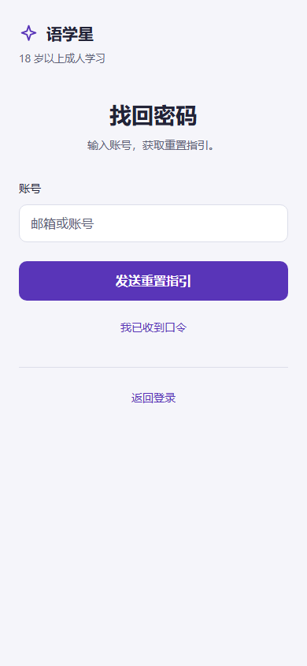
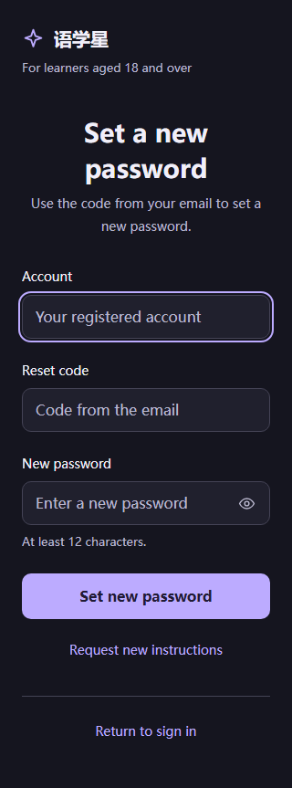
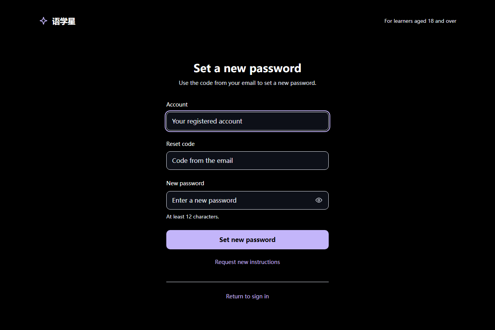
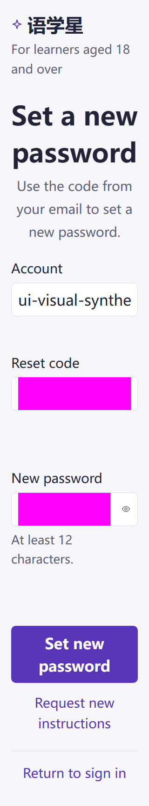

# MB-003 最终独立视觉复审

2026-10-14。结论：**UI_SCOPE_PASS（视觉范围）；待根Agent合并独立动态结论并逐页提交推送**。

本审者只读正式页面与共享资源，没有修改应用、旧证据、Git或服务。复审入口为 `http://127.0.0.1:18183/#/pages/reset-password/reset-password`；服务为固定18183/PID29808。Browser插件/技能不可用，使用既有Playwright Chromium，未安装依赖或放宽TLS。

本审者不是重置页作者，没有借作者68组结果充作独审覆盖。

## 源码与证据

页面在开始、结束及复核时SHA-256均为 `b3eebb09cf8e2194ed9355f5dce863786789ca870b25d47203022815bef7c361`。共享i18n为 `f772bccef324eeac99e3f7b31292040d1353557387aaf6f05d309b74d7ad947d`；其余资源见[results.json](results.json)。

独立脚本[audit.cjs](audit.cjs)只审视觉、输入呈现及反馈自然高度：

`node docs/takeover/ui-audit-20261013/mobile-reset/20261014-final-visual/audit.cjs`

| 检查 | 本次独立结果 |
| --- | --- |
| 两步骤 × 320/390/768/1280 × 中英 × 四主题 | **64/64 PASS**。64张正常状态截图已逐张实际查看；单标题、开放最大420px表单，无装饰card/hero/默认状态框、裸key或框架overlay，无横向溢出。 |
| 字体与信息顺序 | 标题28px；说明/标签14px；原生输入及主按钮16px；密码规则13px。申请只显示账号与申请主动作；确认明确账号、口令、新密码和规则，重新申请与返回登录各自清楚，主次不争抢。 |
| 真实间距与图标 | 字段之间、末字段到主按钮实际24px；眼睛19px、品牌25px经源和截图核对。全部按钮命中区至少44×44px。确认步骤自动焦点环没有裁切或与边界混淆。 |
| 色彩与对比 | 全矩阵标题/标签最小14.17；说明/成人说明/规则5.50；主按钮8.00；两辅助动作7.36，均≥4.5。暗色和高对比按钮文字可读，焦点边界明确。系统主题每上下文实际切暗再切亮通过。 |
| 原生语义与共享文案 | 原生name/autocomplete/可访问标签符合identifier/username、token/one-time-code、newPassword/new-password。真实页面新中英标题、说明和「至少12位」规则生效；未用源码代替运行时文案验证。 |
| 英文320/390、两步骤200% | **4/4 PASS**。输入实际32px、辅助规则26px，标题/按钮自然换行，纵向滚动可达，无横溢出。八张必填/纠正截图已查看；口令、新密码区域遮罩，未保存合成值。 |
| 多行错误纠正后稳定 | 320确认口令及新密码错误行自然高89.59375px；390新密码错误同高。纠正后保留原自然高度，visibility:hidden、aria-hidden=true、alert role移除，原生invalid/错误关联解除。四种放大状态按钮top前后严格相等，字段/动作gap仍24px。 |
| 320×460短视口 | 两步骤均能滚动到返回登录。另以真实viewport边界复核，[short-visible.json](short-visible.json)记录申请scrollY130、确认403；出口top约376、bottom约420，完整落在460px视口内。两张viewport截图已查看，不能仅凭isVisible判断可见。 |
| 异常与API | 本次API请求 **0**、pageerror **0**、console error **0**。API拦截仍先安装，校验失败及纠正没有提交。 |

默认英文320确认标题和说明各自然换行，主按钮仍可达；平板/宽屏顶部成人说明移至右侧、表单仍居中420px。全部正常图、八张200%状态图、两张完整短页图及两张短视口图均已实际目检。版式沿已有认证方向：正常无衬线、克制紫色主动作、开放排版、没有无用等待框和装饰堆叠。错误被清理后留白仅保留已发生反馈的自然尺寸，初始无占位。

## 安全与未测边界

确认步骤由真实「我已收到口令」控件进入，URL从未携带口令；JSON只保存hash路由、语义、几何、状态及哈希。合成口令/密码仅在隔离上下文内生成，所有含输入的确认截图均遮罩；截图中的粉色块是审计遮罩，属于证据处理，不是页面配色。没有读取真实Token、Cookie、认证存储、request header/body，没有真实账号或后台写入。

长度、回执、步骤清理、busy、重复提交、成功后字段清除由另一个独立动态审者负责，本报告不重复声称其验收。真实IAM、邮件送达、有效一次性口令、真实密码更新、原生App/小程序、物理软键盘、读屏、原生浏览器缩放均 **NOT_RUN**。200%为显式字号模拟。没有重新执行类型检查或构建；作者已有结果不升级为本次新证据。

## 主要截图

