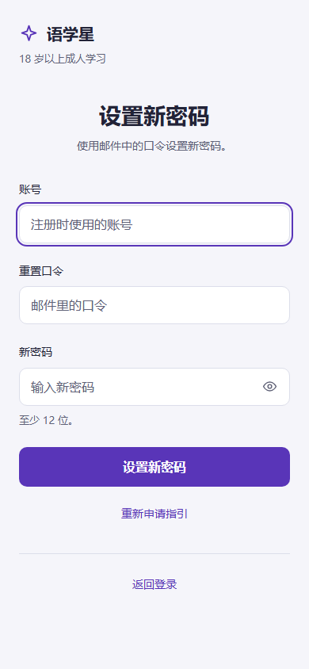
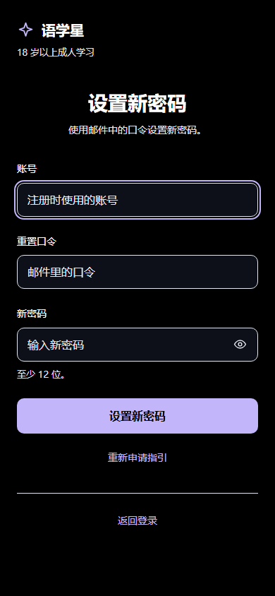
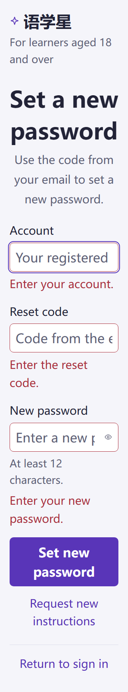
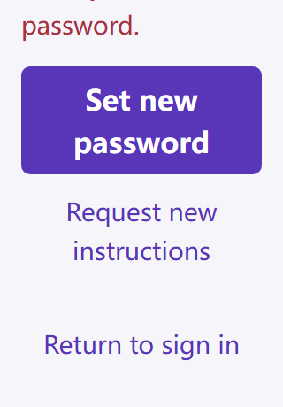

# MB-003 冻结源码独立复审

2026-10-14。结果 **DIFF_NATIVE_ISOLATION_LIFECYCLE_NAMED_VISUAL_SCOPE_PASS**。这份复审覆盖当前改稿的 diff/平台隔离/卸载生命周期与四个具名视觉态，不能单独替代完整交互签收、真实 IAM 业务或原生运行证据。

**整页仍未签，需继续修复。** root随后传回动态独审FAIL：英文200%已有账号长错误变成较短必填错误时，100ms模型更新后、真实pointerdown之前主按钮上移约44.8px，导致点击丢失。本次静态四态与隔离/卸载PASS不能覆盖或抵消这个实际交互失败；本报告保留在旧9729哈希，等待新稿短复签，不自动迁移状态。

页面 SHA-256：`9729e8140c0e70fa99308f1be8543949e7dbf67a1aef7650596c7b38153cefa6`。
共享 helper SHA-256：`6464f4c1712b5a0f2fd4ab01d451d5bb6ffaa13bde486826a424511059ef6425`。
开始、结束均核对冻结哈希一致。没有修改源码、共享资源、服务、Git、旧证据或旧报告。

## 当前修改审查

- 真实输入模型和 form/blur/confirm 即时事件提交逻辑保持分离；新增手势快照只锁视觉反馈，不读取 DOM.value、不固定延时、没有凭据/存储/接口改动。
- `usePointerFeedback` 在本页根容器内、具名动作命中、主指针及主键且未 busy/完成时才捕获。snapshot 只含当时错误文字、回执布尔等反馈；当前响应式校验仍用于真实提交。动作外释放、取消/中断可清快照；正常动作释放保留到实际 click 后。具体真实长按/拖离/取消与提交矩阵由独立动态审查承担，本文件不重复签它的范围。
- helper 的 document/window/Element/PointerEvent 行为全部在 H5 编译条件内；本页原生输入语义桥及 afterRelease 的同步调用也受 H5 条件保护。类型中的 HTMLElement 不构成原生运行时 DOM 访问。
- helper 在 onUnmounted 设置 mounted=false、移除所有监听、清 gesture/snapshot；排队 nextTick 执行前再查 mounted。页面语义同步按 ref 是否仍可用检查，无跨端 DOM 回退。此次没有新增页面导航或成功状态推进行为。

## 隔离与生命周期证据

使用当前项目官方 `@dcloudio/uni-cli-shared` initPreContext/preJs，并以当前 TypeScript 转为运行时代码；不是手写删除 H5 行的投影。

| 检查 | 结果 |
| --- | --- |
| App 条件编译 | 页面/helper 运行时代码没有 document、window、Element、PointerEvent、querySelector 或 syncNativeInputs；helper 在无 DOM globals 的隔离 VM 可执行，返回 null snapshot，不注册 DOM 生命周期。PASS。 |
| mp-weixin 条件编译 | 同上。PASS。 |
| 活动手势卸载 | 真实 helper 转译代码的隔离 hook harness：卸载前8个监听，卸载后0；snapshot 清空，afterRelease未执行。PASS。 |
| 已排队释放后卸载 | click先排队 nextTick，卸载后回收微任务；原监听全部移除，snapshot为空，没有卸载后回调。PASS。 |

该 harness 验证 helper 的卸载行为；不等同于 App/小程序真机运行，不声明 uni 页面缓存隐藏/恢复的全链生命周期或真机手势已经通过。

## 正式 H5 四态视觉证据

环境：`http://127.0.0.1:18183/#/pages/reset-password/reset-password`，实际 Vue/uni H5 正式路由；Browser plugin/skill unavailable，按 frontend-testing-debugging 用已有 Playwright Chromium。未启动/重启服务。新浏览器隔离上下文，全 API 路由拦截、其它外部请求阻断；本轮 API请求 **0**，pageerror **0**，console error **0**。没有读取 token/storage/cookie/header/body，也没有口令 URL；字段为空，不存密码明文。全部5张截图已由独立复审实际查看。

| 具名状态 | 字号/布局/颜色 | 结果 |
| --- | --- | --- |
| 390中文申请、亮色 | 原生输入16px；一个标题，开放主体、无默认等待/错误大框；动作间距24px；按钮/出口≥44px；最小文字对比5.50。 | PASS |
| 390中文确认、亮色 | 三个原生输入16px，账号/口令/新密码与辅助规则层级清楚；品牌25px、眼睛19px保留；自动账号焦点环完整；字段间及动作24px；最小对比5.50。 | PASS |
| 390中文确认、高对比 | 黑色背景、输入边界与焦点清楚，主按钮文字可读，最小文字对比11.31；字号、24px间距与44px命中区一致。 | PASS |
| 320×460英文确认、200%必填错误 | 实际输入32px；标题/说明/标签/规则/动作同步放大，错误28px。错误自然高度44.796875/89.59375/89.59375；没有横向溢出或遮盖，字段/动作间距仍24px；英文多行自然换行。实际滚动后返回登录底部419.921875位于460px视口内。 | PASS |

页面身份与文档标题正确属于找回流程，单个H1；没有 Vite overlay 或旧卡式 header。点击“我已收到口令”确实进入三个输入的确认态；200%空表提交出现三个字段错误且聚焦账号，未发 API。申请/确认均保留原生 name、label、autocomplete 语义。

## 证据与限制

可复验脚本：[audit.cjs](audit.cjs)；完整数值：[results.json](results.json)。本次仅四态，不重跑此前64组合。旧64视觉报告仍仅对其旧源码哈希 `b3eebb09…` 有效；当前动态/pointer复审、作者当前源码检查和root最后整合须另行对应冻结哈希，不能将旧视觉源哈希改写为新测试。

真实 IAM、邮件、账号/口令生命周期、原生App/小程序实际输入/手势、安全存储权限均 **NOT_RUN**。这份报告没有运行构建或类型检查，也不把官方条件预处理当作原生运行。UI fixture与后台证据继续分开。

## 截图

