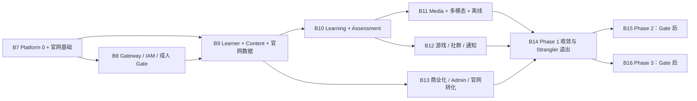

# v2 B7+ 代码重塑与交互测试任务基线

> 基线 ID：`V2-CODE-BASELINE-20260822`  
> 状态：任务设计已建立；B7–B14 全部“待开始”，B15/B16 为阶段 Gate 冻结任务。  
> 唯一业务来源：[v2-980plus 设计包](../../docs/06-design/v2-980plus/README.md)；唯一目标架构来源：[v2 微服务架构](../../docs/02-architecture/v2-microservices-architecture.md) 与 [`ARCH-*` 能力矩阵](../../docs/02-architecture/v2-platform-capability-matrix.md)。  
> 旧资产来源：B0–B6 的代码、契约、迁移、夹具和验证记录只作为迁移输入与行为回归样本，**不**继承旧 `DEV-*` 的完成状态、服务边界或 Java 17 单体实现。  
> 本轮范围：仅设计和实施代码层开发、单元/契约/集成逻辑测试、组件/浏览器交互测试；不把真实生产部署、真实支付、真实设备、容量压测、SRE 演练或 Phase 2/3 合规签字算作本轮完成。

---

## 1. 目标、边界与完成口径

目标是在已经存在的 B0–B6 代码资产之上，完成从 Java 17 `core-api` 兼容单体到 v2 Java 25 微服务目标架构的**渐进重塑**，并把四个前端项目迁移到统一 Gateway、契约、权限、页面状态、国际化和主题 Token 模型：

- `apps/mobile`：uni-app 学习端，承载移动 H5、iOS、Android、iPad 与后续微信小程序条件编译；
- `apps/learner-web`：PC Web、平板浏览器和 PWA 学习工作台；
- `apps/admin-web`：教研、审核、运营、商业化和客服后台；
- `apps/official-site`：Nuxt/Vue 公开品牌、课程、价格、下载、SEO 和合规站点；不承载登录后的学习业务、同步或消息。

### 1.1 代码层完成（本基线允许标记）

每个 B7+ 任务至少具备：

1. 已细化签收的 `FEAT-*` / `PRD-ATOM-*` / `V2-980-*` 或独立 `ARCH-*` 引用；
2. 契约先行：OpenAPI、AsyncAPI 或 JSON Schema 与生成客户端同步；
3. 独立服务/前端源代码、迁移或兼容适配代码，且不跨 owner 直写；
4. 单元、契约、逻辑集成测试，以及受影响界面的组件或浏览器交互测试；
5. 八态中的相关状态至少覆盖 success、loading、empty、error、permission、recovery；涉及离线/媒体/长任务时还覆盖 offline、processing；
6. 静态安全约束：服务侧 PEP、`TenantScope`、幂等、敏感字段和 Phase Gate 的自动化断言。
7. 涉及 UI 的任务必须复用 `packages/i18n` 与 `packages/design-tokens`，验证 UI locale 与 `contentLocale` 分离、缺失翻译 fallback、主题持久化和颜色之外的状态表达；不得在业务页面新增品牌/状态色硬编码。

### 1.2 本基线明确不允许的误报

- 不因目录、README、Mock、测试替身或同一 Pod/JVM 而宣称领域服务已抽取；
- 不因前端隐藏开关而绕过成人年龄、版权、支付、AI 或 K12 Gate；
- 不将 B0–B6 中的共享表、`core-api` DTO、客户端角色头或内存 Repository 当成 v2 的目标实现；
- 不把 310 个 `V2-EXT-*` 占位单元拆成代码任务；它们必须先完成产品、架构、合规细化签收；
- 不把 B15/B16 的冻结任务提前放入默认路由、菜单、官网营销、数据库迁移或埋点注册。

### 1.3 任务编号与状态

任务格式为 `V2-B<批次>-<域>-<序号>`，例如 `V2-B8-IAM-001`。平台任务可只引用 `ARCH-*`；领域任务必须同时绑定业务来源和 `ARCH-*`。本文件中每行的“初始状态”即 B7+ 的初始状态事实，后续认领、证据和阻塞更新在该行追加，不能回写旧 `DEV-*` 状态表。

---

## 2. B0–B6 可复用资产与迁移规则

| 旧批次 | 可复用的代码层资产 | v2 使用方式 | 禁止继承 |
|---|---|---|---|
| B0/B1 | pnpm monorepo、固定端口、OpenAPI/事件生成、Flyway、Core API 身份/Onboarding、内容种子、learner-web/mobile 壳 | 作为契约命名、测试夹具、页面交互和迁移适配的输入 | Java 17 运行时、双 Token 自研协议、`core-api` 作为新领域 owner |
| B2 | SRS、练习、判分、掌握度规则与 B2 夹具 | 提取纯规则，分别迁入 `learning-service` 与 `assessment-service`；内容定义迁入 `content-service` | 将题目、attempt、SRS 放入同一 schema 或由前端决定分数 |
| B3 | 语法/写作、听说读、离线 cursor、媒体 hash、四档性能降级 | 保留交互状态机和安全失败用例，改接 v2 内容、媒体、学习和测评服务 | `core-api` 跨域 JDBC、原始音频/答案进入事件或日志 |
| B4 | 游戏、社群、低 UGC、离线包与通知状态机 | 迁入 `gamification-service`、`social-service`、`notification-service` 并消费可信事件 | 客户端积分入账、未受控自由 UGC、把 REST ticket 当作真实实时运行证据 |
| B5 | 商业化、CMS 双审、Admin 页面、风控、客服和审计逻辑 | 迁入 `commerce-service`、`content-service`、`admin-ops-service`；复用 fail-closed 规则测试 | BFF 持有订单/内容事实、自研 SSO、真实支付已上线的暗示 |
| B6 | 响应式、无障碍、PWA、质量 Gate、性能策略、E2E 场景骨架 | 作为四项目交互测试和质量门禁的共同基线 | 将静态 Gate 当作真实设备/备份/生产发布证据 |

现有 `services/*-worker`、`ai-orchestrator`、`realtime-voice` 等目录只视为候选代码资产；只有满足 v2 独立进程、schema、凭据、契约、发布/回滚责任后，才可称为目标服务。

---

## 3. 批次依赖与并行原则

- B7 的官网静态骨架可与 Platform 0 服务模板并行；B9 的官网公开数据投影必须等待 B7 契约/Gateway 基座。
- B11、B12、B13 在 B10 的可信学习事件和 B8 的服务侧 PEP 可用后可以并行，但不得共享写模型。
- B15 仅在 `G-P2` 通过后解冻；B16 仅在 `G-P3` 通过后解冻。两者的任务设计存在不代表授权开发或上线。

---

## 4. B7 — Platform 0、v2 契约、国际化/主题与官网基础（7 项）

**批次目标**：建立 Java 25/Spring Boot 4.1 服务开发骨架、Gateway 兼容入口、数据/事件测试底座、四前端国际化/主题基础和 `apps/official-site` 的真实源代码骨架。  
**主要引用**：`ARCH-PLAT-001`、`ARCH-API-001`、`ARCH-DEP-001`、`ARCH-DATA-001`、`ARCH-OBS-001`、`ARCH-REL-001`；v2 01/02/07。  
**初始状态**：待开始。

| 任务 ID | 代码目标 | 服务/前端宿主 | 逻辑与交互测试 | 依赖 | 初始状态 |
|---|---|---|---|---|---|
| V2-B7-PLAT-001 | 建立 Java 25、Spring Boot 4.1、统一 BOM、服务模板、健康探针、配置与本地固定端口约束；冻结四前端构建边界，并将 `apps/miniapp-wechat` 收敛为 `apps/mobile` 的条件编译兼容壳，禁止保留独立业务路由或 API 层；模板不复用 `core-api` 运行时 | `services/*` 模板、前端 workspace | 模板启动、配置拒绝、健康/readiness、版本兼容、端口冲突及独立小程序业务入口扫描测试 | 无 | 待开始 |
| V2-B7-API-002 | 将 v2 OpenAPI/AsyncAPI/JSON Schema 分层、生成、兼容 diff 和四端 API client 迁移机制落入代码 | `packages/contracts`、四前端共享 SDK | schema 破坏性变更、生成类型、错误 envelope、Idempotency-Key/trace 传播测试 | 001 | 待开始 |
| V2-B7-GW-003 | 新建 `api-gateway` 的无业务写入路由骨架，提供 `/api/v1`、CORS、限流、requestId/traceId 与 `core-api` 兼容路由 | `services/api-gateway` | 路由匹配、限流、CORS、直连拒绝、兼容回退与错误映射测试 | 001/002 | 待开始 |
| V2-B7-DATA-004 | 建立服务 schema/Flyway、`TenantScope`、Outbox、幂等、Redis namespace 与测试 fixture 基础库 | 服务模板、`database/` | 复合 tenant 约束、越权查询、重复写入、Outbox 去重/重放、迁移顺序测试 | 001/002 | 待开始 |
| V2-B7-OBS-005 | 建立 OTel、结构化审计、超时/重试预算、错误分类和浏览器测试替身 | Gateway、服务模板、四前端 | 一次模拟请求 trace 连通、敏感字段脱敏、超时/恢复状态和错误 UI 测试 | 003/004 | 待开始 |
| V2-B7-OFS-006 | 从空壳构建官网 Nuxt 源码：首页、课程、价格、下载、关于、合规页、SEO/robots/sitemap/结构化数据、公开状态组件 | `apps/official-site` | SSR/SSG 构建、元数据、断链、移动/桌面导航、加载/空/错误/下载禁用交互测试；不接入登录学习业务 | 002/007 | 待开始 |
| V2-B7-FE-007 | 建立 `packages/i18n` 与扩展 `packages/design-tokens`：UI locale 与 `contentLocale` 分离、`zh-CN` 默认/受控 fallback/格式化/伪本地化检查；原子与语义 Token、亮色/暗色/跟随系统/高对比主题，以及 Nuxt SSR、Vue Web、uni-app、Element Plus 适配层 | `packages/i18n`、`packages/design-tokens`、四前端 | locale key 缺失、插值/日期数字格式、UI 与内容语言分离、主题切换与持久化、Nuxt 无闪烁 hydration、色彩对比/非颜色状态、四端适配编译与交互测试 | 001 | 待开始 |

**批次退出条件**：四前端都能通过生成客户端访问 Gateway 测试替身和共享国际化/主题适配层；官网有可构建的源页面而非 `.nuxt/.output` 产物；不要求真实 IdP、Kubernetes 或生产 CDN。

### B7 执行记录（2026-08-22）

本节追加代码层执行状态，不改写上表的“初始状态”事实。7 项任务均已完成代码实现并通过对应逻辑/静态/构建验证，可进入测试阶段；运行态和 Gate 仍按验收标准处理。

| 任务 | 执行状态 | 主要证据 | 未覆盖项 |
|---|---|---|---|
| `V2-B7-PLAT-001` | 代码完成 | `services/service-template/`、`services/api-gateway/pom.xml`、`config/local-ports.json` | 当前环境 Java 24、无 Maven，Java 25 构建待专用工具链 |
| `V2-B7-API-002` | 代码完成 | `packages/contracts/schemas/v1/`、`scripts/contracts/compatibility-diff.mjs`、`packages/api-client/src/gateway-test-double.ts`、`tests/b7/gateway-client.test.mjs` | 真实四端 Gateway 运行态待测试 |
| `V2-B7-GW-003` | 代码完成 | `services/api-gateway/src/`、`tests/b7/gateway-platform.test.mjs`；legacy 兼容仅 GET/HEAD，默认 deny，local profile 只读放行 | OIDC/JWKS、服务侧 PEP/RBAC 属于 B8；真实 Gateway 运行态待测试 |
| `V2-B7-DATA-004` | 代码完成 | `database/mysql/migrations/V0001–V0004`、Redis keyspace、`tests/b7/data-observability.test.mjs` | 真实 MySQL/Redis/Kafka 故障注入待测试 |
| `V2-B7-OBS-005` | 代码完成 | `packages/telemetry/`、服务模板 OTel 配置、数据观测测试 | OTel collector/跨进程 trace 运行态待测试 |
| `V2-B7-OFS-006` | 代码完成 | `apps/official-site/`、`tests/b7/official-site.test.mjs` | 真实 CDN/公开数据投影由 B9/部署阶段完成 |
| `V2-B7-FE-007` | 代码完成 | `packages/i18n/`、`packages/design-tokens/`、四端 `v2-foundation` 适配入口、i18n/theme 测试 | 浏览器 hydration、真机主题/locale 回归待测试 |

完整交接证据见 [`docs/07-operations/b7-validation.md`](../../docs/07-operations/b7-validation.md)。

---

## 5. B8 — Gateway、IAM 与成人安全入口（7 项）

**批次目标**：将所有登录后业务调用收敛到 Gateway + 标准 IdP + 服务侧 PEP，不重建自研 Token 服务。  
**主要引用**：ONB/USR/INF 的已细化单元；`ARCH-GW-001`、`ARCH-IAM-001/002`、`ARCH-SEC-001`、`ARCH-OBS-001`。  
**前置 Gate**：`G-IDP`（标准 OIDC IdP 的 ADR、PKCE/移动端/workload identity/迁移回滚方案）必须先通过；未通过时仅可完成接口和测试替身，不能接入真实身份供应商。

| 任务 ID | 代码目标 | 服务/前端宿主 | 逻辑与交互测试 | 依赖 | 初始状态 |
|---|---|---|---|---|---|
| V2-B8-IAM-001 | 接入获准的标准 OIDC/OAuth 2.1 IdP，实施授权码+PKCE、JWKS、刷新/撤销、工作负载身份适配 | `iam-service`、Gateway | 登录回调、PKCE 失败、JWKS 轮换、撤销、重放与失效会话测试 | G-IDP、B7 | 待开始（G-IDP） |
| V2-B8-IAM-002 | 建立不可变 principal 映射、服务端派生 `platform` tenant、设备、会话、同意和审计事实 | `iam-service` | tenant/subject 不可由客户端覆盖、会话隔离、同意版本和设备踢出测试 | 001/004 | 待开始 |
| V2-B8-IAM-003 | 实施 RBAC+ABAC、资源 owner/phase/rights/consent 判定、服务侧 PEP 与本地策略包/短期缓存 | IAM SDK、各服务模板 | allow/deny 矩阵、客户端角色头拒绝、PDP/撤销/策略版本故障 fail-closed 测试 | 001/002 | 待开始 |
| V2-B8-GW-004 | 将 Gateway 路由升级为认证、限流、审计边界，并将旧 `core-api` 入口包入反腐适配 | Gateway、`core-api` adapter | 未认证、过期、403、租户错配、原端口直连拒绝与回滚路由测试 | 001/003 | 待开始 |
| V2-B8-USR-005 | 实施 Phase 1 成人年龄 Gate、注册/恢复/隐私最小化和明确拒绝语义；不创建儿童、家长、监护或未成年人支付事实 | IAM、learner 适配层 | 年龄拒绝、伪造字段、重复注册、恢复页、审计留痕和无客户端绕过测试 | 002/003 | 待开始 |
| V2-B8-FE-006 | mobile、learner-web、admin-web 的登录、刷新、登出、权限页和会话恢复接入 Gateway；官网仅提供公开登录入口跳转，并复用 B7 的 locale/theme 适配 | 四前端 | 路由守卫、401/403、撤销后回到登录、深链恢复、无权后台菜单、官网不持有业务会话、不同 locale/theme 下权限文案测试 | 001–005/B7-FE-007 | 待开始 |
| V2-B8-TEST-007 | 建立认证安全旅程测试包与行为兼容夹具转换 | 服务/四前端测试 | 浏览器模拟：登录→成人 Gate→授权访问→撤销→恢复；契约/组件/逻辑集成全链路 | 001–006 | 待开始 |

### B8 执行记录（2026-08-22，代码层）

本轮按“代码开发完成后进入测试阶段”的目标执行。7 项任务均已落地代码/契约/静态逻辑测试切片，但不把 G-IDP、真实 OIDC/JWKS、Java 25/Maven 运行态、跨进程安全旅程或真机验收误报为完成。

| 任务 | 代码层证据 | 本轮结果 | 后续 Gate |
|---|---|---|---|
| `V2-B8-IAM-001` | `services/iam-service`、B8 OIDC contract、`tests/b8/iam-service.test.mjs` | provider-neutral authorization-code + PKCE、state/nonce/verifier、JWKS/refresh/revoke/workload seam | G-IDP、真实 provider/JWKS rotation、Java 25/Maven |
| `V2-B8-IAM-002` | V0016、principal/device/session/consent/adult/audit domain | platform tenant、immutable mapping、hash-only session secret、成人拒绝边界 | durable adapter、审计回放、删除/恢复运行态 |
| `V2-B8-IAM-003` | `services/service-template`、PEP/PolicyCache/LocalPolicyEvaluator、`tests/b8/service-template-security.test.mjs` | RBAC+ABAC、owner/phase/rights/consent、撤销/策略/PDP 异常 fail-closed | 复制到领域服务、PDP/跨租户故障注入 |
| `V2-B8-GW-004` | `services/api-gateway`、18087 端口登记、Gateway B8 tests | IAM canonical/legacy route、Resource Server Gate、伪造头清理、401/403 审计 | G-IDP 后启用、真实限流/直连/回滚 |
| `V2-B8-USR-005` | IAM adult Gate domain、V0016、B8 contracts | 成人 Gate 和 child/guardian/K12/minor-payment 禁止事实边界 | 注册/恢复/隐私 HTTP 与真实年龄证明 |
| `V2-B8-FE-006` | 四端 session/auth 适配器、路由守卫、B8 frontend test、四端 build | Gateway 登录/刷新/登出/权限/恢复代码切片；官网只做公开入口 | 浏览器/App/iPad/小程序/弱网 |
| `V2-B8-TEST-007` | `tests/b8/*.test.mjs` | 28/28 B8 静态契约、迁移、Gateway、IAM、PEP、前端 canonical 路径边界测试 | 完整浏览器/跨进程/真机旅程 |

交接文档：[B8 验证交接](../../docs/07-operations/b8-validation.md)；身份提供方 Gate：[ADR-0011](../../docs/10-decisions/0011-oidc-idp-selection-gate.md)。

---

## 6. B9 — Learner、Content 与官网公开数据（7 项）

**批次目标**：抽取学习者档案和内容供应链，完成 Onboarding/Home 迁移，并让官网安全消费公开课程、价格、下载和合规投影。  
**主要引用**：v2 03 的 ONB、v2 04 的 USR/ADM/INF；`ARCH-DATA-001`、`ARCH-API-001`、`ARCH-EVT-001`、`ARCH-SVC-001`。

| 任务 ID | 代码目标 | 服务/前端宿主 | 逻辑与交互测试 | 依赖 | 初始状态 |
|---|---|---|---|---|---|
| V2-B9-LRN-001 | 建立 `learner-service`：学习档案、目标、偏好、首日投影与服务 own schema；对旧用户资料做只读影子适配 | learner-service | tenant/owner、目标校验、偏好恢复、幂等更新和旧读模型一致性测试 | B8/B7 | 待开始 |
| V2-B9-CNT-002 | 建立 `content-service`：课程/词条/语法/题目定义、版本、版权、草稿/双审/发布/下线事实 | content-service | 草稿不可读、版权缺失拒绝、版本回滚、答案规则不下发、发布 Outbox 测试 | B7/B8 | 待开始 |
| V2-B9-CNT-003 | 建立学习端公开内容读投影和缓存失效，禁止前端或 Admin BFF 直写内容事实 | content-service、Gateway | 版本 pin、下线恢复、缓存失效、公开/登录后字段过滤测试 | 002 | 待开始 |
| V2-B9-ADM-004 | 将内容编辑/审核 UI 改为命令至 `content-service`，Admin 仅聚合、发命令与关联审计 | admin-web、admin-ops adapter | 角色隔离、双审不可自批、冲突编辑、草稿/发布/回滚状态交互测试 | B8/002 | 待开始 |
| V2-B9-ONB-005 | 将移动端和 learner-web 的目标、测评入口、今日任务/Home 深链迁到 learner/content read model，并接入共享 locale/theme | mobile、learner-web | 表单、加载、空任务、内容下线、恢复、无权和跨端续学；locale fallback、主题恢复及 UI/content language 分离交互测试 | 001–003/B7-FE-007 | 待开始 |
| V2-B9-OFS-006 | 官网接入只读公开投影：课程目录、价格展示、下载渠道、版本公告、合规声明；无登录学习 API | official-site、公开 Gateway route | SSR 缓存/降级、公开字段白名单、价格未发布、下载不可用、SEO 页面状态测试 | B7-006/003 | 待开始 |
| V2-B9-TEST-007 | 建立 Onboarding→公开内容→登录学习的契约和浏览器交互回归 | 相关服务/三端 | 成人用户进入、未发布内容拒绝、官网→登录→Home 深链恢复、审计/trace 关联测试 | 001–006 | 待开始 |

### B9 执行记录（2026-08-22，代码层）

本轮按“代码层完成后进入测试阶段”执行。7 项任务均已落地代码/契约/前端接入/逻辑测试切片；初始状态列保留为计划快照，以下记录是本轮实际交付，不把 Java 25/Maven、真实 Gateway、MySQL/Kafka/IdP、浏览器或真机运行态误报为完成。

| 任务 | 代码层证据 | 本轮结果 | 测试阶段后续 |
|---|---|---|---|
| `V2-B9-LRN-001` | `services/learner-service`、服务 Flyway V1、`javac --release 24` | profile/goal/preferences/first-day、旧 shadow 只读、tenant/owner、幂等/Outbox | Java 25/Maven、MySQL、跨进程 PEP 和 shadow 对账 |
| `V2-B9-CNT-002` | `services/content-service`、ContentDomainSmoke、内容状态机/投影 policy | 定义/版本/版权/双审/发布/回滚、答案规则隔离、Outbox/cache port | Spring Boot/controller、durable repository、Kafka/DLQ 和故障注入 |
| `V2-B9-CNT-003` | B9 OpenAPI/event、V0017、Gateway 相对路径、公开投影 BFF | version pin、公开/学习者字段过滤、content epoch/cache fallback | 跨进程缓存失效、下线恢复和字段回放 |
| `V2-B9-ADM-004` | `apps/admin-web/src/api/content-service-command-adapter.ts`、B9 admin command/list contract、AdminContentView | 单一 command endpoint、状态版本、双审节点和冲突恢复交互边界 | admin-ops 聚合、真实 RBAC/ABAC、浏览器命令旅程 |
| `V2-B9-ONB-005` | learner-web/mobile B9 API/store/page 接入、共享 i18n/design-token | onboarding、测评、home、today、任务幂等、空/下线/无权/恢复状态 | Gateway session、弱网/离线、浏览器/App/iPad/小程序和无障碍 |
| `V2-B9-OFS-006` | official-site public projection composable/server BFF、canonical public route、SSR build | 首页/课程/价格/下载/公告/合规只读投影、stale fallback、download-disabled | 真实 Gateway/CDN/SEO 和线上公开字段回放 |
| `V2-B9-TEST-007` | `tests/b9/*.test.mjs`、B1–B9 回归、契约/迁移/端口/构建记录 | B9 6/6；B8 28/28；四端构建和共享包 typecheck 通过 | 完整官网→登录→Onboarding→Home 浏览器/跨进程/设备链路 |

交接文档：[B9 验证交接](../../docs/07-operations/b9-validation.md)。

---

## 7. B10 — Learning、Assessment 与规则化学习闭环（8 项）

**批次目标**：切开内容定义、作答判分和学习/SRS 事实，重建 Phase 1 规则化学习闭环。  
**主要引用**：v2 03 的 VOC/GRM/RDG/WRT/ASM 已细化单元；`ARCH-DATA-001`、`ARCH-EVT-001`、`ARCH-REL-001`、`ARCH-IAM-002`。

| 任务 ID | 代码目标 | 服务/前端宿主 | 逻辑与交互测试 | 依赖 | 初始状态 |
|---|---|---|---|---|---|
| V2-B10-LRN-001 | 建立 `learning-service`：计划、SRS、进度、复习队列、掌握度投影与唯一学习 schema | learning-service | SM-2/规则回放、时区、非法状态迁移、幂等复习、tenant/owner 测试 | B9 | 待开始 |
| V2-B10-ASM-002 | 建立 `assessment-service`：会话、attempt、checkpoint、规则评分、错因和报告快照 | assessment-service | 服务端权威判分、断点恢复、答案不泄露、重复提交、超时、报告重放测试 | B9/001 | 待开始 |
| V2-B10-CNT-003 | 从 `content-service` 提供题目、答案规则和内容版本快照；assessment 不维护题库主表 | content/assessment contract | 版本锁定、题目下线、规则兼容、答案规则权限与契约测试 | B9-002 | 待开始 |
| V2-B10-EVT-004 | 实现 `attempt.submitted → assessed → learning projection` 的 Outbox、去重、补偿和回放 | assessment/learning | 至少一次、乱序、重复消息、DLQ、回放、失败恢复和 Saga 测试 | 001–003 | 待开始 |
| V2-B10-FE-005 | 迁移词汇/SRS、阅读、基础练习、错题和报告的移动/Web 交互 | mobile、learner-web | 卡片不重复推进、题型错误/恢复、空队列、内容失效、离线恢复与可访问性交互测试 | 001–004 | 待开始 |
| V2-B10-FE-006 | 迁移语法树、长难句、仿写、病句改错和规则写作反馈；不引入 AI 评分 | mobile、learner-web | 拖拽/键盘操作、保存/恢复、规则反馈、答案保护、Performance 降级测试 | 002–004 | 待开始 |
| V2-B10-MIG-007 | 建立 B2/B3 行为夹具到目标服务的读旁路、对账和渐进切换代码 | content/learning/assessment、core-api adapter | 同输入旧/新规则比对、只读影子、可回退路由、无跨服务直表访问扫描 | 001–004 | 待开始 |
| V2-B10-TEST-008 | 建立“目标→练习→反馈→复习→报告”的逻辑/交互测试包 | 相关服务/两学习端 | 单元、契约、组件、浏览器模拟全链路；覆盖八态与 trace/event 关联 | 001–007 | 待开始 |

### B10 执行记录（2026-08-22，代码层）

本轮按“代码层完成后进入测试阶段”执行。8 项任务均已形成代码、契约、迁移、兼容适配或学习端交互测试切片；初始状态列保留为计划快照。当前机器使用 Java 24 且无 Maven，以下记录不把 Java 25/Spring Boot 运行态、真实 Gateway、MySQL/Kafka/IdP、浏览器或设备验收误报为完成。

| 任务 | 代码层证据 | 本轮结果 | 测试阶段后续 |
|---|---|---|---|
| `V2-B10-LRN-001` | `services/learning-service`、独立 Java 25 POM、`LearningDomainSmoke` | 计划/任务/进度、SM-2/SRS、时区、复习队列、mastery projection、幂等和 tenant/owner 默认拒绝 | Java 25/Maven、Spring HTTP、MySQL durable adapter、跨进程 PEP 和 DST/故障注入 |
| `V2-B10-ASM-002` | `services/assessment-service`、独立 Java 25 POM、`AssessmentDomainSmoke` | session/attempt/checkpoint、服务端规则判分、超时自动提交、错因/报告快照、答案保护和幂等 | Java 25/Maven、controller、MySQL/Flyway、真实恢复/重复提交/超时和权限运行态 |
| `V2-B10-CNT-003` | B10 content snapshot/assessment OpenAPI、`ContentSnapshotPort`、B10 fixture | 内容版本 pin、题目/规则通过 content owner 只读端口进入 assessment，客户端和事件不持有答案规则 | content-service 跨进程快照、下线/版本失效、权限与规则兼容回放 |
| `V2-B10-EVT-004` | B10 AsyncAPI 事件、V0018 outbox/dedupe/DLQ/Saga 表、内存 outbox | `attempt.submitted → assessed → mastery.projected`、重复投递、补偿、回放和安全事件 envelope 已具备代码/契约边界 | Kafka/Outbox worker、乱序/断点/DLQ 人工恢复、跨服务 trace 和至少一次运行态 |
| `V2-B10-FE-005` | learner-web/mobile B10 API、store、词汇/SRS/阅读/练习/错题/报告页面 | Gateway 相对路径、幂等写、离线队列、空/失效/无权/恢复、UI locale/contentLocale 和主题/性能边界 | 浏览器/App/iPad/小程序交互、弱网、无障碍和真实会话恢复 |
| `V2-B10-FE-006` | learner-web/mobile grammar/X-ray/paraphrase/error-correction/rule-writing 组件与页面 | 键盘/拖拽、草稿/断点、规则化反馈、答案保护和四级 Performance 降级入口 | 浏览器组件回放、触控/键盘可达性、真实内容版本和设备画质验收 |
| `V2-B10-MIG-007` | `core-api` B10 compatibility adapter、B10 compatibility OpenAPI、V0018 `cmp_b10_*` ledger、fixture | B2/B3 只读 shadow、对账状态、配置版本、渐进 route、回滚状态机；回滚明确不改领域事实 | Java 17/Maven 集成、legacy/target 双读源、真实对账、Gateway 切换和故障回退 |
| `V2-B10-TEST-008` | `tests/b10/*.test.mjs`、两端 B10 静态测试、两个服务 smoke、兼容 adapter smoke | 目标→练习→反馈→复习→报告的代码级边界、事件安全、迁移可重放和交互恢复证据已建立 | 浏览器/跨进程/数据库/Kafka/IdP/设备全链路测试 |

交接文档：[B10 验证交接](../../docs/07-operations/b10-validation.md)。

---

## 8. B11 — Media、多模态训练、离线与通知（7 项）

**批次目标**：将媒体资产、播放/录音权限、离线同步和多模态交互移到可独立演进的边界；保持 Phase 1 无 AI 评分。  
**主要引用**：v2 03 的 LST/RDG/SPK/WRT，v2 04 的 INF；`ARCH-DATA-001`、`ARCH-EVT-001`、`ARCH-REL-001`、`ARCH-OBS-001`。

| 任务 ID | 代码目标 | 服务/前端宿主 | 逻辑与交互测试 | 依赖 | 初始状态 |
|---|---|---|---|---|---|
| V2-B11-MED-001 | 建立 `media-service`：媒体元数据、版权引用、校验和、转码状态、短期签名 URL 与 manifest | media-service | 授权/撤权、Range、过期 URL、checksum、转码失败、无媒体降级测试 | B9/B8 | 待开始 |
| V2-B11-INF-002 | 将通知偏好、离线 change、cursor、冲突和恢复迁入 `notification-service`/工作流边界 | notification/workflow、learning adapter | clientEventId 去重、版本向量、空间不足、通知偏好、重复消费和恢复测试 | B8/B10 | 待开始 |
| V2-B11-FE-003 | 迁移精听、听写、倍速、A-B、Language Clips、分级阅读的服务端状态和页面交互 | mobile、learner-web | 媒体加载/失败、位置保存、字幕/题目同步、权限拒绝、断网和恢复测试 | 001/002 | 待开始 |
| V2-B11-FE-004 | 迁移音标、跟读、Shadowing、录音自评与规则化口语/写作媒介流程；不产生 AI 分数 | mobile、learner-web | 录音权限、hash 生命周期、失败提示、提交幂等、无 AI 评分断言测试 | 001/002/B10 | 待开始 |
| V2-B11-PERF-005 | 将 Ultra/High/Medium/Performance 策略接入真实 v2 页面组件，提供 3D/波形/动效 2D 降级 | 四端共享性能包、学习端 | 低档关闭重资源、减少动效、内存/离线降档、可手动关闭动效交互测试 | 003/004 | 待开始 |
| V2-B11-MIG-006 | 为 B3 媒体/离线资产建立只读兼容、对象引用迁移和撤回路径 | media/notification/core-api adapter | 旧 manifest 对账、未授权资产不可读、迁移失败回退、无原始音频入事件测试 | 001–004 | 待开始 |
| V2-B11-TEST-007 | 建立媒体、离线与多模态交互模拟测试包 | 相关服务/学习端 | 录音/播放/断网/恢复/画质降级的组件与浏览器交互测试；不要求真机或真实 S3 | 001–006 | 待开始 |

### B11 执行记录（2026-08-22，代码层）

本节追加本轮执行结果，不改写上表的“初始状态”事实。7 项任务均已完成代码层切片并具备逻辑/静态/构建证据，可进入测试阶段；Java 25/Spring Boot 运行态、真实 Gateway/IdP、MySQL/Kafka、对象存储、浏览器和真机联调仍按测试阶段处理。

| 任务 | 代码层证据 | 本轮结果 | 测试阶段后续 |
|---|---|---|---|
| `V2-B11-MED-001` | `services/media-service`、MediaDomainSmoke、B11 媒体契约和 V0019 | 元数据/版权引用/checksum/size、转码/rendition、manifest、Range、短时授权、过期/撤销、默认拒绝 | Java 25/Maven/Spring HTTP、MySQL、S3/CDN/KMS、真实权限和跨进程事件 |
| `V2-B11-INF-002` | `services/notification-service`、NotificationServiceSmoke、NotificationWorkflowSmoke | 通知偏好/消息/投递重试/DLQ、clientEventId 去重、cursor/向量冲突、空间不足和人工恢复 seam | 推送供应商、Kafka/Workflow durable worker、数据库和真实设备弱网 |
| `V2-B11-FE-003` | learner-web/mobile B11 listening/reading 页面、store、Gateway API | 精听、字幕/时间轴、倍速、A-B、Language Clips、听写、阅读进度/题目、离线/授权失败状态 | 浏览器点击回放、真实 Gateway/媒体、iPad/小程序条件编译和无障碍 |
| `V2-B11-FE-004` | learner-web/mobile B11 speaking、录音安全适配器和规则自评 | 麦克风权限、SHA-256 生命周期、本地加密恢复、重录/自评/Shadowing；Phase 1 明确无 AI 评分 | 浏览器麦克风、App Keychain/Keystore、真实媒体授权和设备恢复 |
| `V2-B11-PERF-005` | `packages/performance`、四级媒体策略和 B11 页面降级入口 | Ultra/High/Medium/Performance、离线存储压力降档、手动关闭动效、波形/3D/动效静态降级 | 真机内存/帧率/存储压力、视觉回归和无障碍对比度 |
| `V2-B11-MIG-006` | `B11MediaOfflineCompatibilityAdapter`、V0019 `cmp_b11_*`、兼容 API/事件 | 旧 manifest 对账、授权失败不可读、对象引用 hash 迁移、失败 fallback、撤回和 `domainFactsUntouched` | core-api 双读/target 运行态、持久化 adapter ledger、真实回滚演练 |
| `V2-B11-TEST-007` | `tests/b11`、learner-web/mobile B11 边界测试、三类纯 Java smoke | 契约/迁移/前端/服务边界已形成可重复验证包 | 浏览器/跨进程/设备/基础设施集成矩阵 |

完整交接证据见 [`docs/07-operations/b11-validation.md`](../../docs/07-operations/b11-validation.md)。

---

## 9. B12 — 游戏化、社群与可信通知消费（7 项）

**批次目标**：将成长、低 UGC 社群和通知从客户端/单体逻辑迁为可信学习事件的消费者，保持权益与审计边界。  
**主要引用**：v2 04 的 GAM/SOC/INF；`ARCH-EVT-001`、`ARCH-IAM-002`、`ARCH-REL-001`、`ARCH-SEC-001`。

| 任务 ID | 代码目标 | 服务/前端宿主 | 逻辑与交互测试 | 依赖 | 初始状态 |
|---|---|---|---|---|---|
| V2-B12-GAM-001 | 建立 `gamification-service`，只消费可信学习事件，拥有 XP、等级、Streak、奖励账本与赛季事实 | gamification-service | 事件去重、账本守恒、时区、重复奖励、关闭旗标不阻断学习测试 | B10/B8 | 代码层完成，待运行态测试 |
| V2-B12-SOC-002 | 建立 `social-service` 的自习室、排行榜、可见性、受控低 UGC、举报与治理边界 | social-service | tenant/owner、房间恢复、无自由文本、举报幂等、权限拒绝与状态机测试 | B8/B10 | 代码层完成，待运行态测试 |
| V2-B12-INF-003 | 建立可信事件到通知/工作流的消费、偏好过滤、重试和人工恢复代码 | notification/workflow | 事件去重、延迟、DLQ、偏好拒收、恢复通知和审计测试 | B11/B10 | 代码层完成，待运行态测试 |
| V2-B12-FE-004 | 迁移成长世界、游戏、Avatar/奖励箱的移动/Web 状态与低画质交互 | mobile、learner-web | 服务端结算、暂停/恢复、重复点击、Performance 可玩、奖励概率披露测试 | 001 | 代码层完成，待浏览器/设备测试 |
| V2-B12-FE-005 | 迁移自习室、排行榜、打气互动、通知中心和举报交互；前端不产生社群事实 | mobile、learner-web、admin-web | 入房/离房、断线、空房、权限、举报/处理、无自由文本输入测试 | 002/003 | 代码层完成，待浏览器/设备测试 |
| V2-B12-MIG-006 | 建立 B4 游戏/社群/通知旧事实的影子读、事件回放与切换适配 | gamification/social/notification、core-api adapter | 旧新结果对账、重复事件、回滚、无客户端积分写入扫描 | 001–003 | 代码层完成，待双读/回滚演练 |
| V2-B12-TEST-007 | 建立成长与社群跨服务逻辑/交互测试包 | 相关服务/三端 | 学习完成→成长→通知→社群可见性的回放；覆盖权限、恢复和异常态 | 001–006 | 代码层完成，基础逻辑测试通过 |

### B12 执行记录（2026-08-22，代码层）

本轮按“契约/迁移 → 服务边界 → 前端交互 → 兼容适配 → 逻辑验证”完成 B12 的代码层切片。`gamification-service`、`social-service`、`notification-service` 均建立独立服务边界；旧 `core-api` 仅新增只读/可回滚的 B12 兼容反腐层，不承接新的成长、社群或通知领域写入。移动端、learner-web、admin-web 已接入奖励概率披露、社群排行榜/预设举报、通知偏好、治理和恢复状态，并继续复用共享 i18n、主题 Token、Gateway 相对路径和服务端事实。

| 任务 | 代码层证据 | 当前验收结论 |
|---|---|---|
| `V2-B12-GAM-001` | `services/gamification-service`；可信事件、账本/等级/Streak/奖励/赛季、幂等与 Feature Flag | Java 依赖无关冒烟通过；Maven/Java 25/Spring HTTP 留待测试环境复验 |
| `V2-B12-SOC-002` | `services/social-service`；房间席位租约、断线恢复、可见性、预设互动、排行榜、举报和默认拒绝 | 子 Agent 报告 Java 25 Maven/HTTP smoke 通过；主工作站需在 Maven/JDK 25 环境复验 |
| `V2-B12-INF-003` | `services/notification-service`；可信事件 allowlist、偏好过滤、延迟重试、DLQ、人工恢复、审计 | B11/B12/Workflow pure-Java smoke 通过；真实 Kafka/Workflow/推送供应商留待测试 |
| `V2-B12-FE-004` | learner-web/mobile B12 奖励箱、概率披露、成长世界入口、加载/空/离线/权限/恢复状态 | 两端 B12 静态交互边界、learner-web 类型检查、mobile H5/App/微信小程序构建通过；浏览器和真机矩阵留待后续验证 |
| `V2-B12-FE-005` | learner-web/mobile 社群扩展、预设举报、通知偏好；admin-web 治理/恢复页、权限和幂等命令 | learner-web/mobile/admin-web B12 边界测试和 admin-web 构建通过；浏览器/设备联调留待测试 |
| `V2-B12-MIG-006` | `B12CompatibilityAdapter`、V0020 `cmp_b12_*`，影子 hash、事件回放去重、TARGET/FALLBACK 回滚、禁止客户端成长事实 | Java 17 兼容冒烟通过；未执行真实双读、持久化和回滚演练 |
| `V2-B12-TEST-007` | `tests/b12` 7 项契约/迁移/兼容/跨服务逻辑测试 | 7/7 通过；不替代跨进程、基础设施、浏览器和真机验收 |

完整交接证据见 [`docs/07-operations/b12-validation.md`](../../docs/07-operations/b12-validation.md)。

---

## 10. B13 — 商业化、运营后台与官网转化边界（8 项）

**批次目标**：抽取订单/权益/对账、运营命令与只读分析；官网只展示公开价格并安全地移交到登录/结算，不承担订单事实。  
**主要引用**：v2 04 的 COM/ADM/INF；`ARCH-IAM-002`、`ARCH-DATA-001`、`ARCH-EVT-001`、`ARCH-DR-001`、`ARCH-SEC-001`。

| 任务 ID | 代码目标 | 服务/前端宿主 | 逻辑与交互测试 | 依赖 | 初始状态 |
|---|---|---|---|---|---|
| V2-B13-COM-001 | 建立 `commerce-service`：SKU、价格快照、订单、权益、激活码、退款和对账 own schema | commerce-service | 金额快照、权益幂等、激活码一次性、退款补偿、tenant/owner 测试 | B8/B7 | 待开始 |
| V2-B13-COM-002 | 建立支付 provider port、回调验证、默认关闭 Gate 和状态恢复；不接入或宣称真实渠道上线 | commerce-service | 签名失败、重复回调、金额不符、支付关闭、恢复/取消状态交互测试 | 001 | 待开始 |
| V2-B13-ADM-003 | 建立 `admin-ops-service` 的命令编排、只读投影、审批/风控/工单/审计关联；不复制领域事实 | admin-ops-service、admin-web | 二次确认、越权拒绝、命令幂等、审计不可变、跨域双写扫描测试 | B8/B9/B13-001 | 待开始 |
| V2-B13-ANL-004 | 建立 `analytics-service`/worker 的脱敏事件消费、指标投影和可重算边界 | analytics service/worker、admin-web | 事件重放、口径版本、脱敏、指标回算与空数据/错误态测试 | B10/B12/B13-001 | 待开始 |
| V2-B13-SUP-005 | 建立客服工单、附件引用、SLA、脱敏视图和领域命令转发边界 | admin-ops、notification、admin-web | 附件权限、脱敏、SLA 状态、无关用户拒绝、恢复/审计测试 | B8/B11 | 待开始 |
| V2-B13-OFS-006 | 官网价格、权益说明、下载和活动页消费公开只读投影；登录/结算只做安全跳转，不写订单 | official-site、Gateway | 未发布价格、维护中、地区/资格提示、UTM 保留、登录回跳、无订单 API 调用测试 | B9-OFS-006/001 | 待开始 |
| V2-B13-FE-007 | 迁移学习端结算/权益和后台商业/风控/对账/客服交互 | mobile、learner-web、admin-web | 价格变化、权益恢复、支付关闭、权限、审批/工单状态交互测试 | 001–005 | 待开始 |
| V2-B13-TEST-008 | 建立商业化与运营的逻辑/交互测试包 | 相关服务/四端 | 官网→登录→结算意图→权益投影→后台审计的模拟回放；不触发真实支付 | 001–007 | 待开始 |

### B13 执行记录（2026-08-22，代码层）

本轮按“契约/迁移 → 服务边界 → Gateway → 四端交互 → 逻辑验证”完成 B13 代码层切片。支付真实渠道保持 Gate 关闭；官网只消费公开投影并安全跳转；admin-ops 只读聚合并转发命令，不复制 commerce、content 或 learner 领域事实。以下为本轮执行结果，不把 Java 25/Maven、真实支付、OIDC、Kafka、MySQL、浏览器或设备运行态误报为已验收。

| 任务 | 代码层证据 | 当前验收结论 |
|---|---|---|
| `V2-B13-COM-001` | `services/commerce-service`：SKU 版本、价格快照、订单、权益、激活码、退款、对账、tenant/owner PEP、Audit/Outbox seam；V0021 `com_b13_*` | 纯 Java smoke 通过；持久化 adapter、真实 HTTP/数据库留待测试阶段 |
| `V2-B13-COM-002` | Provider port、sandbox HMAC 验签、金额/币种/订单绑定、重复回调、恢复/取消和 `PaymentGate` 默认关闭；服务侧 JWT/workload callback 边界 | 纯 Java smoke 通过；真实微信/支付宝/Apple provider 不在本轮启用 |
| `V2-B13-ADM-003` | `services/admin-ops-service`：投影查询、权限/租户隔离、作者与操作者分离、审批二次确认、命令幂等、不可变审计；admin-web B13 订单/工单/指标页 | Pure Java smoke 通过；真实 OIDC、领域命令 adapter 和持久化留待测试阶段 |
| `V2-B13-ANL-004` | `services/analytics-service`：B10/B12/B13 显式事件 allowlist、PII/支付/音频/答案字段拒绝、dedupe、指标投影、回放重算和写入幂等键 | B13 analytics smoke 通过；Kafka/worker durable 运行态留待测试阶段 |
| `V2-B13-SUP-005` | admin-ops 支持工单、SLA、脱敏视图、MediaObjectRef 附件引用权限和通知命令 seam | admin-ops smoke 覆盖附件、SLA、越权、恢复和审计；真实 media/notification 联调留待测试阶段 |
| `V2-B13-OFS-006` | `apps/official-site` 价格/权益/活动公开投影、状态降级、UTM 保留、OIDC/结算受控跳转；不创建订单、不调用支付写接口 | 官网子进程报告 5/5 B13、8/8 B7，Nuxt SSR build 通过；真实 Gateway/CDN/OIDC 留待测试阶段 |
| `V2-B13-FE-007` | learner-web/mobile 迁移 `/commerce` Gateway canonical 路径和 `payment-intents`；admin-web 接入订单/工单/指标只读投影和审批命令；继续共享 i18n/design-token | learner-web、admin-web build 与 mobile H5 build 通过；浏览器、App/小程序/真机矩阵留待测试阶段 |
| `V2-B13-TEST-008` | `tests/b13` 契约、事件、V0021、三端 commerce 边界、官网只读、安全、服务幂等/脱敏/默认拒绝测试 | 12/12 通过；不替代跨进程、基础设施、支付和浏览器验收 |

本轮统一接线：Gateway B13 路由与 `18096/18097/18098` 固定端口已登记；OpenAPI/AsyncAPI 已合并为 canonical；V0021 已进入 migration manifest；`config:check` 与 `ports:check` 通过。

完整交接证据见 [`docs/07-operations/b13-validation.md`](../../docs/07-operations/b13-validation.md)。

---

## 11. B14 — Phase 1 收敛、Strangler 退出与代码级全链路回归（6 项）

**批次目标**：在代码层关闭 Phase 1 的跨服务所有权、兼容路由和前端入口缺口，为后续运行态验收准备可回放的迁移/回滚代码。  
**主要引用**：v2 03/04/07 的 Phase 1/CROSS 已细化单元；`ARCH-SVC-001`、`ARCH-LCM-001`、`ARCH-REL-001`、`ARCH-OBS-001`、`ARCH-DR-001`。

| 任务 ID | 代码目标 | 服务/前端宿主 | 逻辑与交互测试 | 依赖 | 初始状态 |
|---|---|---|---|---|---|
| V2-B14-MIG-001 | 为 learner/content/learning/assessment/media/gamification/social/commerce 建立逐域数据迁移、只读影子和对账代码 | 目标服务、core-api adapter | 行数/版本/汇总对账、重复迁移、失败补偿、回退读路径测试 | B9–B13 | 待开始 |
| V2-B14-GW-002 | 逐域切换 Gateway 路由与兼容弃用窗口，保留可配置回滚但禁止新增 `core-api` 跨域写入 | Gateway、core-api adapter | 路由切换、旧客户端兼容、弃用警告、回滚、直连拒绝测试 | 001/B8 | 待开始 |
| V2-B14-SEC-003 | 执行服务 owner、schema 权限、PEP、TenantScope、秘密和事件 payload 的静态/集成扫描 | 全服务/CI | 跨服务 SQL、共享 entity、客户端 role/tenant、PII 事件、fail-closed 回归测试 | 001/002 | 待开始 |
| V2-B14-CROSS-004 | 收敛 Outbox、消费者去重、Saga/补偿、DLQ/replay 和 API/事件/数据库兼容窗口代码 | 平台与所有领域服务 | 断点/重复/乱序/失败重试、旧 schema、补偿和人工恢复逻辑测试 | B10–B13 | 待开始 |
| V2-B14-FE-005 | 统一四前端的 Gateway base URL、深链返回、八态文案、Feature/Phase Gate、locale/theme 和官网公开边界 | mobile、learner-web、admin-web、official-site | 四项目路由/返回、Loading/Empty/Error/Permission/Recovery、locale/theme 切换/恢复、无颜色单独传达状态、官网无登录业务状态测试 | B8–B13/B7-FE-007 | 待开始 |
| V2-B14-TEST-006 | 建立 Phase 1 代码级回归包和迁移证据索引 | 全仓测试 | 目标→学习→媒体→成长/社群→权益→后台/官网的 mock/容器化逻辑回放；不代替真实基础设施或真机验收 | 001–005 | 待开始 |

**B14 后状态**：允许宣称“Phase 1 v2 代码层重塑完成并可进入运行/设备测试准备”；仍不得宣称生产迁移、支付上线、真实媒体/RTC、备份恢复或服务抽取运行态已完成。

### B14 执行记录（2026-08-22，代码层）

本轮按“迁移兼容 → Gateway 收敛 → 安全边界 → 可靠性 → 四端入口 → 全链路回归”完成 B14 代码层开发。以下证据只覆盖逻辑/静态/构建验证，不把 Java 25/Spring Boot 运行态、真实数据库/消息总线、生产迁移或浏览器/设备验收误报为完成。

| 任务 | 代码层证据 | 当前验收结论 |
|---|---|---|
| `V2-B14-MIG-001` | `services/core-api/src/main/java/com/englishflow/modules/b14/B14MigrationCompatibilityAdapter.java`：8 域批次、版本/行数/摘要对账、shadow 状态、重复迁移、失败补偿、fallback read、TenantScope 和客户端事实拒绝 | Java 17 目标纯 Java smoke 通过；真实 MySQL/目标服务/生产迁移留待测试阶段 |
| `V2-B14-GW-002` | `services/api-gateway` B14 route matrix、8 个目标服务 URL、TARGET/SHADOW/LEGACY/FALLBACK 配置、兼容 GET/HEAD 和 `Deprecation`/`Sunset`、authority header 清理 | B14 Gateway 静态测试通过；Java 25/Maven、真实跨进程路由和网络直连策略留待测试阶段 |
| `V2-B14-SEC-003` | `scripts/security/verify-b14-boundaries.mjs`：服务 owner/schema/PEP/TenantScope、SQL/秘密、客户端 authority、事件 payload 和默认拒绝扫描 | 12 服务、551 源文件、13 事件片段扫描通过；CI 镜像/JWKS/数据库权限/KMS 留待测试阶段 |
| `V2-B14-CROSS-004` | `services/service-template/src/main/java/com/englishflow/platform/template/reliability/B14ReliabilityLedger.java`：规范化、去重、乱序、重试、DLQ、replay、幂等、Saga 补偿/人工恢复 | `-Xlint:all -Werror` 与纯 Java smoke 通过；Kafka/Outbox durable adapter 和 worker 留待测试阶段 |
| `V2-B14-FE-005` | 四端 platform foundation：Gateway base URL、safe deep-link、8 UI states、server-only Feature/Phase Gate、UI/content locale、theme 恢复；官网仅公开投影 | learner-web/admin-web/official-site、mobile H5/App/微信小程序构建通过；浏览器/PWA/真机/iPad/无障碍矩阵留待测试阶段 |
| `V2-B14-TEST-006` | `tests/b14` 迁移/可靠性/strangler/安全/Phase 1 synthetic chain 回归包及 `docs/07-operations/b14-validation.md` 证据索引 | B14 6/6，B12 7/7，B13 12/12；容器化跨进程旅程和真实基础设施不在代码层完成定义内 |

统一回归：契约校验通过（402 operations、476 schemas、144 events），兼容性 diff 为 0 breaking，21 个数据库迁移、固定端口、运行配置和 v2 任务基线检查全部通过。

完整交接证据见 [`docs/07-operations/b14-validation.md`](../../docs/07-operations/b14-validation.md)。

---

## 12. B15 — Phase 2 成人 AI（Gate 冻结，6 项）

**解冻条件 `G-P2`**：成人 Phase 1 数据、内容审核、隐私、成本、模型/供应商、实时语音、Schema、安全与灰度 Gate 已由产品/架构/合规签收。未解冻前，以下任务不建路由、不建生产数据表、不配置供应商密钥。  
**主要引用**：v2 05 的 AI2 已细化单元；`ARCH-IAM-002`、`ARCH-REL-001`、`ARCH-SEC-001`。

| 任务 ID | 代码目标 | 服务/前端宿主 | 逻辑与交互测试 | 依赖 | 初始状态 |
|---|---|---|---|---|---|
| V2-B15-AI-001 | 建立 `ai-orchestrator` 的结构化输入/输出、prompt_version、模型路由、超时和安全降级 | Python ai-orchestrator | schema、超时、重试、拒绝和无模型降级测试 | G-P2/B14 | 冻结 |
| V2-B15-AI-002 | 建立内容安全、评测、成本配额、审计与人工复放边界 | content-safety/evaluation | 敏感输入/输出、预算耗尽、审计关联、fail-closed 测试 | 001 | 冻结 |
| V2-B15-AI-003 | 建立受版权/权限约束的 RAG/知识访问与来源引用 | AI/content/rights adapter | tenant/rights/版本过滤、无来源拒绝、引用可追溯测试 | 001/002 | 冻结 |
| V2-B15-RTC-004 | 建立商业 RTC 适配、Barge-in、断线/降级与媒体权限边界 | realtime-voice、media | 无供应商密钥降级、会话中断、权限拒绝、状态机测试 | 001/B11 | 冻结 |
| V2-B15-FE-005 | 建立 AI 页面、流式增量渲染、成本/安全/失败提示；官方站仅公开说明 | mobile、learner-web、admin-web、official-site | 流式/取消、降级、权限、空/错误、无 AI Gate 页面测试 | 001–004 | 冻结 |
| V2-B15-TEST-006 | 建立 AI Schema、安全、成本和交互回归包 | 相关服务/前端 | 模型替身、Prompt 回放、结构化校验、会话恢复测试 | 001–005 | 冻结 |

---

## 13. B16 — Phase 3 K12、监护与机构（Gate 冻结，6 项）

**解冻条件 `G-P3`**：未成年人保护、地区/主体资质、教材/媒体版权、监护同意、防沉迷、数据隔离、运营与应急流程完成专项合规签收。未解冻前，不创建儿童、家长、教师、机构、K12 课程或支付主体事实。  
**主要引用**：v2 06 的 K12 已细化单元；`ARCH-IAM-002`、`ARCH-DATA-001`、`ARCH-SEC-001`、`ARCH-DR-001`。

| 任务 ID | 代码目标 | 服务/前端宿主 | 逻辑与交互测试 | 依赖 | 初始状态 |
|---|---|---|---|---|---|
| V2-B16-GRD-001 | 建立 guardian/未成年人主体、同意、年龄、监护关系和审计边界 | guardian-service、IAM | 监护授权、撤回、越权、年龄/地区 Gate、审计测试 | G-P3/B8 | 冻结 |
| V2-B16-ORG-002 | 建立机构、教师、班级、TenantScope 与组织授权服务 | institution-service | 跨机构读取/写入/导出拒绝、角色转移、数据隔离测试 | 001 | 冻结 |
| V2-B16-RGT-003 | 建立教材/课程版权、地区和内容版本许可服务 | curriculum-rights-service/content adapter | 权利到期、地区不符、版本撤回、审计/恢复测试 | 001/002 | 冻结 |
| V2-B16-FE-004 | 建立学生、监护人、教师/机构的受控 UI 与防沉迷/隐私交互 | mobile、learner-web、admin-web | Gate 解释页、时长控制、监护同意、无权深链、可访问性测试 | 001–003 | 冻结 |
| V2-B16-ADM-005 | 建立 K12 合规审核、应急、投诉、数据请求与官方站合规公示管理 | admin-ops、official-site | 审批流、导出限额、公开公示、拒绝/恢复和审计测试 | 001–004 | 冻结 |
| V2-B16-TEST-006 | 建立 K12 合规、tenant、版权、监护和交互回归包 | 相关服务/四端 | 受监管 Gate、跨租户、删除/导出、恢复与审计回放测试 | 001–005 | 冻结 |

---

## 14. 统一逻辑与交互测试要求

所有 B7–B14 任务在代码层至少选择并实现下列测试层；B15/B16 在解冻后适用同一标准：

| 层级 | 必须验证 | 不在本轮替代的证据 |
|---|---|---|
| 单元/规则 | 状态机、算法、权限判定、幂等、TenantScope、异常/补偿 | 真实多实例事务、真实供应商行为 |
| 契约 | OpenAPI/AsyncAPI/Schema 兼容、生成客户端、错误/版本语义 | 生产网关/供应商连通 |
| 服务逻辑集成 | 以容器或测试替身验证 owner、Outbox、重放、迁移读影子 | 真实 Kubernetes、Kafka、KMS、对象存储演练 |
| 组件/浏览器交互 | 八态、表单、深链、键盘、路由守卫、恢复、响应式、公开/登录边界 | 真机、读屏、商店审核、真实弱网 |
| 国际化/主题 | locale 与 `contentLocale` 分离、fallback/格式化、伪本地化、亮/暗/系统/高对比主题、持久化、SSR 无闪烁和非颜色状态表达 | 本地化人工审校、真实读屏与设备显示校准 |
| 回归 | B0–B6 行为夹具与 v2 目标服务结果比对 | 以旧单体行为覆盖 v2 架构错误 |

所有测试数据只使用合成主体、媒体引用和脱敏夹具；不得提交真实手机号、支付凭证、录音、供应商密钥或生产审计数据。

---

## 15. 任务认领、迁移与后续更新

1. 先认领最小任务行，再建立该任务的 `Source Ref / Arch Ref / Contract Ref / Service Owner / Data Owner / Client Host / Evidence` 卡片。
2. B7–B14 的“代码开发完成”只能说明本基线第 1.1 节已满足；运行态、真实设备、生产发布和合规 Gate 仍按 [验收标准](../acceptance-criteria.md) 与 [DoD Gate 规范](./DoD-Gate与证据包规范.md) 继续验收。
3. 发现 v2 需求缺独立名称、来源或验收时，登记为 `V2-EXT-*` 细化请求；不得以 B0–B6 或本文件自行补造需求。
4. 每次切换 `core-api` 兼容路由前，必须先实现读影子、对账、回滚开关和契约弃用窗口；无这些代码证据不得关闭旧路由。
5. B7+ 的进度、owner、证据和阻塞由本文件相应任务行维护；旧 `Agent开发状态总报表.md` 继续保留旧 B0–B6 历史，不回写新任务状态。
