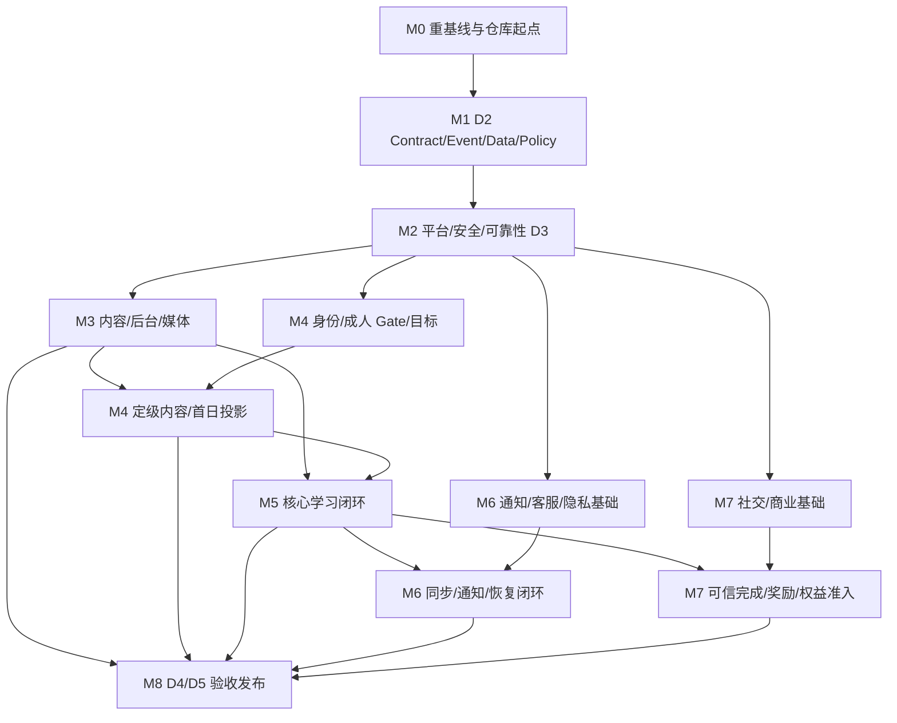

# Phase 1 里程碑与依赖图

> 编排原则：D1 → D2 → D3 → D4 → D5；Contract/Data/Security first；按业务旅程和 owner 排序，不按旧 B 批次或目录机械复制

## 1. 里程碑总览

| 里程碑 | 名称 | 任务数 | 主要成熟度目标 | 结果 |
|---|---|---:|---|---|
| `M0` | 重基线与仓库可执行起点 | 8 | D1 执行准备 | 现状、工具链、历史证据和任务机制可信 |
| `M1` | Contract / Event / Data / Policy Ready | 18 | D2 | 所有核心 GAP 关闭，生成物和兼容性通过 |
| `M2` | 平台、安全与可靠性骨架实现 | 10 | D3 平台层 | Gateway/IAM/PEP/DB/Kafka/Workflow/Observability 可集成 |
| `M3` | 内容、后台与媒体供应链 | 10 | D3 领域层 | 合法内容可经双审发布、下线和回滚 |
| `M4` | 公开入口、身份、成人 Gate 与首日学习 | 10 | D3 业务切片 | 注册→同意→目标→定级→首日/今日可工作 |
| `M5` | 规则学习、SRS、错题、掌握度与报告闭环 | 14 | D3 核心闭环 | 六技能、判分、复习、D1/D7 和报告有唯一事实链 |
| `M6` | 通知、同步、客服、隐私与运营恢复 | 11 | D3 合规/运营 | 用户能自助恢复、联系支持、导出和注销 |
| `M7` | 游戏化、受控社交与商业权益 | 11 | D3 支撑闭环 | 只消费可信事实；生产支付保持关闭 |
| `M8` | 真实 E2E、质量、staging 与发布门禁 | 16 | D4/D5 | 16 个 E2E、恢复、跨端、灾备和 Go/No-Go 闭合 |
| **合计** |  | **108** |  | 不含 Phase 2/3 实现 |

## 2. 总依赖图



文本关键路径：

```text
M0
→ M1（全部 Contract/Event GAP 关闭）
→ M2（IAM/Gateway/PEP + owner DB + INT-P1-017）
→ M3（可发布的版本化合成内容）
→ M4（目标/定级/计划/首日）
→ M5（attempt/SRS/D1/D7/mastery/report）
→ M8（W0–W4 E2E、恢复、staging、发布 Gate）
```

M6 的隐私/删除/恢复和 M7 的生产支付关闭、安全权益准入都是 M8 的发布阻断项，即使它们不位于“首次学习”最短路径上也不能省略。

## 3. 里程碑进入与退出 Gate

| 里程碑 | 进入条件 | 退出条件 | 失败时动作 |
|---|---|---|---|
| `M0` | 已同步包含本计划的 `dev`；工作区和来源提交可识别 | 8 项任务 `ACCEPTED`；工具链、资产标签、CI、夹具和计划检查可复现 | 不进入契约修改；修复仓库/环境基线 |
| `M1` | M0 PASS；D1 文档和 ADR 无未决 owner | 所有 Contract/Event GAP 有唯一关闭任务；OpenAPI/AsyncAPI/migration/policy/生成物/兼容检查 PASS | 阻塞全部 D3 业务实现；回到契约 owner |
| `M2` | M1 PASS | Gateway/IAM/服务侧 PEP、真实 schema、Kafka/Outbox/DLQ/重放、观测和 CI 的最小集成 PASS | 不允许领域服务以 Mock/直连绕过平台 |
| `M3` | M2 的身份、PEP、数据和事件骨架可用 | 草稿→双审→发布→学习/公开投影→下线/回滚可由版本化合成内容驱动 | 阻塞 placement/学习 E2E；保留旧安全版本 |
| `M4` | M2 PASS；M3 提供已发布 placement/首日内容 | JNY-P1-01…05 的页面、服务、数据、事件和最小集成测试 PASS | 不创建假计划；目标/报告保留并进入可查询恢复 |
| `M5` | M3、M4 适用任务 PASS | JNY-P1-06…09 的唯一 attempt/SRS/mastery/report 链和六技能降级 PASS | 不发奖励、不宣称掌握；进入重放/修复 |
| `M6` | M2 PASS；通知/同步依赖 M5 可信事件 | JNY-P1-14/15、INT-P1-012…018 适用链路和人工恢复最小集成 PASS | 阻塞发布；不得以客服或 BFF 跨域改事实 |
| `M7` | M2 PASS；奖励和权益准入依赖 M5/M3 可信事实 | JNY-P1-10…12 最小集成 PASS；Sentence Train 为唯一 P0 游戏；sandbox PASS、生产支付 OFF | 禁用对应 feature flag；不得用客户端成功页补账/发权益 |
| `M8` | M3–M7 全部适用 D3 任务 PASS；可重复环境就绪 | 16 个 E2E、跨端质量、安全、性能、灾备、staging、RC、回滚和独立 Go/No-Go 全部 PASS | 结论保持 `NO-GO`，不以部分波次替代发布门 |

## 4. 可并行轨道

M1 整体通过后，M2–M7 可以按以下轨道并行，但必须遵守任务级 `Depends On`：

| 轨道 | 主范围 | 不可绕过的依赖 |
|---|---|---|
| 平台与安全 | Gateway、IAM、PEP、schema、Outbox、Trace、CI | M1；为所有领域轨道提供运行骨架 |
| 内容/后台/媒体 | JNY-P1-13、INT-P1-005/011/017 | IAM/PEP、内容 owner；在 placement/学习 E2E 前发布合成版本 |
| 核心学习 | JNY-P1-03…09、INT-P1-003/004/006/007/014 | 已发布内容、成人 Gate、INT-P1-017 |
| 运营与合规 | JNY-P1-14/15、INT-P1-012/013/015/016/018 | IAM/PEP、各领域 owner receipt、审计与恢复 |
| 互动与商业 | JNY-P1-10…12、INT-P1-008…010 | 可信学习完成、内容/权益 PEP、生产支付 OFF |
| 四端与质量 | 56 个 PAGE、八态、i18n、主题、性能、a11y、Browser Evidence | 随业务任务同步，不允许等到 M8 才集中补页面 |

## 5. 18 条联调的依赖顺序

```text
INT-P1-017（Outbox/DLQ/Replay spine）
├─ INT-P1-001 → 002
├─ INT-P1-005 → 011
├─ 001/002/017 → 003 → 004
├─ 005/017 → 006 → 007 → 014
├─ 006/017 → 008
├─ 001/002 → 009
├─ 001/002/005 → 010
├─ 001/002/017 → 012
├─ 领域事件/017 → 013
├─ 001/002/017 → 015 → 016
└─ 002/015/016 → 018
```

## 6. D4 E2E 波次

| 波次 | 场景 | 依赖 |
|---|---|---|
| `W0` 基础 | PUBLIC-ENTRY、AUTH-LIFECYCLE、ADULT-CONSENT、CONTENT-PUBLISH | M2、M3、M4 基础 |
| `W1` 首日 | FIRST-DAY、TODAY-SESSION | W0、目标/placement/plan |
| `W2` 学习 | SRS、MISTAKE-MASTERY、MULTISKILL | W1、M5 |
| `W3` 支撑 | REWARD、SOCIAL、ENTITLEMENT | W1/W2 可信事实、M7 |
| `W4` 运营恢复 | NOTIFICATION-SYNC、SUPPORT、PRIVACY、RECOVERY | M6、INT-P1-017，并覆盖所有 owner 故障 |

每个波次必须使用当前 commit 的 Browser、Gateway/API、owner DB、Outbox/Kafka、consumer projection、Trace/Audit 和 Recovery Evidence。波次通过不自动意味着 D5；M8 的安全、跨端、性能、灾备、staging 和回滚仍须独立完成。
